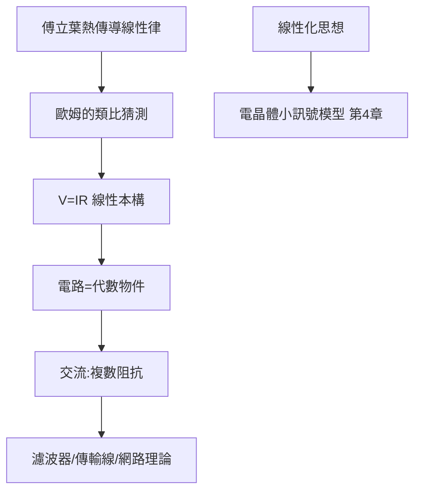

# 1.2 1827年：歐姆定律與線性電路代數

## 1. 問題：電流如何被預測？

Volta（1800）的電池使人類第一次擁有**持續電流**，電學從靜電走入動電。但工程師立刻遇到困境：同樣的電池，接不同導線，電流忽大忽小，沒有規律可循。電報（1800 年代蓬勃發展）需要知道「多長的導線會損失多少訊號」，這是純粹的工程計算需求。

格奧爾格·歐姆（Georg Ohm）——一位中學教師——以傅立葉熱傳導理論（1822）為**數學範本**，猜測電的「流動」也該有類似的線性輸運律。

## 2. 數學：線性輸運律與電路代數

歐姆 1826–27 年實驗確立：

$$
I = \frac{V}{R} \qquad\Longleftrightarrow\qquad \vec J = \sigma \vec E
$$

微觀版（歐姆定律的場形式，Drude 1900 年解釋為電子散射）中 $\vec J$ 是電流密度、 $\sigma$ 是電導率。這是**線性本構關係**的第一個實例。

其革命性在於把複雜的微觀過程（電子在導體中的散射）**壓縮成一個參數 $R$ **，使電路可以用代數處理：

- **串聯**： $R_{\text{eq}} = R_1 + R_2 + \cdots$
- **並聯**： $\dfrac{1}{R_{\text{eq}}} = \dfrac{1}{R_1} + \dfrac{1}{R_2} + \cdots$

更深一層，歐姆定律是**線性化**的典範：任何非線性元件在小訊號下都可以局部線性化（後來的電晶體小訊號模型、增量分析皆源於此）。交流電時代，Kamerlingh Onnes 等人以複數擴充：

$$
Z = R + jX, \qquad V = Z\,I
$$

**複阻抗**把微積分（微分方程 $L\frac{di}{dt}$ ）降為複數代數——線性 + 正弦穩態 + 複數，三者合擊使交流電路的分析效率提升百倍。

## 3. 後果

- **電報工程的可計算性**：1855 年 Kelvin 的電報方程（傳輸線理論）建立在歐姆定律 + 1.3 節克希荷夫定律之上，橫越大西洋電纜（1866）的設計是第一個「數學預測先行」的電機工程壯舉。
- **等效電路思想**：Thevenin（1883）、Norton 定理允許把任何複雜線性網路化為一個電源加一個阻抗——**模組化設計**的數學基礎，今日的晶片設計流程（抽象層級）源於此。
- **量測學**：惠斯登電橋（1843）以零檢測法精測電阻，成為一切精密電測的原型。

## 4. 回饋

歐姆定律的「線性」是**近似**：電流大時發熱改變 $R$ （自熱）、半導體中 $\sigma$ 依賴 $\vec E$ 本身（非歐姆元件）。當工程進入高功率與半導體時代，**非線性電路數學**（Volterra 級數、相平面、混沌）被逼出來。更重要的是：歐姆定律只處理「單一迴路、集中參數」；多迴路、多節點的網路（電報網、配電網）需要網路層級的數學——這是 1.3 節克希荷夫的主題。

## 5. 延伸思考

1. 為何「線性」在工程中如此受寵？（疊加、可分解、頻域對角化——線性代數的全部紅利）
2. 歐姆定律在奈米導體（彈道輸運、Landauer 公式 $G = \frac{2q^2}{h}M$ ）下如何修正？電阻的量子化顯示「歐姆定律」其實是統計極限。
