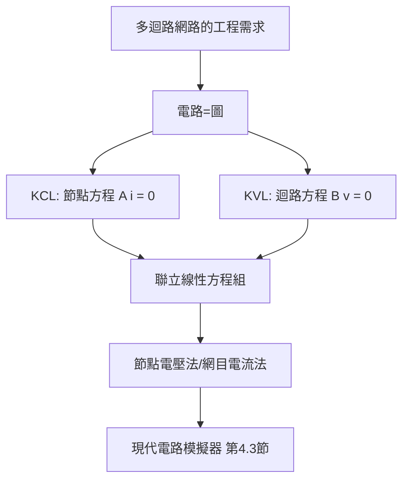

# 1.3 1845年：克希荷夫定律與圖論式的網路分析

## 1. 問題：多迴路網路怎麼算？

歐姆定律（1.2 節）處理單一迴路，但 1840 年代的真實問題是網路：電報線在節點分岔、實驗室的多環電橋電路（如 Wheatstone bridge）、配電系統的多源多載。逐段套歐姆定律會陷入自我纏繞的方程組——**缺少一套系統性的「網路層級」數學**。

21 歲的古斯塔夫·克希荷夫（Gustav Kirchhoff）在 1845 年（學生時代！）提出兩條定律，把這個問題徹底代數化。

## 2. 數學：兩條定律 = 線性代數 + 圖論

**電流定律（KCL）**：任一節點，流入 = 流出：

$$
\sum_{k} i_k = 0
$$

其物理根源是**電荷守恆**。

**電壓定律（KVL）**：任一迴路，繞行一圈電位降之和為零：

$$
\sum_{k} v_k = 0
$$

其物理根源是**能量守恆**（電場保守性，靜磁近似下）。

數學上深刻的兩件事：

1. **電路是圖**：節點 = 頂點、支路 = 邊，克希荷夫定律是**圖的拓撲性質**，與元件無關。以**降階節點關聯矩陣** $\mathbf{A}$（incidence matrix）寫成矩陣形式：

$$
\mathbf{A}\,\mathbf{i} = 0 \qquad (\text{KCL})
$$

2. **拓撲與代數的連結**：對具有 $n$ 個節點、$b$ 條支路的連通圖，獨立迴路數恰為

$$
\ell = b - n + 1
$$

這正是圖論中**基本迴路空間的維數**（cyclomatic number，Euler 公式的直接後裔）。KCL 與 KVL 的解空間是正交補空間——電路分析在 1845 年就已是**線性代數的子空間理論**，比線性代數正式化還早。

**節點電壓法**（Maxwell 也貢獻過網目法）：以節點電壓為未知數，KCL 自動滿足，得到 $n-1$ 條方程：

$$
\mathbf{G}\,\mathbf{v} = \mathbf{i}_s
$$

其中 $\mathbf{G}$ 是**節點導納矩陣**（Laplacian 矩陣的電路化身！）——圖的 Laplacian 與電路導納矩陣是同一個數學物件，這條線後來通往譜圖理論、隨機漫遊（電阻距離）與網路科學。

## 3. 後果

- **任意網路皆可算**：電力網潮流計算（power flow）、濾波器綜合、電橋靈敏度分析，全部成為標準化的線性代數程序。
- **傳輸線與電力系統**：三相交流系統的對稱分量法（Fortescue, 1918）是 KVL/KCL 在相空間的推廣。
- **圖論與電路的互哺**：電路拓撲激勵了 Kirchhoff 對樹（spanning tree）的研究（1847 年 Kirchhoff 論文既是電路文獻，也是圖論經典）；一百年後，網路科學（社會網絡、網際網路）反過來用電路 Laplacian 分析同步與擴散。

## 4. 回饋

KCL/KVL 的成立條件是**集總參數近似**（lumped）：元件尺寸 $\ll$ 波長。當頻率升高（無線電、微波），「節點」失去意義，必須回到場論（第 2 章）；工程界則發展出傳輸線的分布參數模型與散射參數（S-parameters）。**電路代數與場論是同一物理的兩種座標**，兩者的邊界由波長劃定——這個張力貫穿整個電機史，直到 5.3 節的光子積體電路再次出現。

## 5. 延伸思考

1. 為何 KVL 在時變磁場中失效？（$\oint \vec E \cdot d\vec l = -\frac{d\Phi_B}{dt} \ne 0$）工程上如何在含變壓器的電路中「偷渡」這個非保守項？
2. 若把整個網際網路視為電阻網路，其等效電阻與圖的代數連通度（Fiedler 值）有何關係？（譜圖理論的應用）
