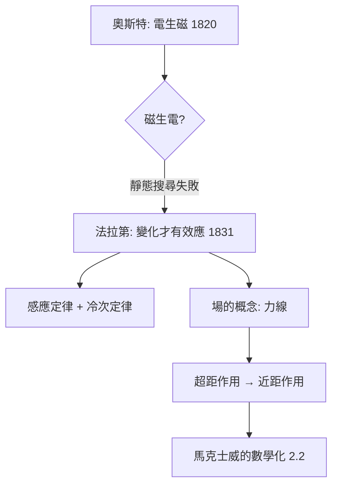

# 2.1 1831年：法拉第電磁感應與場的概念

## 1. 問題：電能生磁，磁能生電嗎？

Ørsted（1820）發現電流使磁針偏轉——電能生磁。法國數學物理學派（Ampère、Biot–Savart）迅速以微積分形式化。但反向問題懸而未決：

> 磁能生電嗎？

Ampère、Colladon 等人多次實驗失敗——因為他們找的是**靜態**效應。Michael Faraday，一位沒有正式數學訓練的書店學徒出身的實驗家，憑著不同的物理直覺找到了答案：**變化**才是關鍵。

## 2. 數學：感應定律與「場」的誕生

1831 年 8 月，法拉第發現：磁通量**變化**時，線圈產生電動勢：

$$
\varepsilon = -\frac{d\Phi_B}{dt}, \qquad \Phi_B = \int_S \vec B \cdot d\vec A
$$

負號即**冷次定律**（1834）：感應電流反對磁通變化——能量守恆的體現（若非如此，可得永動機）。

更深遠的是概念革命。牛頓式的「超距作用」（力即時穿越虛空）無法解釋：為何變化的磁在**空間中各處**同時激起電場？法拉第提出**力線**（lines of force）：電與磁不是點對點的作用，而是**空間本身承載的狀態**——這就是**場**（field）的誕生。

$$
\oint_C \vec E \cdot d\vec l = -\frac{d}{dt}\int_S \vec B \cdot d\vec A
$$

（此積分形式的數學化由 Maxwell 在 1855–1865 完成；法拉第本人用的是力線幾何。）

法拉第還發現**自感**與**互感**，其數學後果是電感成為電路的動態元件：

$$
v_L = L\frac{di}{dt}
$$

$R$、$L$、$C$ 三元件齊備，電路正式成為**微分方程系統**（不再是 1.2 節的代數）。

## 3. 後果

- **發電機與變壓器**：感應定律直接孵化了整個電力工業——Picciotti/Pixii 早期發電機（1832）、Ferranti 變壓器、Westinghouse 交流系統。**場的數學 → 能源的規模化**，這是理論兌現為文明基建的第一個大案例。
- **電感的電路角色**：RLC 電路出現振盪（1853 年 Kelvin 分析放電波形，預言電磁振盪）——為無線電埋下種子。
- **場概念的普適化**：「場」成為十九世紀後物理學的標準本體（重力場、後來的量子場），起點正是法拉第的力線。

## 4. 回饋

法拉第的力線缺乏數學語言：力線的密度、張力、傳播速度都只能是比喻。他 1852 年的〈On the Physical Character of the Lines of Magnetic Force〉已猜到力線的**有限傳播速度**，但無法計算。**把力線翻譯成數學**成為下一代人的任務——一位讀了法拉第《電學實驗研究》的蘇格蘭學生 James Clerk Maxwell 接下了它（2.2 節）。

## 5. 延伸思考

1. 法拉第幾乎不懂微積分——實驗直覺與數學語言的分工在科學史上的邊界何在？
2. 若磁通量不改變就沒有感應，發電機本質上是「把機械功換成電流的熵泵」——從能量守恆角度，發電與馬達互為逆過程，這如何決定了電力工業的技術路徑（直流 vs. 交流之爭）？
