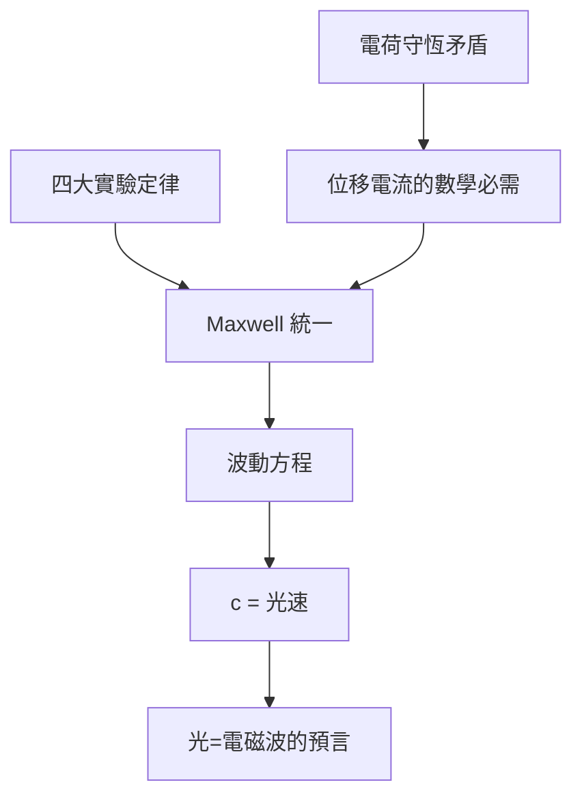

# 2.2 1865年：馬克士威方程組與電磁波的預言

## 1. 問題：把法拉第的力線翻譯成數學

到 1850 年代，電與磁的實驗定律齊備：庫倫/高斯（靜電）、安培（電流生磁）、法拉第（感應）。但它們是**四堆互不相干的公式**，且建立在超距作用的數學框架上。關鍵缺口有三：

1. 力線如何傳播？速度多少？
2. 電、磁、光三者有無關係？
3. 位移電流：在電容器兩板之間（沒有傳導電流處），安培定律 $\nabla\times\vec H = \vec J$ 造成矛盾——對曲面取散度得 $\nabla\cdot\vec J = 0$，違反電荷守恆 $\nabla\cdot\vec J + \frac{\partial\rho}{\partial t} = 0$。

Maxwell（1855–1865，代表作〈A Dynamical Theory of the Electromagnetic Field〉, 1865）逐一解決。

## 2. 數學：四個方程與一個預言

**馬克士威方程組**（微分形式）：

$$
\begin{aligned}
\nabla\cdot\vec E &= \frac{\rho}{\varepsilon_0} \\
\nabla\cdot\vec B &= 0 \\
\nabla\times\vec E &= -\frac{\partial \vec B}{\partial t} \\
\nabla\times\vec B &= \mu_0\vec J + \mu_0\varepsilon_0\frac{\partial \vec E}{\partial t}
\end{aligned}
$$

Maxwell 的兩個決定性貢獻：

1. **位移電流** $\varepsilon_0\frac{\partial \vec E}{\partial t}$：純為挽救電荷守恆（連續性方程）而引入的數學項，卻使方程組可以**自持**——變化的電場生磁、變化的磁生電，無需電荷也能傳播。
2. **波動方程**：在真空（$\rho = 0, \vec J = 0$）中對旋度方程再取旋度，利用 $\nabla\times(\nabla\times) = \nabla(\nabla\cdot) - \nabla^2$，得

$$
\nabla^2 \vec E = \mu_0\varepsilon_0 \frac{\partial^2 \vec E}{\partial t^2}, \qquad c = \frac{1}{\sqrt{\mu_0\varepsilon_0}}
$$

代入實驗值，$c \approx 3\times10^8$ m/s——**與 Fizeau 測得的光速一致**。Maxwell 寫下名言：「我們幾乎無法避免推論：光就是媒介中的電磁擾動。」

數學史意義：這是**對稱性與一致性驅動物理發現**的第一個範例——位移電流不是被觀測到的，是被**方程的內部邏輯**要求出來的。此後「理論先行、實驗追認」成為現代物理學的標準模式。

## 3. 後果

- **光是電磁波**：電磁學與光學統一，光譜（無線電→微波→紅外→可見→紫外→X 射線）成為同一方程的不同解——直接指向第 5 章光電工程。
- **狹義相對論的搖籃**：Maxwell 方程在 Galileo 變換下不變，但在 Lorentz 變換下不變（1904 Lorentz、1905 Einstein）——電磁學逼出了相對論。
- **工程側**：天線理論、波導、微波工程（Radar，二戰）都由馬克士威方程組 + 邊界條件出發；Heaviside 的向量分析（把 20 個分量方程化為 4 個向量方程）與運算微積分（Laplace 變換）成為電機教育的通用語言。

## 4. 回饋

完美的場方程立即遇到兩個實務問題，各自催生新數學：

1. **求解邊值問題太難**：天線輻射、波導模態需解向量波動方程 + 邊界條件——數值電磁（矩量法 MoM、有限差分時域 FDTD, 1966；有限元素法）應運而生，成為計算數學的大戶。
2. **場與電路的鴻溝**：工程師需要「可接線」的直覺。Heaviside 的傳輸線理論、等效原理、S 參數把場論「降維」回 1.3 節的電路語言——**場論 ⇄ 電路代數的雙向翻譯**成為高頻工程的核心技藝，直到今日的訊號完整性（SI/PI）分析。

## 5. 延伸思考

1. Maxwell 引入位移電流的原始理由（乙太中的機械應力）已被拋棄，但方程留存——**錯誤的物理直覺 + 正確的數學結構**，歷史上還有哪些例子？
2. 微分形式（$\int_\Sigma dF = 0$）把四條方程寫成兩條——為何幾何語言（外微分、微分形式）成為現代電磁理論與規範場論的共同基礎？
