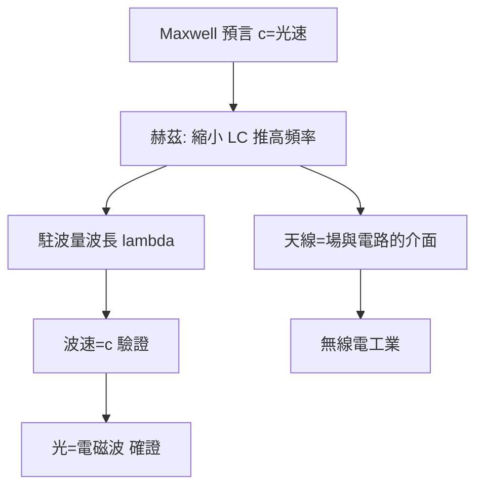

# 2.3 1888年：赫茲實驗與無線電的誕生

## 1. 問題：預言需要證據

Maxwell 預言電磁波（2.2 節），但 1879 年柏林科學院懸賞徵求實驗驗證時，主流物理學家（包括 Helmholtz 本人）認為**無法做到**：機械上造不出高頻振盪，探測上沒有足夠靈敏的儀器。乙太理論的支持者（如 Helmholtz）希望驗證的是「乙太中的波」；而 Maxwell 理論本身（位移電流、場的實在性）仍備受懷疑。

海因里希·赫茲（Heinrich Hertz），Helmholtz 的學生，1886–1888 年在卡爾斯魯厄完成了這一壯舉。

## 2. 數學：偶極天線的輻射與波的特性測量

赫茲的系統是數學設計的教科書案例：

**產生**：火花間隙放電的 LC 迴路，共振頻率

$$
f_0 = \frac{1}{2\pi\sqrt{LC}}
$$

把 $L$、$C$ 做小（偶極子），頻率推高到 $f \approx 50\text{–}500$ MHz 級，波長 $\lambda = c/f$ 縮短到公尺級——**實驗室尺度可以放下整個波**。

**輻射場**：短偶極子的輻射場（由 Maxwell 方程解出）：

$$
E_\theta \approx \frac{I_0 l \sin\theta}{4\pi\varepsilon_0 c^2 r}\,\frac{d}{dt}(\cdots) \;\propto\; \frac{1}{r}, \qquad P \propto \frac{1}{r^2}
$$

**近場 $1/r^3$、感應場 $1/r^2$、輻射場 $1/r$** 的三層結構——只有 $1/r$ 項攜帶淨能量流（Poynting 向量 $\vec S = \vec E\times\vec H$），功率按 $1/r^2$ 稀釋。這是赫茲能探測到波的數學基礎，也是今日天線工程的全部出發點。

**驗證**：赫茲用金屬板反射產生駐波，以 $\lambda = 2 \times$ 波節距離測出波長；配合已知頻率得波速 $= c$。他還演示了偏振（金屬線柵）、反射、折射——**光的一切幾何性質，電磁波皆有**。

## 3. 後果

- **無線電的誕生**：赫茲本人說「這沒有用處」，但 Marconi（1895–1901）用火花發射機跨越大西洋；無線電報、廣播、雷達、衛星、行動通訊——**全部是赫茲實驗的工程化**。
- **天線理論成形**：偶極子、陣列天線（相控陣）、互易定理成為獨立學科；天線是「電路（1.3 節）與場（2.2 節）的介面」，S 參數、阻抗匹配（$Z_0 = \sqrt{L/C}$）等概念定型。
- **乙太的死刑**：赫茲實驗無法分辨波在「乙太中」還是「場本身」，最終由 Michelson–Morley（1887）與 Einstein（1905）終結乙太——電磁場自己就是實體。

## 4. 回饋

無線電的工程化反過來對數學提出新需求，塑造了二十世紀應用數學的版圖：

1. **頻域思維**：調變、濾波、選台需求使 Fourier 分析從數學冷宮變成工程通用語——直接通往 3.3 節的 DSP 與 FFT。
2. **隨機性**：大氣雜訊、熱雜訊（Nyquist–Johnson, 1928）逼出**隨機過程理論**進入工程（Wiener、Kolmogorov），是 3.1 節控制理論與 3.2 節通訊理論的共同基礎。
3. **電波傳播**：電離層（1902 證實 Marconi 為何能跨洋）、多路徑衰減，需要波在隨機媒質中的統計理論。

## 5. 延伸思考

1. 赫茲探測器（火花環）的靈敏度來自共振——「共振」這一數學概念（特徵頻率）為何成為電學、力學、光學、量子力學的通用語言？
2. 若赫茲多活二十年（1900 年代），他說「無用」的態度會如何被無線電工業改寫？基礎研究與應用的時間尺度如何管理？
