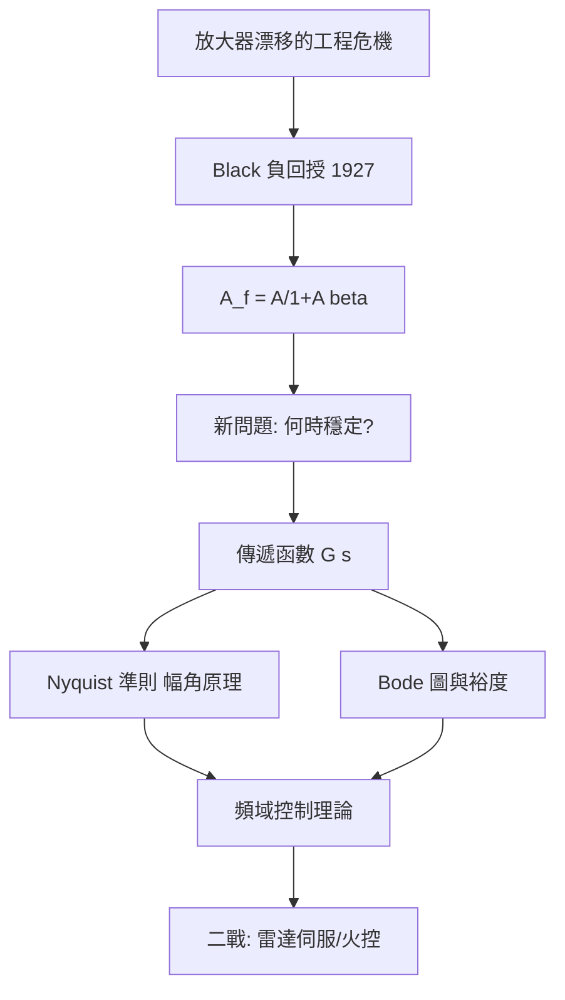

# 3.1 1932年：負回授與回授控制理論

## 1. 問題：放大器不可靠、系統會振盪

1920 年代的電話中繼網路是美國 AT&T 的命脈，但真空管放大器（4.1 節的前身）有致命缺陷：增益隨老化、電源、溫度漂移，失真嚴重。貝爾實驗室的 Harold Black 在 1927 年提出驚世駭俗的方案——**犧牲大部分增益，把輸出送回輸入相減**（負回授）。同事的反應是荒謬：「你把輸出餵回輸入，這不是要振盪嗎？」

Black 的洞見：增益漂移被壓縮 $1 + T$ 倍（$T$ 為迴路增益），代價是**系統可能不穩定**。於是核心數學問題誕生：

> 什麼條件下，回授系統穩定？

## 2. 數學：傳遞函數、頻域判據與穩定性

### 基本代數

負回授結構的閉迴路增益：

$$
A_f = \frac{A}{1 + A\beta}
$$

當 $|A\beta| \gg 1$：$A_f \approx 1/\beta$——**增益只由被動回授網路決定**（電阻比極穩定），真空管的不完美被數學消除了。靈敏度 $S = \frac{d\ln A_f}{d\ln A} = \frac{1}{1+A\beta}$，失真與雜訊同樣被壓縮。

### 穩定性判據

系統動態由線性微分方程描述，取 Laplace 變換得**傳遞函數** $G(s)$；穩定性等價於極點都在左半平面。Nyquist（1932）給出頻域判據：

$$
\text{Nyquist 準則}：\quad \text{開迴路頻率響應 } L(j\omega) \text{ 的軌跡不包圍 } -1 \text{ 點}
$$

它基於**幅角原理**（Cauchy's argument principle，複變函數論！）——只需量測開迴路頻率響應（實驗可做！），無需求出極點，即可判定閉迴路穩定性。Bode（1940）補上增益裕度、相位裕度與 $|L(j\omega)| \le 1$ 時的 Bode 積分（靈敏度守恆：水床效應，壓一處凸另一處）。

二戰把理論推向成熟：雷達天線伺服、防空火控（Wiener 的預測濾波）需要**時域最適化**——Wiener–Hopf 方法與 1948 年後的狀態空間（Kalman）路線相繼出現。

## 3. 後果

- **電子學的基礎設施**：所有精密類比電路（運算放大器、電源、鎖相環）都是負回授結構；「運算放大器」之名即來自「做運算的回授放大器」（類比計算機）。
- **控制工程成為學科**：從化工程序、航太（阿波羅、太空梭）到機器人，回授是自動化的統一範式。
- **觀念外溢**：回授概念進入生物學（恆定性 homeostasis）、經濟學（市場調節）、氣候模型——成為二十世紀的通用科學隱喻（cybernetics，Wiener 1948）。

## 4. 回饋

頻域理論的極限催生新路線：

1. **多變數系統**：MIMO 系統（飛行控制）中各通道耦合，單迴路 Bode 分析失效——狀態空間方法（Kalman 1960：可控性、可觀測性、Kalman 濾波）以矩陣指數 $e^{At}$ 為核心，控制理論完成「頻域→時域→最佳化」三部曲。
2. **回授 = 資訊**：Kalman 濾波與 Wiener 濾波本質上是統計估計——控制問題與通訊問題在數學上同構，匯流到 3.2 節的資訊理論視角（控制即資訊處理）。
3. **非線性與混沌**：回授太強的系統出現極限環與混沌（Lorenz 1963 源自大氣對流的回授模型），非線性動力學成為新領域。

## 5. 延伸思考

1. Black 的負回授用「增益換穩定」——這是普遍的工程交易嗎？還有哪些「數學上等價的資源交換」範例？
2. Bode 積分證明靈敏度不能處處變小——回授設計有「守恆律」？這與 5.3 節光子積體中的能量守恆約束有何神似？
