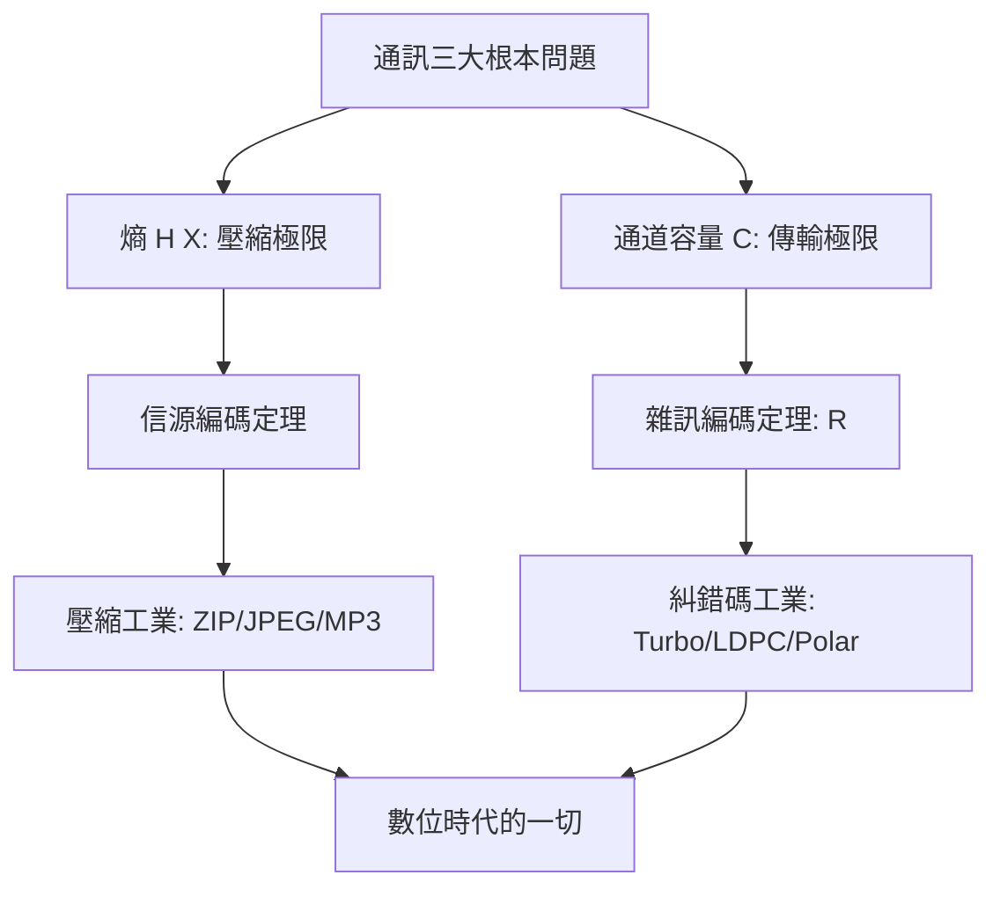

# 3.2 1948年：夏農資訊理論——通訊的數學極限

## 1. 問題：通訊有極限嗎？

二戰後的通訊工業面對三個根本問題，卻沒有任何理論能回答：

1. **頻寬、功率、雜訊之間的兌換關係**：多花功率能換多少傳輸率？有上限嗎？
2. **可靠性有極限嗎**：雜訊是隨機的，錯誤似乎不可避免——工程界普遍相信「降速可以降低錯誤率，但零錯誤不可能」。
3. **什麼是「資訊」**：要壓縮資料，先得知道資訊的度量。

克勞德·夏農（Claude Shannon）1948 年的〈A Mathematical Theory of Communication〉同時回答了三題，而且答案出乎所有人意料。

## 2. 數學：熵、通道容量與編碼的存在性

### 熵：資訊的度量

離散信源 $X$ 的資訊量：

$$
H(X) = -\sum_i p_i \log_2 p_i \quad (\text{位元})
$$

- 意外的程度 = 資訊量（確定事件零資訊）；
- **信源編碼定理**：任何無失真壓縮的平均碼長 $\bar\ell \ge H(X)$，且可任意逼近——Huffman 編碼、ZIP、MP3 的理論極限由此給定。

### 通道容量：雜訊中的完美通訊

夏農–哈特利定理：頻寬 $B$、訊噪比 $\text{SNR}$ 的通道容量：

$$
C = B\log_2\left(1 + \frac{S}{N}\right)
$$

**夏農第二定理（有雜訊編碼定理）**：只要傳輸率 $R < C$，存在編碼使錯誤率**任意小**；若 $R > C$，錯誤率必然高。

這是科學史上罕見的「存在性證明直接改變工業」：夏農**沒有給出編碼方法**，只證明了好碼存在。此後 45 年，整個編碼理論領域（Hamming、卷積碼、Turbo 碼 1993、LDPC 1963/1995 復活、極化碼 2009）都在追趕這條數學極限線——今日 5G、Wi-Fi、深空通訊實測效能已距夏農極限不到 0.1 dB。

數學工具箱的來源：熵取自統計熱力學（Boltzmann 的 $S = k\ln W$）；隨機過程取自 Wiener、Kolmogorov（雜訊模型化，呼應 3.1 節）；抽樣定理（Nyquist 1928、Shannon 1949）把連續信號離散化為 $2B$ 樣本/秒——**類比世界可以無損數位化**，這是整個數位革命的隱藏地基。

## 3. 後果

- **「數位」的合法性**：夏農證明離散編碼可達連續系統的極限——類比設備（黑膠、CRT、類比電話）在理論上沒有不可替代的優勢，數位化成為必然。
- **通訊與計算的統一語言**：位元、熵、通道成為電腦科學、密碼學（夏農 1949 也是現代密碼學之父）、機器學習（交叉熵損失、KL 散度、資訊瓶頸）的共同貨幣。
- **工程設計的北極星**：頻譜拍賣、行動通訊世代（1G→5G 的容量提升全部來自逼近 $C$：細胞化、MIMO、調變編碼）。

## 4. 回饋

夏農理論的成功立刻暴露自身的抽象層次，催生新的數學：

1. **建構性缺口**：存在 ≠ 可實作。碼的建構需要代數（Reed–Solomon，用於 CD、QR 碼、衛星）、圖論（LDPC 碼 = 稀疏圖上的訊息傳遞）、機率方法——**編碼理論成為離散數學的應用主戰場**。
2. **網路資訊理論**：多用戶通道、干擾（蜂巢網路）、分散式信源（感測網路）的容量區域至今仍有未解問題——單通道的 $C = B\log(1+\text{SNR})$ 只是起點。
3. **與物理的再連結**：通道容量的極限最終撞上量子力學——量子通道容量、量子金鑰分配，通往 5.1 與 5.3 節的光電世界。

## 5. 延伸思考

1. 夏農的熵與熱力學熵的差異只是單位（$k_B\ln 2$）？Landauer 原理（擦除 1 位元至少耗散 $kT\ln 2$ 熱）說資訊是物理的——你的硬碟散熱是夏農在收稅。
2. 為何「存在性證明先行、建構追趕半世紀」的模式在工程史屢見？（馬克士威→赫茲、夏農→Turbo/LDPC、演算法賽局的 NP-hard 保護）
