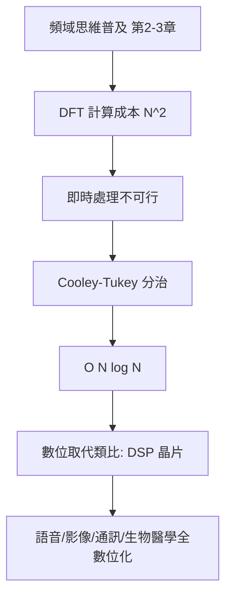

# 3.3 1965年：FFT與數位信號處理的革命

## 1. 問題：Fourier 分析好用的前提是「算得動」

自 3.1–3.2 節，頻域已成為電學工程的通用語言：濾波器、調變、頻譜分析都活在 Fourier 世界裡。但理論與計算之間有巨大鴻溝：

> 對 $N$ 點離散信號做離散 Fourier 變換（DFT），直接計算需要 $N^2$ 次複數乘法。

$N = 1000$ 時是一百萬次運算——在 1960 年代的計算機上，即時頻譜分析、語音處理、地震勘探、雷達信號處理全都算不動。**頻域思維被計算成本卡住**，類比電路仍是唯一「即時」選項。

## 2. 數學：分治與對稱的勝利

Cooley–Tukey（1965, *Mathematics of Computation*）發表的**快速 Fourier 變換**：

$$
X[k] = \sum_{n=0}^{N-1} x[n]\, e^{-j2\pi nk/N}
$$

關鍵：把 $N$ 點 DFT 按奇偶下標拆成兩個 $N/2$ 點 DFT（ $N$ 為 2 的冪）：

$$
X[k] = E[k] + e^{-j2\pi k/N} O[k]
$$

利用旋轉因子 $W_N^k = e^{-j2\pi k/N}$ 的週期性與對稱性，遞迴分治：

$$
T(N) = 2\,T(N/2) + O(N) \quad\Longrightarrow\quad T(N) = O(N\log N)
$$

$N = 2^{20}$ 時， $N^2/\!\log N \approx 5\times 10^4$ 倍加速——**不是更聰明的數學近似，而是同一個變換的更聰明計算順序**。這是「演算法複雜度」概念最著名的工程兌現（Gauss 1805 年其實已有此法，未被重視——發明與傳播是兩回事）。

## 3. 後果

- **數位信號處理（DSP）成為學科**：Oppenheim & Schafer 的教科書（1975）、TI TMS320 DSP 晶片（1982）——濾波、卷積、頻譜、相關全部以 FFT 為引擎。
- **各領域的即時化**：語音編碼（行動電話）、醫學影像（MRI 的 k-space 重構本質就是 2D FFT）、地震勘探（石油工業的訊號革命）、雷達與聲納、JPEG/MPEG（DCT 是 FFT 的近親）。
- **計算複雜度成為工程常數**：演算法的階數與電晶體的速度一樣是設計資源——「矽 vs. 演算法」的取捨從此進入工程決策。

## 4. 回饋

FFT 的成功開啟了「計算思維」主導信號處理的時代，並反向催生數學：

1. **多速率與濾波器組**：FFT 是多相分解的特例——小波轉換（1980 年代，Mallat、Daubechies）以濾波器組實現，多解析度分析彌補 Fourier 無時間定位的缺陷。
2. **FFT 的極限**：複雜度下界研究、非均勻 DFT、數論變換（避免浮點誤差）——演算法理論成為獨立學科。
3. **硬體與演算法共同演化**：DSP → FPGA → GPU，蝶形運算的規則結構直接映射到平行硬體——**數學結構（對稱性）決定矽的形狀**，這一原則在 4.3 節（電路模擬）與 5.3 節（光子積體）反覆重現。

## 5. 延伸思考

1. 為何分治如此有效？（旋轉因子的代數結構 = 循環群 $\mathbb{Z}_N$ 的子群分解；FFT 本質上是 Chinese Remainder / 群上的對角化）
2. 若沒有 FFT，數位革命會延遲多久？「理論已存在但計算不可行」的領域（如通用量子計算的糾錯）今天在哪裡？
