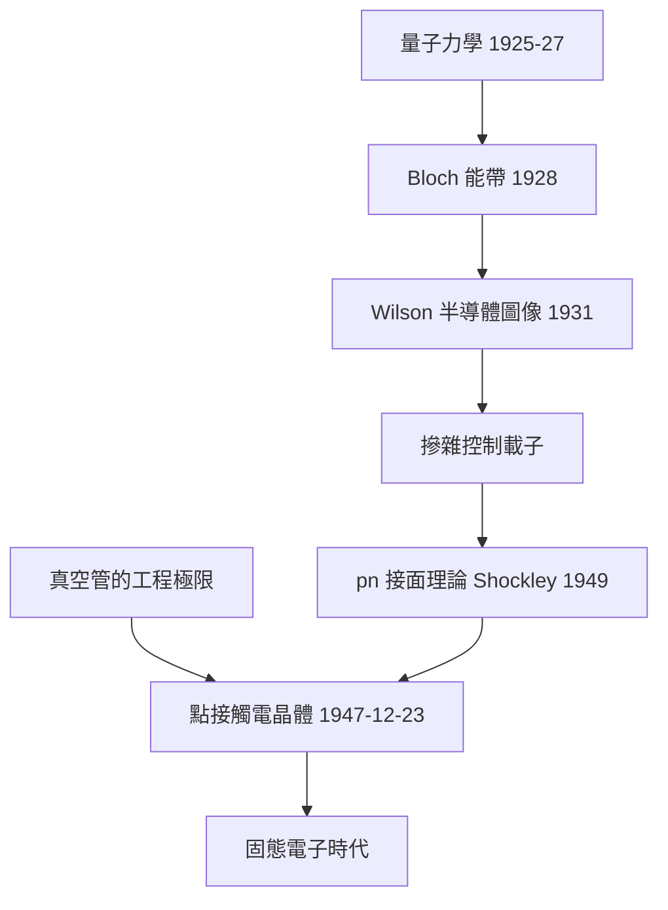

# 4.1 1947年：電晶體的發明與能帶理論

## 1. 問題：真空管的物理與規模極限

到 1940 年代，電子系統（雷達、計算機 ENIAC 用 18,000 支真空管、電話交換機）全部依賴真空管：體積大、耗電、易碎、壽命短（ENIAC 平均每天壞一支管子）。貝爾實驗室需要更好的「電子開關/放大器」——尤其是電話網路需要固態、可靠的放大元件。

二十世紀上半葉的固體物理已備好理論武器：量子力學（1925–27）、Bloch 能帶理論（1928）、Wilson 的半導體能帶圖像（1931：導帶/價帶/禁帶）、摻雜與載子概念。**問題是：理論很多，器件沒有。**

## 2. 數學：能帶、載子統計與pn接面

### 能帶論的核心數學

週期位勢中的 Schrödinger 方程（Bloch 定理）：波函數具週期性調制

$$
\psi_k(\vec r) = e^{i\vec k\cdot\vec r} u_k(\vec r), \qquad u_k(\vec r + \vec R) = u_k(\vec r)
$$

能量成為 $\vec k$ 的函數 $E(\vec k)$，形成能帶與禁帶。半導體 = 小禁帶（矽 1.12 eV）。

### 載子統計：費米–狄拉克的工程化

導帶電子濃度由 Fermi–Dirac 分佈 + 態密度積分：

$$
n = N_c\, e^{-(E_c - E_F)/kT}, \qquad p = N_v\, e^{-(E_F - E_v)/kT}
$$

摻雜使 $E_F$ 移動 → 控制 $n$、$p$——**摻雜 = 用化學寫入電性**，這是半導體相對真空管的根本數學優勢（可設計性）。

### pn 接面二極體（Shockley 理論, 1949）

空間電荷區的載子擴散 + 漂移平衡給出指數特性：

$$
I = I_0\left(e^{qV/kT} - 1\right)
$$

非線性、單向、指數敏感——**一個方程式定義一個元件**。接面電晶體（1948 Shockley 提出，1950 製成）的電流增益 $I_C = \beta I_B$ 來自基極薄層的少數載子擴散：$\beta \sim e^{W/L}$ 級的幾何控制。

歷史次序的諷刺：**器件（1947 點接觸電晶體，Bardeen–Brattain）先於理論（1949 接面理論）**——但理論立刻回頭統治了製造：接面擴散製程（1955+）取代手工點接觸，量產成為可能。

## 3. 後果

- **電子學的固態化**：體積縮小百萬倍、壽命近乎無限、耗電降低千倍——收音機、計算機、電話交換全面換血。
- **可設計性革命的起點**：載子濃度 $10^{15}$–$10^{20}$ cm$^{-3}$ 可由摻雜精確調控，「材料 → 元件 → 電路」的設計鏈條首次打通，直通 4.2 節積體電路。
- **諾貝爾獎（1956）**：Shockley–Bardeen–Brattain；且 Shockley 的「理論家做器件」模式（元件物理 device physics）成為半導體工業的方法論。

## 4. 回饋

電晶體的成功暴露了能帶論的粗略，推動更深數學：

1. **有效質量與異質結構**：$E(\vec k)$ 在能帶極值附近可展開 $E \approx E_c + \frac{\hbar^2 k^2}{2m^*}$——「有效質量 $m^*$」讓固態中的電子可當**自由電子**算，大幅簡化設計；異質接面（不同能隙材料疊層）則催生量子井、雷射二極體（5.3 節）。
2. **縮小到極限**：當尺寸接近載子波長，古典漂移–擴散失效，需要量子輸運（NEGF、Landauer–Büttiker）——今日 3 奈米電晶體已是「準量子元件」。
3. **統計製程變異**：摻雜原子數在奈米尺度僅數十個，機率分佈成為電路參數——統計數學重新進入「確定性」的電子學。

## 5. 延伸思考

1. 為何是矽而非鍺或砷化鎵統治世界？（SiO₂ 絕緣層的品質 = MOS 可製造性——材料化學決定了數位革命的路徑）
2. 能帶論假設完美週期與獨立電子；真實晶體有缺陷與交互作用——「近似理論為何足以設計出精確器件」？（製程公差吃掉理論誤差）
