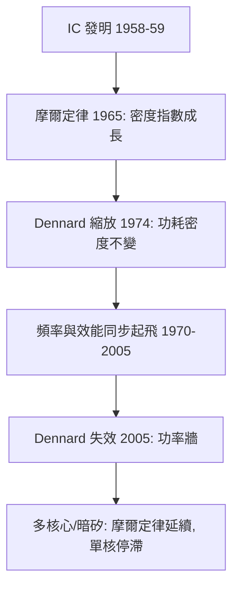

# 4.2 1965年：摩爾定律與積體電路的縮放數學

## 1. 問題：電晶體多了之後，怎麼連？

電晶體（4.1 節）比真空管小，但**一個一個焊接**的方式讓複雜系統的可靠性隨元件數崩潰：$N$ 個接點、$N$ 條焊線，故障率疊加。Kilby（1958，鍺上做出第一個 IC）與 Noyce（1959，矽上平面製程 + 金屬互連）解決了「造」的問題——元件與連線在同一次製程中完成。

但商業問題隨之而來：IC 什麼時候會便宜？一顆晶片能放多少電晶體？Fairchild 的 Gordon Moore 1965 年在《Electronics》雜誌畫了一張圖，回答了這個問題。

## 2. 數學：指數縮放與 Dennard 定律

### 摩爾定律

Moore 的觀察（1965 原版：每年倍增；1975 修正為每兩年倍增）：

$$
N(t) = N_0 \cdot 2^{(t - t_0)/2\ \text{年}}
$$

這不是物理定律，而是**自我實現的產業規劃**：它成為研發投資的基準，做不到的公司出局——數學曲線變成經濟契約。

### Dennard 縮放（1974）

Robert Dennard 證明：若所有尺寸縮小 $\alpha$ 倍並同步降低電壓，則

$$
\text{面積} \to \frac{A}{\alpha^2}, \quad \text{延遲} \to \frac{t_d}{\alpha}, \quad \text{功率密度} \to \text{不變}
$$

即：**愈小愈快、愈小愈省電（每晶片）、功率密度不變**。摩爾定律（密度）+ Dennard 縮放（功耗）的聯手，使 1970–2005 年的處理器可以同時變快又不過熱——指數成長的雙引擎。

### 指數的另一面：成本曲線

晶圓成本緩慢線性成長 + 每晶片電晶體指數成長 ⇒ **每電晶體成本指數下降**（约每 2 年 ÷2）。這是數位革命真正的經濟引擎：運算力成為近乎免費的資源。

## 3. 後果

- **半導體成為最大工業**：DRAM、微處理器（4004, 1971）、個人電腦、行動通訊——全部站在指數曲線上。
- **設計方法學的階層化**：數十億電晶體無法人工設計，逼出 4.3 節的 EDA、硬體描述語言（Verilog/VHDL）、邏輯合成——**設計本身也被演算法化**。
- **運算紅利外溢**：3.3 節的 FFT、3.2 節的糾錯碼、機器學習的深度網路，全部因「運算力指數變便宜」而從理論變產品。

## 4. 回饋

指數曲線撞牆的過程，是數學反哺工程最密集的時期：

1. **Dennard 失效（2005，功率牆）**：亞閾值漏電 $I \propto e^{-qV_{th}/kT}$（Boltzmann 暴政）不隨尺寸縮小——單核頻率停在 ~4 GHz，產業轉向**多核心**並行：並行程式設計、快取一致性、同步數學（Petri 網、模型檢查）成為新戰場。
2. **物理極限的逼近**：閘極氧化層薄到量子穿隧（等效於漏電），需要高 k 介電、FinFET/GAA 立體結構——**3D 幾何學進入製程設計**。
3. **縮放的替代數學**：當元件不再「更小」，效能成長轉向架構（加速器、TPU、稀疏化）與軟硬共同設計——**摩爾紅利被演算法紅利接棒**，計算數學（數值線性代數、近似演算法）成為第一線工程。

## 5. 延伸思考

1. 摩爾定律是「物理」還是「經濟」？若是後者，什麼樣的協調機制（ITRS 路線圖）能維持指數？這與夏農極限（3.2 節）作為硬極限的本質差異何在？
2. 指數成長必有盡頭：下一條曲線（量子、光子、3D 堆疊、新計算範式）的數學基礎已經齊備了嗎？
