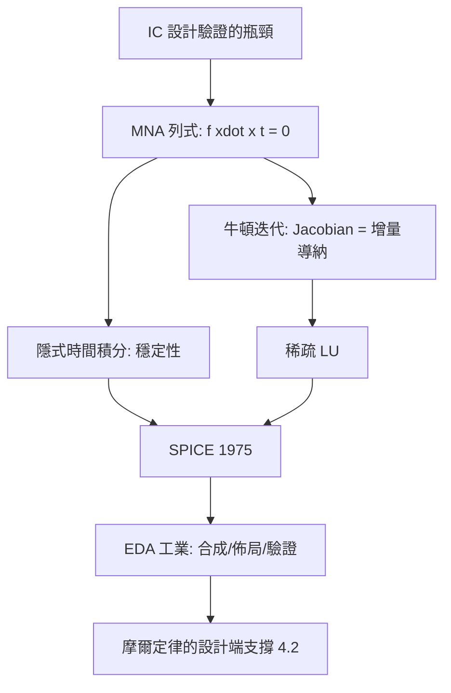

# 4.3 1975年：SPICE與電路的電腦輔助分析

## 1. 問題：IC 時代的手算極限

4.2 節的積體電路讓電晶體數指數成長，但**設計驗證**還在用紙筆與麵包板：

1. 電晶體電路是**非線性**的（4.1 節的指數接面方程），克希荷夫定律（1.3 節）的線性代數不再直接可用；
2. 含電容電感的電路是**微分代數方程**（DAE），手算只能做小訊號線性化；
3. 晶片一經流片無法修改，「先模擬後製造」成為生死攸關的需求。

柏克萊的 Donald Pederson 實驗室在 1970 年代開發 CANCER，後改名 SPICE（Simulation Program with Integrated Circuit Emphasis），1975 年的 SPICE2 成為工業標準——**電路設計第一次以數值數學為核心**。

## 2. 數學：非線性 DAE 的數值解

SPICE 解的問題形式：以修正節點法（Modified Nodal Analysis, MNA）列式：

$$
\mathbf{f}\big(\dot{\mathbf{x}}, \mathbf{x}, t\big) = 0
$$

（$\mathbf{x}$ = 節點電壓 + 支路電流；元件方程含非線性 $I = f(V)$ 與微分項 $i_C = C\,\dot v_C$。）

三層數學架構：

1. **時間離散**：隱式積分（backward Euler / trapezoidal）把 DAE 轉為每步的非線性代數方程——隱式方法的選擇是為了**穩定性**（剛性系統：電路時間常數橫跨奈秒到秒）。
2. **牛頓–拉福森迭代**：解非線性方程組

$$
\mathbf{J}(\mathbf{x}^{(k)})\,\Delta\mathbf{x} = -\mathbf{f}(\mathbf{x}^{(k)}), \qquad \mathbf{J} = \partial\mathbf{f}/\partial\mathbf{x}
$$

Jacobians 在電路中有個美妙性質：**它就是增量導納矩陣**（1.2 節小訊號概念的自動化）——每步牛頓迭代都化為一次線性電路求解。
3. **稀疏線性求解**：MNA 矩陣極稀疏（每行數個非零），採用稀疏 LU 分解（Markowitz 定序）——**電路模擬是稀疏矩陣計算的最大應用之一**。

直流工作點（DC）、暫態（transient）、交流掃頻（AC，複阻抗 + 線性化）構成 SPICE 的三大分析模式。

## 3. 後果

- **EDA 工業誕生**：從模擬擴展到邏輯合成、佈局繞線（NP-hard 組合優化！）、形式驗證、時序分析——今日晶片設計 80% 的工時在 EDA 工具內完成。
- **開源化的深遠影響**：SPICE 免費散布（美國政府資助、無版權限制），育出 HSPICE、LTspice、ngspice、Xyce——**一個模擬器馴養了整個電子工程教育與工業**。
- **方法論輸出**：MNA + 牛頓 + 隱式積分的框架被移植到電力系統（潮流/暫態穩定）、MEMS、熱模擬、甚至生化網路——「任何守恆網路皆可如此模擬」。

## 4. 回饋

模擬器的成功反過來暴露並催生新數學：

1. **收斂性與多重解**：非線性 DC 解可能不唯一（多穩態、閂鎖效應）——同倫法（homotopy）、連續法進入電路分析。
2. **剛性與步長控制**：Differential-Algebraic Systems 的指標（index）理論、局部截斷誤差估計——數值分析（Gear、Petzold）與電路模擬共同成長。
3. **模型層級的膨脹**：數十億電晶體無法全元件模擬——**降階模型**（model order reduction, via Krylov 子空間、平衡截斷）與統計模擬（Monte Carlo 製程變異）成為 EDA 前沿；這些數學又被 5.3 節光子模擬與電池模擬繼承。
4. **可驗證性**：類比設計自動化的難度（混訊、PVT 變異）至今部分是人工技藝——「非線性系統的自動設計」仍是開放數學問題。

## 5. 延伸思考

1. SPICE 的元件模型（如 BSIM）本身就是數百行方程的統計回歸產物——「模型不準 vs. 模型太慢」的取捨如何工程化？
2. 若牛頓法不收斂，SPICE 會報錯而非給答案——工程模擬的「可信度」該如何驗證？（驗證 verification vs. 確認 validation 的哲學）
