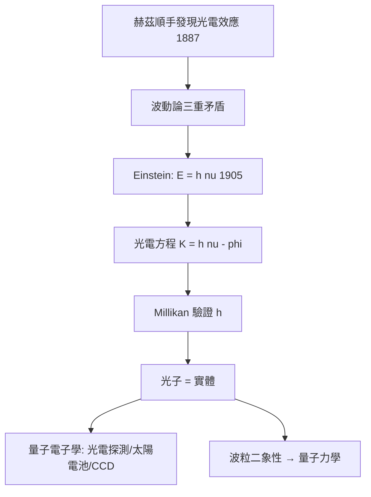

# 5.1 1905年：光電效應、光子與量子電子的起點

## 1. 問題：光是波，怎麼會有「粒子」的數據？

十九世紀末，馬克士威理論（2.2 節）讓「光 = 電磁波」看似定案。但 1887 年赫茲（2.3 節作者本人！）在實驗中順帶發現：紫外光照射金屬會打出電荷（光電效應）。隨後的實驗（Lenard, 1902）出現三個波動理論無法解釋的事實：

1. **即時性**：光的強度再弱，電子幾乎立刻射出（波動論預言需要能量累積時間）；
2. **頻率門檻**：低於某頻率的光，再強也打不出電子；
3. **動能只依賴頻率**，與光強無關。

波動理論說：能量應正比於**振幅（強度）**。實驗說：能量取決於**頻率**。這是馬克士威體系的內部危機。

## 2. 數學：光量子與 Einstein 方程

1905 年，Einstein（同一年發表狹義相對論與布朗運動）大膽假設：光本身的能量以量子形式存在：

$$
E = h\nu
$$

（普朗克 1900 年只把量子當作黑體輻射的數學技巧；Einstein 主張它是**物理實在**。）光電效應因此由一條線性方程完全描述：

$$
K_{\max} = h\nu - \phi
$$

（$\phi$ = 功函數；$h\nu = \phi$ 的頻率即門檻頻率。）即時性自動解釋：電子一次吸收**一顆**光子。Millikan（1916）精密測量證實斜率恰為 Planck 常數 $h$——Einstein 獲 1921 年諾貝爾獎。

數學上的深意：光電方程把**波動量 $\nu$** 與**粒子量 $E$** 用一個常數 $h$ 縫合——這是後來 de Broglie（1924：$\lambda = h/p$）與 Schrödinger 方程的邏輯起點。**電學（電子）與光學（光子）的統一語言在此誕生**，本書第 1–4 章的兩大主線（電路/場 vs. 光）從此可以互相翻譯。

## 3. 後果

- **光電探測工業**：光電管、光電倍增管（粒子物理、天文）、CCD/CMOS 感光元件（數位相機，2009 諾獎）、光電二極體（光纖接收端，5.2 節）——全部是光電方程的工程化。
- **太陽電池**：1954 年 Bell Labs 的矽太陽電池，本質是 p-n 接面（4.1 節）+ 光電效應的組合；能帶理論預測 Shockley–Queisser 極限（單接面 ~33%）——量子數學直接給出工程天花板。
- **量子力學的催化**：光子概念迫使波粒二象性成為正式理論，量子力學（1925–27）誕生；而量子力學回頭給出 4.1 節的能帶論——**光電效應是半導體電子學的邏輯先祖**。

## 4. 回饋

光子成為「電的數學」的一部分後，反過來要求新的數學工具：

1. **輻射場的量子化**：光子的統計（Bose–Einstein）與相干態（Glauber, 1963）成為量子光學的語言——雷射（5.3 節前身）的雜訊、壓縮光的極限都由此計算。
2. **探測的統計極限**：光電探測本質是 Poisson 過程（散粒雜訊 $\sigma = \sqrt{N}$），通訊接收器的靈敏度極限（量子極限）由統計數學給定——連回 3.2 節夏農框架的物理版。
3. **單光子技術**：量子金鑰分配（BB84, 1984）、量子運算的光子實現——「電的數學」正走向「光的量子數學」。

## 5. 延伸思考

1. Einstein 1905 的推理是「理論一致性」驅動（需要量子化才能解釋數據），與 Maxwell 位移電流（2.2 節）同構——「數學必需性」作為物理發現的引擎，還能走多遠？
2. 光電效應說明「觀測工具改變了被觀測世界」：任何探測至少吸收一顆光子——這與量子力學的測量問題、以及今日的單光子感測極限有何連結？
