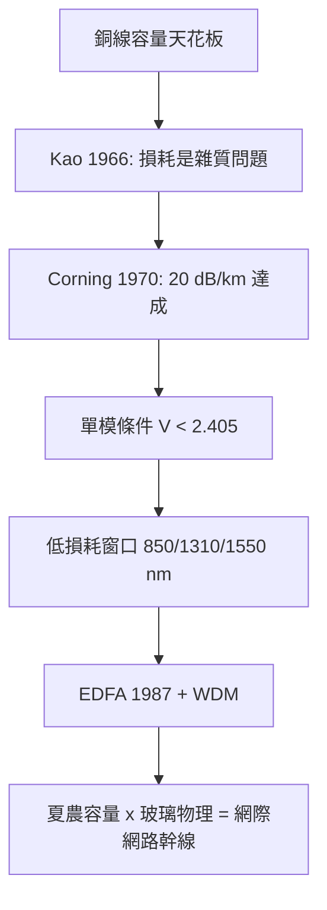

# 5.2 1970年：光纖通訊與低損耗的極限數學

## 1. 問題：銅線的容量天花板

1970 年代的通訊骨幹是同軸電纜與微波中繼，但銅的物理極限步步進逼：

1. **高頻損耗**：集膚效應使銅損耗 $\propto \sqrt{f}$，頻寬越大衰減越快；
2. **串音與干擾**：電磁耦合隨頻率惡化（馬克士威方程的詛咒）；
3. **容量需求指數成長**：長途電話、後來的資料傳輸。

光（頻率 $\sim 2\times10^{14}$ Hz）的載波容量比微波高萬倍——前提是**能把光關進一條細細的玻璃裡、走幾十公里不散不失**。1966 年，標準電信實驗室的高錕（Charles Kao）與 Hockham 計算出關鍵判斷：玻璃的損耗若是**雜質**造成的，純化後可低於 20 dB/km——光纖通訊可行。當時的玻璃損耗是 1000 dB/km（走 10 公尺光就沒了）。

## 2. 數學：波導模態、全反射與損耗預算

### 導光的數學

圓柱形波導解馬克士威方程組（2.2 節的工程兌現）：階梯折射率 $n_1 > n_2$ 的纖核/包層結構下，場解是**離散模態**，歸一化頻率 $V$：

$$
V = \frac{2\pi a}{\lambda}\sqrt{n_1^2 - n_2^2}
$$

$V < 2.405$ 時只剩**單一模態**（單模光纖）——模態間色散消失，這個貝塞爾函數的第一個零點 $2.405$ 決定了今日光纖的芯徑（$\approx 9\,\mu m$）。**一個特殊函數的零點，決定了一根纖維的幾何。**

### 損耗預算（Link budget）

接收端功率 = 發射功率 − 全部損耗：

$$
P_r = P_t - \alpha L - \sum \text{(接頭/彎曲/耦合損耗)} \;\ge\; P_{\text{sens}}
$$

工程設計化為**減法**；而 $\alpha(\lambda)$（光譜損耗曲線）由玻璃物理決定：Rayleigh 散射 $\propto \lambda^{-4}$ 設定下界，OH 離子與 Si–O 吸收峰劃出**三個低損耗窗口**（850/1310/1550 nm）——今日所有光纖系統都活在這三扇窗裡。

### 色散與夏農的會合

脈衝展寬由色散 $\beta_2$（ps²/km）決定，限制傳輸距離×速率積；摻鉺光纖放大器（EDFA, 1987）解決了中繼，WDM（波分複變）在 1550 nm 窗塞進上百個波長。光纖的通道容量最終由 3.2 節的公式給定：

$$
C = \int_{\Delta\lambda} B(\lambda)\log_2(1+\text{SNR})\,d\lambda
$$

**夏農極限 × 玻璃物理 = 網際網路的海底與陸地幹線。**

## 3. 後果

- **通訊基建的換代**：1977 年首條商用光纖系統；1988 年跨大西洋光纖（TAT-8）；今日全球 99% 的洲際資料走海底光纖——**網際網路的物質載體是 1970 年的一項玻璃純化突破**。
- **光纖感測**：光的相位/偏振對溫度、應變、磁場敏感——光纖陀螺、分散式溫度/震動感測成為獨立工業。
- **諾貝爾獎（2009）**：高錕「關於光在纖維中的傳輸以用於光學通訊的突破」——一個「算出來的判斷」帶動了四十年工業。

## 4. 回饋

光纖系統的規模化反過來推動數學：

1. **非線性光纖光學**：功率提高後，Kerr 效應（$n = n_0 + n_2 I$）使光纖成為非線性介質——**光孤子**（soliton，非線性 Schrödinger 方程的可積解）一度成為超長距傳輸的候選技術；四波混頻則成為 WDM 的干擾極限，非線性補償（數位反向傳播）成為 DSP（3.3 節）的新任務。
2. **隨機媒質中的波動**：多模色散、偏振模色散（PMD）是隨機過程，需要統計波動力學。
3. **光與電的界面工程**：發射器（雷射）與接收器（光電二極體，5.1 節）的驅動/放大電路把 4 章的電子學與光學縫合——**矽光子（silicon photonics）**應運而生，通向 5.3 節。

## 5. 延伸思考

1. Kao 的洞見是「把損耗歸因於雜質而非玻璃本質」——這是模型選擇（可去除的因素 vs. 不可去除的因素），如何用數據做這種歸因？（Rayleigh 散射的 $\lambda^{-4}$ 曲線擬合）
2. 光纖容量已逼近非線性夏農極限——下一個數量級的容量要靠空間（多芯/多模復用），「維度」本身成為工程資源？
