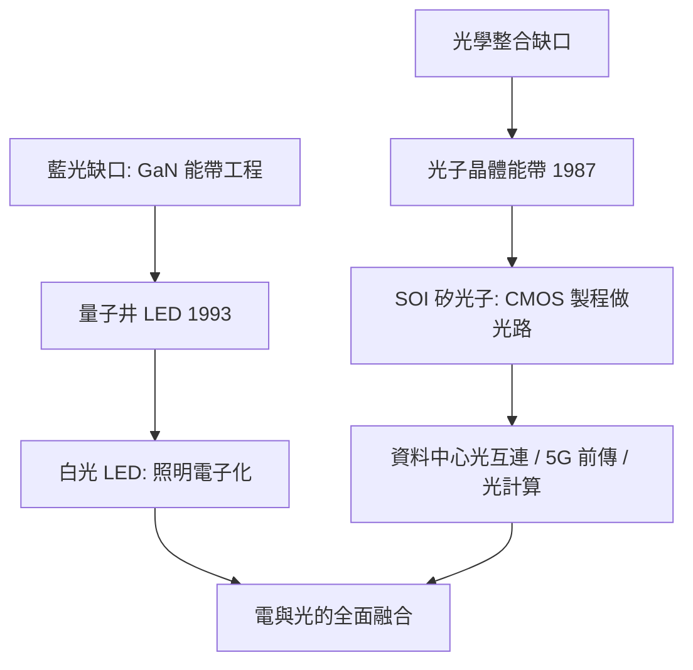

# 5.3 1990年代藍光LED、白光照明與光子積體電路

## 1. 問題：缺一種顏色，與缺一種平台

1990 年代的光電工業面對兩個看似不相干的問題：

1. **照明的數學缺口**：紅光 LED（1962, Holonyak）與綠光已存在，但**藍光**遲遲做不出來——沒有藍光就沒有白光 LED，整個照明工業無法電子化。技術障礙是氮化鎵（GaN）：缺乏合適基板（晶格失配）、p 型摻雜做不出來（4.1 節的摻雜數學在 GaN 上失靈）。
2. **光通訊的整合缺口**：5.2 篇的光纖系統由分立元件拼成（雷射、調變器、探測器各自封裝），體積大、對準難、成本高——需要光學版的「積體電路」（4.2 節）。

兩條線在 1990–2010 年代先後突破，共同完成「光的電子工程化」。

## 2. 數學：能帶工程與光子晶體

### 藍光 LED：直接能隙與量子井

LED 的發射波長由能隙決定：

$$
\lambda = \frac{hc}{E_g} \quad\Longrightarrow\quad E_g \approx 2.7\ \text{eV} \leftrightarrow \text{藍光}
$$

GaN 的直接能隙恰在此處，但真正的突破是**能帶工程**：中村修二（1993）以 InGaN **量子井**（量子侷限 Stark 效應的設計與補償）實現高效率藍光；p 型 Mg 摻雜的活化（退火）解開最後一道鎖。2014 年諾貝爾獎（赤崎勇、天野浩、中村修二）。白光 = 藍光 LED + 釔鋁石榴石（YAG）螢光粉（色度學座標 CIE 1931 的工程化）。

**社會後果**：LED 照明的能耗比白熾燈低 ~85%，全球照明用電占比大幅下降——這是數學（能帶 + 色度學）直接兌現的能源革命。

### 光子積體電路（PIC）：光子晶體與矽光子

光的「克希荷夫定律」在介質波導中成形：光子晶體以週期折射率形成**光子能帶**（與 4.1 節電子能帶同構！）：

$$
\nabla\times\frac{1}{\epsilon(\vec r)}\nabla\times\vec H = \frac{\omega^2}{c^2}\vec H
$$

（這是特徵值問題：$\omega$ 的「能帶」= 允許頻率，帶隙 = 禁止頻率。）Yablonovitch 與 John（1987）提出概念；工程上更實用的是**絕緣上矽（SOI）**平台：矽（高折射率）與 SiO₂（低折射率）的巨大對比使波導尺寸縮到數百奈米，與 CMOS 製程相容——**用 4.2 節的縮放數學製造 5.2 節的光路**。

## 3. 後果

- **照明的電子化**：LED 進入一切顯示（手機、電視的 mini/micro LED）、照明、UV 殺菌、Li-Fi 通訊。
- **資料中心的光互連**：矽光子使每秒 Tb 級光鏈路可量產——雲端運算、AI 訓練叢集的互連骨幹。
- **新計算範式的候選**：矩陣乘法用馬赫–曾德干涉儀陣列做（光學神經網路）、光子的平行性與零耗散傳播——**摩爾定律之後，光子成為運算力的續命選項之一**（4.2 節的回饋）。
- **量子光電**：單光子源/探測器積體化，量子通訊（5.1 節 BB84 的工程化）與光量子計算進入實驗室到產品的過渡。

## 4. 回饋：融合時代的數學

電與光的融合暴露了兩套數學的邊界，催生新問題：

1. **光電共模擬**：波動光學（Maxwell 特徵值問題）與電路（4.3 節 SPICE DAE）必須在同一個模擬流程中耦合——光學 S 參數、電光混合 MNA 是現行工程答案，但嚴格的統一理論仍在建構。
2. **光子沒有電晶體**：光子不交互作用（好處：無耗散；壞處：無法「放大+開關」像電晶體那樣疊增益）——光邏輯的數學缺口使「全光計算」屢屢受挫；目前主流是**電光混合**（電做邏輯、光做傳輸）。
3. **製程變異的光學版**：波導寬度差 1 nm 即改變相位——製程變異（4.1 節回饋的統計數學）在光子積體中更嚴苛，需要可調諧元件與閉迴路校準（3.1 節回授的回歸）。
4. **能源回饋**：LED 與太陽電池把光電數學變成氣候議題的數學——「電的數學」的最終尺度是行星尺度。

## 5. 延伸思考

1. 電子能帶與光子能帶是同一個數學（週期算符的譜理論）——物理不同的系統共享數學，這種「結構同型」還有哪些例子？（聲子晶體、電路量子電動力學）
2. 若光子積體電路重演 4.2 節的指數縮放（已有「Moore's law for photonics」之說），十年後的光晶片與今日電晶體晶片的關係會是取代、共存還是分層？
