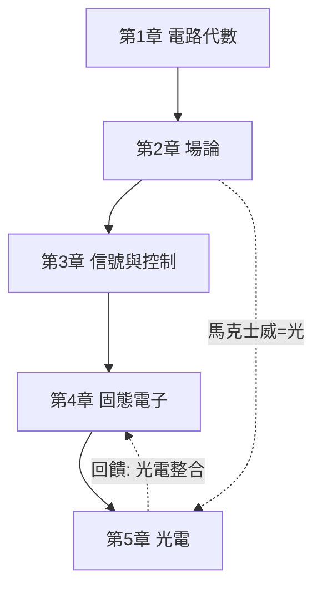

# 電的數學

從庫倫的扭秤到光子積體電路——一本以「數學 ⇄ 工程」互相驅動為主軸的電學教科書。每一個電學理論的誕生都是為了回應真實的工程困境；每一個工程突破又反過來催生新的數學。

## 目錄

* 第1章-靜電與電路：從力的數學到網路的數學
    * [1.1-1785年：庫倫定律與平方反比力的測量](01.1-1785年庫倫定律與平方反比力的測量.md)
    * [1.2-1827年：歐姆定律與線性電路代數](01.2-1827年歐姆定律與線性電路代數.md)
    * [1.3-1845年：克希荷夫定律與圖論式的網路分析](01.3-1845年克希荷夫定律與圖論式的網路分析.md)
* 第2章-電磁場：向量場的勝利
    * [2.1-1831年：法拉第電磁感應與場的概念](02.1-1831年法拉第電磁感應與場的概念.md)
    * [2.2-1865年：馬克士威方程組與電磁波的預言](02.2-1865年馬克士威方程組與電磁波的預言.md)
    * [2.3-1888年：赫茲實驗與無線電的誕生](02.3-1888年赫茲實驗與無線電的誕生.md)
* 第3章-信號、系統與控制：讓電做有用的事
    * [3.1-1932年：負回授與回授控制理論](03.1-1932年負回授與回授控制理論.md)
    * [3.2-1948年：夏農資訊理論——通訊的數學極限](03.2-1948年夏農資訊理論——通訊的數學極限.md)
    * [3.3-1965年：FFT與數位信號處理的革命](03.3-1965年FFT與數位信號處理的革命.md)
* 第4章-半導體與電子學：固態時代的數學
    * [4.1-1947年：電晶體的發明與能帶理論](04.1-1947年電晶體的發明與能帶理論.md)
    * [4.2-1965年：摩爾定律與積體電路的縮放數學](04.2-1965年摩爾定律與積體電路的縮放數學.md)
    * [4.3-1975年：SPICE與電路的電腦輔助分析](04.3-1975年SPICE與電路的電腦輔助分析.md)
* 第5章-光電與通訊：光的工程化
    * [5.1-1905年：光電效應、光子與量子電子的起點](05.1-1905年光電效應、光子與量子電子的起點.md)
    * [5.2-1970年：光纖通訊與低損耗的極限數學](05.2-1970年光纖通訊與低損耗的極限數學.md)
    * [5.3-1990年代起：藍光LED、白光照明與光子積體電路](05.3-1990年代藍光LED、白光照明與光子積體電路.md)

## 閱讀路線

## 本書的方法論

每節遵循同一敘事結構：

1. **問題**：當時工程/科學面臨什麼困境？
2. **數學**：什麼數學被發明或引入？
3. **後果**：如何改變了技術？
4. **回饋**：技術的反省如何催生新數學？
