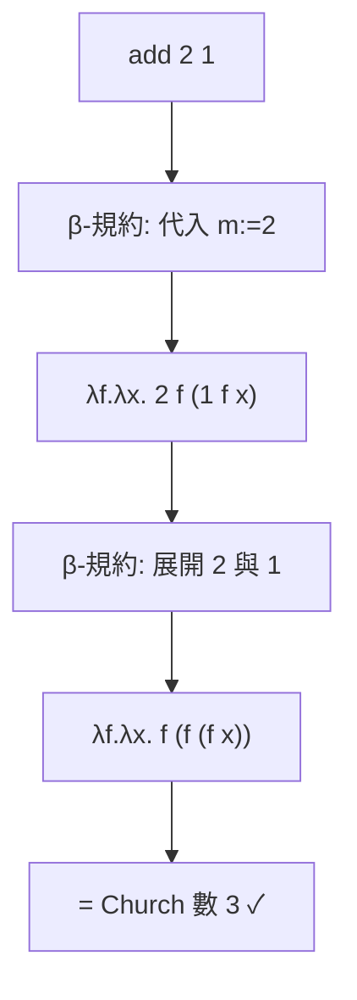

# 1.1 1930s Church 的 λ 演算：函數式程式的數學基石

## 前言：在電腦誕生之前，先有了「計算」的定義

1930年代，「電腦」這個詞還只指一種職業（做計算的人）。但數學基礎危機（Hilbert 的 Entscheidungsproblem，判定問題）逼使邏輯學家回答一個根本問題：**「可計算」到底是什麼意思？** 什麼樣的函數是「能有效算出來」的？

1936 年，Princeton 的 Alonzo Church 用一個極簡的符號系統——**λ 演算（lambda calculus）**——給出答案；同一年，他的學生 Alan Turing 用完全不同的圖像——**圖靈機**——給出另一個答案。驚人的是，兩者刻畫的「可計算函數」集合完全相同（Church-Turing 命題）。這場競爭（後來 Churchill 邀 Turing 當博士指導學生）確立了：**計算不需要狀態機與記憶帶，只需要「函數套用」這一件事。**

λ 演算的語法小到不可思議：

$$
e ::= x \mid \lambda x.\, e \mid e_1\; e_2
$$

只有三種東西：變數、抽象（建立函數）、套用。整個函數式程式設計——從 Lisp 到 Haskell 到 JavaScript 的箭頭函數——都是這三個語法構造的工程化擴充。

## 三條歸約規則：λ 演算的全部語義

λ 演算的「執行」就是**規約（reduction）**，有三條規則：

| 規則 | 名稱 | 定義 |
|---|---|---|
| $\alpha$ | 改名 | $\lambda x. x \equiv_\alpha \lambda y. y$ （約束變數可改名） |
| $\beta$ | 套用 | $(\lambda x. e_1)\; e_2 \to e_1[x := e_2]$ （代入） |
| $\eta$ | 外延 | $\lambda x.\, f\; x \to f$ （ $x$ 不自由出現時） |

其中 $\beta$ 規約是「函數呼叫」的數學定義。注意它**沒有賦值、沒有狀態**——這就是「純函數式」的哲學根源：程式的意義只是項到項的改寫。

### 一個完整例子：自然數（Church 數）

Church 用「函數套用次數」編碼自然數：數字 $n$ 是一個把函數套用 $n$ 次的高階函數：

$$
0 = \lambda f. \lambda x. x,\qquad
1 = \lambda f. \lambda x. f\; x,\qquad
2 = \lambda f. \lambda x. f\; (f\; x)
$$

加法就是函數組合： $\text{add} = \lambda m. \lambda n. \lambda f. \lambda x.\, m\; f\; (n\; f\; x)$ 。驗證 $2 + 1$ ：

```text
add 2 1
= (λm.λn.λf.λx. m f (n f x)) (λf.λx. f (f x)) (λf.λx. f x)
→ (λn.λf.λx. (λf'.λx'. f' (f' x')) f (n f x)) (λf.λx. f x)
→ λf.λx. (λf'.λx'. f' (f' x')) f ((λf''.λx''. f'' x'') f x)
→ λf.λx. f (f (f x))      -- 即 Church 數 3
```



## 布林值、序對與條件：一切皆函數

連 `if` 都能用函數表達。定義真值為「選擇器」：

$$
\text{true} = \lambda a. \lambda b.\, a,\qquad \text{false} = \lambda a. \lambda b.\, b
$$

則 `if c then a else b` 就是 `c a b`——布林值本身「知道」如何選擇。序對（pair）同理： $\text{pair} = \lambda a.\lambda b.\lambda f.\, f\; a\; b$ 。**資料結構可以是函數，函數也可以是資料**——這個等價性（函數是一等公民，first-class functions）要到 1958 年 Lisp 才真正被機器實現，但數學基礎在 1936 年就完成了。

## 歷史插曲：λ 演算差點死於「類型悖論」

Church 原始的「無型別 λ 演算」有一個致命傷：自套用 $\lambda x.\, x\; x$ 允許構造出不動點，進而（配合邏輯解釋）重新產生 Russell 悖論式的矛盾——1935 年 Kleene-Rosser 證明 Church 早期系統不一致。Church 的回應有二：一是將 λ 演算「降格」為純粹的計算系統（不管邏輯），二是後來發展**簡單型別 λ 演算**（1940）。前者成為 Lisp 的理論基礎（動態、無型別），後者成為 ML/Haskell 的祖先（靜態型別）。今天的函數式語言家族，正是這兩條路線的分岔與再會合。

## λ 演算與求值順序：一個悬而未決的選擇

$\beta$ 規約可以在不同位置進行，產生不同的求值策略：

- **應用序（applicative-order）**：先算完參數再套用——今天的絕大多數語言（C、Python、ML、Scheme）。
- **常態序（normal-order）**：最左最外優先，需要時才展開參數——**Church-Rosser 定理**保證若項有常態形（normal form），常態序必能找到它。

Church-Rosser 定理（合流性，confluence）是 λ 演算最重要的定理：

$$
\text{若 } a \to^* b \text{ 且 } a \to^* c,\ \text{則存在 } d \text{ 使 } b \to^* d \text{ 且 } c \to^* d
$$

這個定理在數學上說「規約順序不影響結果」，但在工程上留下伏筆：既然順序不重要，那**能不能乾脆不算用不到的東西**？——這就是 30 年後 Haskell 惰性求值（第3章）的理論根據。

## 程式碼：用 JavaScript 直接實作 Church 數

λ 演算可以直接在今天的語言裡「運行」，說明它不是玩具而是真實的計算模型：

```javascript
// Church 數：n = 把 f 套用 n 次
const zero  = f => x => x;
const succ  = n => f => x => f (n (f) (x));
const one   = succ(zero);
const two   = succ(one);
const three = succ(two);

// 加法 = 第二數把 f 接在第一數之後
const add = m => n => f => x => m (f) (n (f) (x));

// 轉回 JavaScript 數字以驗證
const toNum = c => c (x => x + 1) (0);
console.log(toNum(add(two)(three))); // 5

// 布林值與條件
const T   = a => b => a;
const F   = a => b => b;
const IF  = c => t => e => c (t) (e);
console.log(IF (T) ("yes") ("no")); // "yes"

// 序對
const pair = a => b => sel => sel (a) (b);
const fst  = p => p (T);
const snd  = p => p (F);
console.log(toNum(fst(pair(two)(three)))); // 2
```

這段程式碼中沒有一個 `if`、沒有物件、沒有迴圈——只有函數。它就是 1936 年的「機器」。

## 歷史意義與後續發展

λ 演算對後世的影響沿三條線展開：

1. **Lisp（1958）**：McCarthy 直接以 λ 演算為語義模型，Lisp 的 `(lambda (x) e)` 就是 Church 的 $\lambda x. e$ ；JavaScript（1995）則因借用 Scheme 的語義而成為「穿著 C 外衣的 λ 演算」，閉包、箭頭函數、`Array.map` 全部源自本章。
2. **型別理論**：簡單型別 λ 演算 → Curry 型別指派 → Hindley-Milner 推導（第2章）→ 依值型別，構成 ML、Haskell、Coq/Lean 的血統。
3. **編譯理論**：λ 演算是函數式編譯器的中間表示（IR）；continuation-passing style（第4章）本質上就是一種 λ 項改寫系統。

換句話說，**今天每一門語言的「函數」概念，都是 1936 年那三條規則的直系後代**。λ 演算與圖靈機的競爭還有一個深遠的教訓：兩個模型等價，但表達力相同不等於好用相同——λ 演算天生適合「組合與重用」，這個實務優勢最終化為整個函數式程式設計運動。

## 重點整理

- λ 演算用「變數、抽象、套用」三個語法構造定義了可計算性，與圖靈機等價（Church-Turing 命題）。
- 語義只有 $\beta$ 規約一條核心規則；沒有狀態、沒有副作用，「純函數式」由此定名。
- Church 數、布林值、序對證明「一切皆函數」，函數是一等公民的數學根據。
- Church-Rosser 合流性定理保證規約順序不影響結果，為惰性求值鋪路。
- 無型別路線通往 Lisp 與動態語言；簡單型別路線通往 ML 與 Haskell，兩條線在現代語言（Scala、Rust）中重新匯合。
