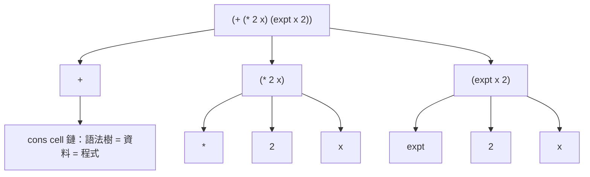

# 1.2 1958 Lisp 的誕生：McCarthy 與符號運算

## 前言：FORTRAN 時代的盲點

1958 年，FORTRAN（1957）剛證明「高階語言 + 編譯器」可行，但它服務的是**數值計算**：浮點陣列、迴圈、公式翻譯。然而 IBM 贊助的 MIT 人工智慧專案（後來的 AI Lab）要處理的是完全不同的問題：符號微分、定理證明、棋局搜尋——資料是任意結構的**符號表示式**（symbolic expression），不是規整的矩陣。

John McCarthy 當時意識到：FORTRAN 的函式呼叫與陣列完全不夠用，符號運算需要（1）任意大小的樹狀資料、（2）遞迴、（3）**函數作為參數**。他在 1958 年暑期於 IBM 構思、回 MIT 後實現的語言，就是 **LISP**（LISt Processor）。他的論文《Recursive Functions of Symbolic Expressions...》（1960）至今仍是程式語言史上最重要的論文之一。

## 核心發明一：S-運算式與「代碼即資料」

McCarthy 把資料與程式統一成同一種語法——**S-運算式（symbolic expression）**：

```lisp
(+ 1 2)                     ; 這是程式
(+ (* 2 x) (expt x 2))      ; 這也可以是資料（符號微分器的輸入）
```

一個 S-運算式是**二元樹**：原子（atom）或 `(head . tail)` 序對（cons cell）。因為程式本身就是這種樹，Lisp 獲得了別的語言夢寐以求的能力：**用 Lisp 程式讀寫 Lisp 程式**——巨集（macro）與同像性（homoiconicity）。這使得 1960 年代的 Lisp 就能自訂控制結構、實現嵌入式 DSL，而主流語言要到半世紀後才以「編譯器外掛」形式勉強補上。



## 核心發明二：以 λ 演算為語義

McCarthy 的關鍵決定是直接採用 Church 的 λ 演算。Lisp 的 `LAMBDA`、函數套用、遞迴定義，全部對應第 1.1 節的數學基礎。但「數學」與「機器」之間有鴻溝，McCarthy 的團隊（包括 Steve Russell）解決了它：

- **eval/apply 分離**：McCarthy 為了在論文中說明 Lisp 的語義，寫下一個universal function `eval`（以 Lisp 自己寫的直譯器）。「Lisp 用自己直譯自己」意外地成為可行的實作方案——Russell 說「我直接把這個 eval 編成機器碼吧」，世界第一個直譯器就此誕生。**先有語義、後有實作**，這個順序影響此後所有語言的設計方法。
- **垃圾回收（GC）**：cons cell 用完即棄，手動釋放不可行。1959 年 McCarthy 為 LISP 1.5 實現了第一個GC——**標記-清除（mark-sweep）**。GC 從此成為高階語言的標配，Java、Go、JavaScript 都繼承這份遺產。

## 核心發明三：函數是一等公民與條件表達式

兩個今天習以為常的設計在當時都是革命：

1. **函數作為參數傳遞**：McCarthy 的 `maplist`（map 的祖先）讓「對每個元素做某事」成為一個函數呼叫，而非迴圈。高階函數首次在真機器上運行。
2. **條件表達式（conditional expression）**：McCarthy 遊說 FORTRAN 團隊、ALGOL 58 委員會採用其函數式條件而未果，乾脆在 Lisp 自行實現：

```lisp
(DEFUN FACT (N) (COND ((ZEROP N) 1)
                      (T (* N (FACT (- N 1))))))
```

注意 `COND` 是**表達式**而非語句——它有值。這個設計經 ALGOL 60 進入主流，最終成為 C 的 `?:`、Python 的條件表達式、Rust 的 `match` 的思想源頭。ALGOL 報告的編者 Peter Naur 事後承認：「我們應該在 ALGOL 60 中採用 McCarthy 的條件表達式。」——這是函數式社群與主流語言委員會的第一回合交手，Lisp 贏了。

## 用 Lisp 寫 Lisp：eval 的七行核心

McCarthy 1960 年論文中的 universal evaluator，大意如下（以現代 Scheme 風格重寫）：

```scheme
(define (eval e env)
  (cond ((number? e) e)
        ((symbol? e) (lookup e env))                 ; 變數查環境
        ((eq? (car e) 'quote) (cadr e))              ; (quote x) 原樣返回
        ((eq? (car e) 'lambda)
         (make-closure (cadr e) (caddr e) env))      ; 建立閉包（第4章主題）
        ((eq? (car e) 'cond) (evcon (cdr e) env))    ; 條件
        (else (apply (eval (car e) env)              ; 套用：先算函數
                     (evlis (cdr e) env)))))         ; 再算參數

(define (apply f args)
  (cond ((primitive? f) (apply-prim f args))
        ((closure? f)
         (eval (closure-body f)
               (extend-env (closure-params f) args
                           (closure-env f))))))       ; 擴充環境 = 閉包的核心
```

這 ~15 行定義了 Lisp 的全部語義。`extend-env` 一行，就是第 4.1 節閉包實作的胚胎。值得一提的是：McCarthy 原始版本**沒有**保存定義時的環境（動態作用域 bug），直到 Sussman 與 Steele 的 Scheme（1975）才修正為詞法作用域——一個 bug 修了 17 年，說明語義設計比實作難得多。

## 歷史意義與後續發展

Lisp 對程式語言史的影響近乎全面：

1. **Lisp → Scheme（1975）→ JavaScript（1995）**：Brendan Eich 受命在十天內做出瀏覽器腳本語言，藍本是 Scheme。JavaScript 的閉包、函數為值、`setTimeout` 回呼風格，全是 Scheme 血統——只是穿著 Java 的皮。
2. **GC 擴散**：LISP 1.5 的 mark-sweep → 分代 GC（Lisp Machine, 1980s）→ Java HotSpot。沒有 Lisp，就沒有「工程師不必管記憶體」的現代預設。
3. **IDE、REPL、巨集**：Lisp Machine 把「語言即環境」推到極致；今日的 Jupyter、Live Reload、Rust macro、Swift macro 都在重複 Lisp 的舊答案。
4. **AI 的語言**：符號 AI 時代（定理證明、專家系統）幾乎全以 Lisp 書寫，使其在 1980 年代 AI 冬天前達到商業頂峰，也間接促成了 Common Lisp（1984）的標準化。

但 Lisp 也有教訓：無型別、動態作用域的混亂、方言碎片化（各自為政的 Maclisp、Interlisp、Franz Lisp），正是這些問題催生了 1970 年代 ML 的靜態型別革命——下一章的主題。

## 重點整理

- Lisp（1958/1960）為符號運算而生：S-運算式統一程式與資料，開啟同像性與巨集。
- McCarthy 以 λ 演算為語義、用「Lisp 寫的 eval」定義語言——語義先於實作的典範。
- LISP 1.5 實現第一個垃圾回收（mark-sweep）；GC 是函數式語言送給主流的禮物。
- 條件表達式、高階函數（maplist）、函數一等公民都在 1958-60 年完成實作。
- Lisp 1.5 的動態作用域缺陷由 Scheme 修正為詞法作用域；其語義經 Scheme 傳給 JavaScript。
- Lisp 的無型別之痛，反過來驅動了 ML 的 Hindley-Milner 型別系統——歷史以對立推動前進。
