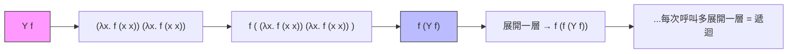

# 1.3 遞迴、不動點與 Y 組合子

## 前言：λ 演算的一個尷尬——它不會「自己呼叫自己」

λ 演算沒有名字（只有參數綁定），因此**無法在函數體內引用函數本身**：遞迴在表面上不可能。Church 面對的問題是：一個連名字都沒有的系統，如何表達「函數呼叫自己」？答案是 1930 年代已由 Curry 發現、後被 Kleene 稱為「最不可思議」的構造——**不動點組合子（fixed-point combinator）**，其中最著名的即 **Y 組合子**。

這一節的深意遠超獵奇：不動點方法說明**遞迴不是機器的特殊能力，而是函數套用語義的邏輯必然**。理解它，就理解了 `let rec`、`defun`、JavaScript 函數宣告底下到底發生了什麼。

## 不動點的數學

函數 $f$ 的**不動點**是滿足 $f\; x = x$ 的 $x$ 。若存在組合子 $\mathrm{fix}$ 能對任意 $f$ 算出其不動點：

$$
\mathrm{fix}\; f = f\; (\mathrm{fix}\; f)
$$

那麼遞迴就解決了。設想我們把「遞迴函數」寫成**接受自己為參數**的形式：想定義 `fact`，先定義

$$
F = \lambda \mathrm{fact}. \lambda n.\, \text{if } n=0 \text{ then } 1 \text{ else } n \cdot (\mathrm{fact}\; (n-1))
$$

$F$ 本身**不是**階乘（它需要一個 `fact` 參數），但階乘正是 $F$ 的不動點： $\mathrm{fact} = F\; \mathrm{fact}$ 。於是：

$$
\mathrm{fact} = \mathrm{fix}\; F
$$

**遞迴 = 對函數泛函求不動點。** 這個觀點後來成為程式語言理論的支柱：遞迴定義的語義、while 迴圈語義、資料型別的最小不動點語義，全部建立其上（D. Scott 的 domain theory，1970s）。

## Y 組合子的構造

$$
Y = \lambda f.\, (\lambda x.\, f\; (x\; x))\; (\lambda x.\, f\; (x\; x))
$$

驗證（逐步 $\beta$ 規約）：

```text
Y f
= (λx. f (x x)) (λx. f (x x))
→ f ((λx. f (x x)) (λx. f (x x)))
= f (Y f)      ✓ 不動點性質成立
```

注意 $(x\; x)$ 的自套用——正是第 1.1 節提到的、讓 Church 早期系統產生悖論的元兇。**遞迴的力量與邏輯悖論的力量是同一個機制**：自引用。Y 組合子是有意識地、建設性地使用自引用。



## 程式碼：JavaScript 中的 Y 組合子

```javascript
// Y = λf.(λx.f (x x))(λx.f (x x))，直接翻譯
const Y = f => (x => f (v => x (x) (v)))      // 注意：η-展開避免無窮展開
               (x => f (v => x (x) (v)));

// 把「遞迴」寫成 F：接受一個「假裝的 fact」，回傳真正的 fact
const F = fact => n => n === 0 ? 1 : n * fact (n - 1);

const factorial = Y (F);
console.log(factorial(5)); // 120

// 同一個 Y 適用於任何遞迴：費氏數列
const fib = Y (f => n => n < 2 ? n : f (n-1) + f (n-2));
console.log(fib(10)); // 55
```

兩個細節值得深思：

1. **`v => x (x) (v)` 而非 `x (x)`**：這是 η-展開（第 1.1 節的 $\eta$ 規則的逆用），把「立即計算」推遲成「呼叫時計算」。在 JavaScript 等應用序語言中，直接寫 `f (x x)` 會無窮遞迴爆棧。**Y 組合子在常態序系統（如 Haskell）中是惰性安全的，在應用序系統中必須 η-展開**——這是理論（合流性）與實務（求值順序）互動的經典案例。
2. `F` 完全不含 `factorial` 這個名字，遞迴被「解命名化」了。

## 實務語言如何真正實作遞迴

真實語言不用 Y 組合子執行遞迴（每層展開都要重複自套用，效率低），而是用**遞迴綁定**在環境中先預留位置：

- Scheme 的 `letrec`、ML/Haskell 的 `let rec`：在環境中先放入一個「黑洞」佔位，定義體內的名字解析到同一格。
- 對應的語義正是 $\mathrm{fix}$ ：`let rec f = e in b` 語義上等價於 `let f = fix (λf. e) in b`——語法糖之下就是本章的數學。

```haskell
-- Haskell 的遞迴定義，語義即不動點
factorial :: Integer -> Integer
factorial n = if n == 0 then 1 else n * factorial (n - 1)
```

有趣的對比：Lisp 一開始就有具名的 `DEFUN`，遞迴「免費」獲得；但 Church 式的純理論系統（以及喜歡徹底性的教學）仍需要 Y 組合子來解釋「為什麼這是合法的」。**實務先於理論，理論事後補證**，是程式語言史反覆出現的模式。

## 後續發展：從不動點到語義學與遞迴型別

不動點思想在 1970-80 年代開枝散葉：

1. **指稱語義（denotational semantics）**：Dana Scott 用**最小不動點**定義遞迴程式意義——程式 = 連續函數，語義 = 其在完備偏序集上的最小不動點。「程式的意思是什麼」第一次有了數學回答。
2. **遞迴型別**：`type int_list = Nil | Cons of int * int_list` 也是不動點（型別方程 $L \cong 1 + \text{int} \times L$ 的解）。代數資料型別（第 2.2 節）的理論基礎即此。
3. **自動機與驗證**：模型檢查中 CTL 公式的滿足集由不動點算法定義；抽象解釋亦然。

一句話：**「遞迴 = 不動點」從一個巧妙的組合子，升格為整個形式語義學的世界觀。**

## 重點整理

- λ 演算無名字、無法自我引用；Y 組合子 $Y = \lambda f.(\lambda x. f(x x))(\lambda x. f (x x))$ 以不動點解決遞迴。
- 關鍵轉化：把遞迴函數改寫為接受自身的泛函 $F$ ，遞迴函數即 $\mathrm{fix}\; F$ 。
- 自套用 $x\,x$ 同時是悖論與遞迴的來源——自引用的建設性使用。
- 應用序語言中 Y 需 η-展開以避免急切求值；常態序（Haskell）中可直接使用。
- 實務上 `let rec` / `defun` 以預留綁定實現遞迴，語義等價於 $\mathrm{fix}$ 。
- 不動點成為指稱語義、遞迴型別、模型檢查的統一數學基礎。
