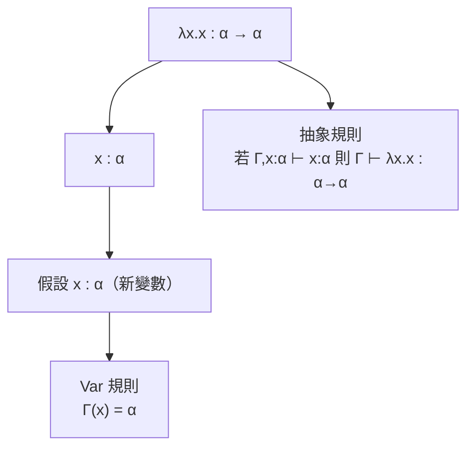

# 2.1 1958 ML 的起源與 Hindley-Milner 型別推導

## 前言：為了證明定理而發明的語言

1958 年，MIT 的 Robin Milner 加入 aI 專案，參與 LCF（Logic for Computable Functions）——一個以 Dana Scott 的邏輯為基礎的**定理證明器**。LCF 的困境是：使用者要在電腦上構造數學證明，但證明步驟繁瑣，需要**可程式化的策略（tactics）**。Milner 於是為「寫證明策略」設計了一個小語言——**ML**（Meta Language，後與「機器學習」同名實屬巧合）。

ML 有三個天生的設計約束，造就了它的三大發明：

1. 策略是**函數**（從證明狀態到證明狀態）→ 高階函數與模式匹配；
2. 定理不可偽造——使用者不得任意構造「證明」→ **型別系統**必須強到能隔離內部原語；
3. 交互式使用 → 使用者不該被逼著寫滿型別宣告 → **型別推導（type inference）**。

到 1975 年 Edinburgh LCF 重寫時，ML 已成為獨立語言；1978 年 Milner 正式發表型別系統論文，與 Roger Hindley（1969，邏輯學家，獨立推導出同樣的演算法）共享命名，即 **Hindley-Milner（HM）型別系統**。

## HM 系統：兩句話說完

HM 可以濃縮為兩個概念：

- **參數多型（parametric polymorphism）**：泛型型別變數 $\alpha$。函數 $\lambda x. x$ 的型別是 $\alpha \to \alpha$——對**所有**型別 $\alpha$ 成立。
- **讓泛化（let-polymorphism）**：`let f = fn x => x in (f 1; f true)` 合法——`f` 在 let 右側被推導出泛型型別 $\forall\alpha.\alpha\to\alpha$，之後每次使用可實例化為不同型別。

與 Lisp 的動態型別相比，HM 的承諾是驚人的：**所有型別錯誤在編譯期被抓到，而使用者幾乎不用寫任何型別標註**。這是 Lisp 社群二十多年來認為不可能的事。

## 型別推導：Algorithm W

推導的核心是 **unification（合一）**——Robinson 1965 年為定理證明發明的演算法，被 Milner 挪用到型別上。給定項，自底向上推出型別約束並求解：

1. 變數 $x$：賦予新的型別變數 $\alpha_x$；
2. 函數套用 $e_1\, e_2$：推導 $\tau_1 = \tau_2 \to \alpha$，與 $\tau_1$、$\tau_2$ 合一；
3. let 綁定：右式型別**泛化**（free type vars 提升為 $\forall$），進入主體。

Algorithm W 以項的大小為線性（近乎）時間完成推導——實用性的保證。

### 推導樹例子

對 `fn x => x`（即 $\lambda x. x$）：



再對 `(fn x => x) 5`：

```text
(λx. x) 5                     -- 目標型別 β
應用規則: τ1 = τ2 → β
推得 λx.x : α → α，5 : int
合一: (α → α) ~ (int → β)  ⟹  α = int = β
結論: 整個項 : int                ✓
```

## 程式碼：SML 與 Haskell 中的 HM

```sml
(* SML：注意——完全沒有型別標註，編譯器全部推導出來 *)
fun compose (f, g) = fn x => f (g x)
(* val compose : ('a -> 'b) * ('c -> 'a) -> 'c -> 'b *)

fun map f [] = []
  | map f (x :: xs) = f x :: map f xs
(* val map : ('a -> 'b) -> 'a list -> 'b list *)

fun length [] = 0
  | length (_ :: xs) = 1 + length xs
(* val length : 'a list -> int   —— 參數多型！ *)
```

`compose` 的型別 `'a -> 'b) * ('c -> 'a) -> 'c -> 'b` 是合一演算出的**最一般型別**（principal type）：它不是「某個」合法型別，而是所有合法型別中最通用的——HM 系統的漂亮保證。

## HM 的極限：價值限制（value restriction）

純粹的 let-polymorphism 在有**可變參照**時出問題：

```sml
val r = ref (fn x => x)   (* 危險：若 r 被泛化為 ∀α.(α→α) ref *)
r := (fn x => x + 1);     (* 存入 int→int *)
!r true;                  (* 取出當 bool→bool 用 —— 型別系統被擊穿 *)
```

1970-80 年代這個漏洞逼出各種補丁，最終由 Andrew Wright 與 Felleisen（1994）給出乾淨解：**只對「語法上的值」（不可展開的運算式）泛化**——value restriction。這是「理論系統遇到現實副作用必須打補丁」的著名案例，也預示了第 3 章 Monad 要解決的同一類問題：**純函數式的數學與可變世界的工程之間的張力**。

## 歷史意義與後續發展

HM 的血脈至今仍是主流：

1. **ML → Caml → OCaml（1996）→ Rust**：Rust 的型別推導就是 HM 樹上的分支（加上生命週期）。
2. **ML → Haskell（1990）**：Haskell 以 HM 為起點，加入型別類（第 5.2 節）擴充。
3. **HM → Generics**：Java 5 泛型（2004）、C# 2.0 泛型（2005）——參數多型的思想源自 Milner；甚至 Python 的 `mypy`、TypeScript 的型別推導演算法也大量借鑑 HM。**今天你寫 `let x = vec![1,2,3];` 不用標型別，受益的是 1958 年為了證明定理而生的那套演算法。**

回顧驅動關係：定理證明需要策略 → 策略需要型別安全 → 型別需要推導 → 推導借了 Robinson 合一演算法 → 合一演算法又反哺定理證明（Prolog 即建立於其上）。**理論與工程在 1960-70 年代完成了一次漂亮的相互驅動**。

## 重點整理

- ML 誕生於 LCF 定理證明器（1958 起），ML = Meta Language；三個設計約束催生三大發明。
- HM 系統 = 參數多型 + let 泛化 + Robinson 合一演算法；保證最一般型別（principal type）。
- Algorithm W 近乎線性時間，使「靜態型別 + 零標註」首次可行。
- 值可變時 let 泛化不安全 → value restriction（Wright & Felleisen 1994）。
- HM 血統直達 OCaml、Haskell、Rust、Java/C# 泛型與現代腳本語言的型別推導。
