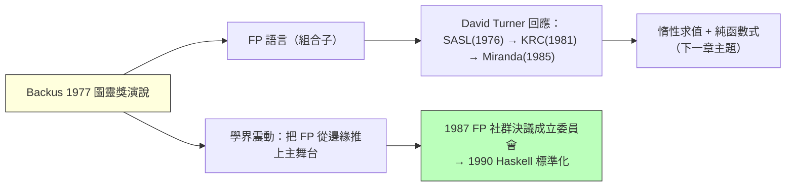

# 2.2 1977 Backus 的圖靈獎演說與代數資料型別

## 前言：FORTRAN 之父的倒戈

1977 年 8 月，John Backus——FORTRAN 的主設計者、BNF 范式的共同發明人、1950 年代最成功的「主流語言」工程師——站在 ACM 圖靈獎頒獎台上，發表了題為 **《Can Programming Be Liberated from the von Neumann Style?》** 的演說。他開宗明義地批判自己一手締造的世界：

> 傳統語言無休止地把程式設計師鎖死在「逐字（word-at-a-time）」思維中……它們是 von Neumann 電腦的語義放大器，把電腦的弱點（單字定址、單一狀態流）強加為程式的樣貌。

這不是異端玩家的牢騷，而是**內部人的懺悔**。Backus 指出問題的根源：馮紐曼機的「狀態 + 逐條指令」模型，使程式無法用**代數規則**推理。你無法對 `x := x + 1` 做任何代數變換——賦值摧毀了等式推理。他的藥方：**函數式程式設計（functional programming, FP）**，以函數組合（composition）與應用性（applicativity）為一等公民，並提出實驗語言 **FP**。

## 演說的核心論證：代數定律

馮紐曼語言的致命傷是**沒有代數**。比較兩種寫「矩陣內積」的方式：

```text
-- 馮紐曼風格（偽 C）
dotprod = 0
for i := 0 to n-1 do
    dotprod := dotprod + a[i] * b[i]
-- 無法拆解：變數被反覆覆寫，無代數性質可言

-- Backus 的組合子風格
def ip = (insert +) ∘ (applytoall ×) ∘ transpose
-- 內積 = 「求和 ∘ 逐對相乘 ∘ 轉置」，三個代數件組合
```

組合子風格的好處：**組合子有定律**。例如：

$$
(\text{applytoall}\, f) \circ (\text{applytoall}\, g) = \text{applytoall}\, (f \circ g)
$$

有了定律，編譯器與程式設計師都能**以等式變換程式**——最佳化、平行化、正確性證明全部化為代數操作。這個論證日後被稱為「組合子的代數性」，是整個函數式最佳化文獻的起點。



## 代數資料型別（ADT）：資料也能有代數

演說的另一條伏線，由 Turner 系語言完成：**代數資料型別**——型別定義為「和（sum）」與「積（product）」的組合：

$$
\text{型別} = \underbrace{T_1 + T_2}_{\text{和：二選一}} \qquad \underbrace{T_1 \times T_2}_{\text{積：同時擁有}}
$$

以 Haskell 為例：

```haskell
-- 積型別：一個 Person 同時有名字與年齡
data Person = Person String Int

-- 和型別：一個 Shape 要麼是圓要麼是矩形
data Shape = Circle Double            -- 1 個 Double
           | Rect Double Double       -- 2 個 Double

-- 遞迴型別（第 1.3 節的不動點！）：鏈結串列
data List a = Nil | Cons a (List a)

-- 樹：和型別 + 遞迴
data Tree a = Leaf | Node (Tree a) a (Tree a)
```

和型別的**尺寸公式**揭示了「代數」二字的實義：若 $|A|=a$ 、 $|B|=b$ ，則 $|A+B| = a+b$ 、 $|A \times B| = a \times b$ 、 $|A \to B| = b^a$ （函數空間是指數）。型別的世界就是一個半環（semiring）——這正是 Curry-Howard 對應（下一節）中「邏輯或 = 和、邏輯且 = 積」的算術根據。

### 模式匹配：和型別的對偶面

代數資料型別的消去（使用）方式是**模式匹配**，編譯器能檢查**窮舉性**（exhaustiveness）：

```haskell
area :: Shape -> Double
area (Circle r)   = pi * r * r
area (Rect w h)   = w * h
-- 若漏掉任何一個建構子，編譯器報錯——新增建構子時，所有未更新的地方都被點名
```

這解決了物件導向 visitor 模式用數百行程式碼勉強模仿的問題，也是 Rust `enum`/`match`、Swift `enum`、Java 17 record+sealed 進化的源頭。

## 程式碼：同一棵樹，三種語言的演化

```haskell
-- Haskell：ADT + 模式匹配（1977 年思想的成熟形態）
data Expr = Num Int
          | Add Expr Expr
          | Mul Expr Expr

eval :: Expr -> Int
eval (Num n)     = n
eval (Add a b)   = eval a + eval b
eval (Mul a b)   = eval a * eval b

-- 代數定律可以用等式直接證明（Backus 的夢想）
-- 乘法對加法分配律：eval (Mul a (Add b c)) == eval (Add (Mul a b) (Mul a c))
```

```rust
// Rust（2015）：ADT 進入系統語言
enum Expr {
    Num(i64),
    Add(Box<Expr>, Box<Expr>),
    Mul(Box<Expr>, Box<Expr>),
}

fn eval(e: &Expr) -> i64 {
    match e {
        Expr::Num(n) => *n,
        Expr::Add(a, b) => eval(a) + eval(b),
        Expr::Mul(a, b) => eval(a) * eval(b),
    }
}
```

## 歷史意義與後續發展

Backus 演說的後果鏈條是教科書級的「一場演說改變一個領域」：

1. **演說 → Miranda（1985）**：Turner 受 FP 激勵，把「組合子 + 惰性 + ADT」整合成教學語言 Miranda，成為大學標準教材。
2. **Miranda 的商業授權問題 → Haskell 委員會（1987）**：因 Miranda 不允許自由實作，社群決議另訂開放標準，1990 年 Haskell 1.0 誕生。
3. **ADT 擴散**：Erlang（1986）、OCaml、Scala `case class`、Rust `enum`、Swift、TypeScript 的 discriminated union、Java 的 sealed interface——**今天所有現代語言都有 ADT**。
4. **組合子代數 → 函數式最佳化與流式處理**：Spark 的 DataFrame 最佳化器、LINQ 的表達式樹，本質上都在利用「操作有代數結構」以便改寫。

馮紐曼式語言最終沒有消失，但 Backus 的判斷以另一種方式應驗：**編譯器與框架的內部語言越來越函數式**（LLVM IR 的 SSA、Spark 的 RDD 變換），因為只有無副作用的代數才能被安全地改寫與平行化。

## 重點整理

- Backus 1977 圖靈獎演說批判馮紐曼風格「無代數性」，主張以函數組合為程式的一等構件。
- 組合子有代數定律 → 程式可做等式推理、改寫、平行化。
- 代數資料型別 = 和型別 + 積型別 + 遞迴；模式匹配是其消去規則，附窮舉檢查。
- 型別運算構成半環： $+,\times,\to$ 對應 $+,\times,\text{exp}$ ，為 Curry-Howard 鋪路。
- 演說 → Turner 系（SASL/KRC/Miranda）→ Miranda 授權限制 → 1987 Haskell 委員會 → 1990 標準化。
- ADT 已成現代語言標配（Rust enum、Scala case class、Java sealed record）。
