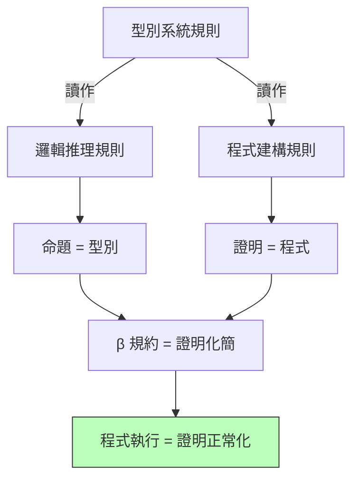

# 2.3 Curry-Howard 對應：型別即命題、程式即證明

## 前言：兩個不相干的人發現了同一件事

1934 年，邏輯學家 Haskell Curry 研究 Hilbert 式直覺主義邏輯的公理系統時注意到：公理模式與組合子的型別之間有一種系統性的相似。1969 年，William Howard（數學家）在未出版的手稿中把這個觀察推廣為完整的對應，後世稱 **Curry-Howard 對應（Curry-Howard correspondence）**，或更戲劇化的說法——**命題即型別（propositions-as-types）**。

它的內容簡單到令人不安：

| 邏輯 | 程式（型別理論） |
|---|---|
| 命題 $P$ | 型別 $\tau$ |
| 證明 | 項（程式） |
| $P \Rightarrow Q$ | 函數型別 $P \to Q$ |
| $P \land Q$ | 積型別 $P \times Q$ |
| $P \lor Q$ | 和型別 $P + Q$ |
| modus ponens（$\frac{P\Rightarrow Q,\ P}{Q}$） | 函數套用 $f\, x$ |
| 證明的規約 | 程式的計算 |

**一個型別是 inhabited（有項居住），當且僅當對應的命題在直覺主義邏輯中可證。** 寫一個能通過型別檢查的程式，就是在構造一個數學證明；執行程式，就是在**化簡證明**。

## 推導樹的雙重身分

以最簡單的命題 $A \Rightarrow A$（恆等）為例：

```text
邏輯側（自然演繹）              程式側
─────────────────────        ─────────────────
  [A]¹                         x : A
  ──── 假設                    ────
   A                            x : A
──────→I (消去¹)              ────── λ
  A ⇒ A                        λx. x : A → A
```

同一棵樹，左讀是證明，右讀是程式。再看和型別（邏輯「或」）的引入規則如何變成建構子的型別：

```haskell
-- 或的左引入：P ⇒ P ∨ Q        →  Left  :: a -> Either a b
-- 或的右引入：Q ⇒ P ∨ Q        →  Right :: b -> Either a b
-- 消去（情況分析）             →  either :: (a -> c) -> (b -> c) -> Either a b -> c
```



## 排中律的失蹤：直覺主義邏輯為什麼「對」

這個對應刻畫的是**直覺主義**（constructive）邏輯：命題 $P \lor \lnot P$（排中律）與 $\exists x. P(x)$ 的雙重否定形式**不可證**，因為它們對應的型別沒有項——你無法在不「給出實例」的情況下證明存在命題。這不是缺陷，而是精確反映：**程式必須建構出答案**。「證明 = 程式」自動排除了非建構性的數學推理。

實務推論：若要讓對應涵蓋古典邏輯，需加入控制運算子——例如 call/cc 對應 Peirce 律（Griffin, 1990）。這個發現把第 4.2 節的 continuation 理論直接接到邏輯上：**跳轉控制 = 邏輯規律**。

## 程式碼：從邏輯定律到型別簽名

Curry-Howard 使「寫出型別簽名」成為證明義務。幾個經典例子：

```haskell
-- 交換律：(A ⇒ B ⇒ C) ⇒ (B ⇒ A ⇒ C) —— flip
flip :: (a -> b -> c) -> (b -> a -> c)
flip f y x = f x y

-- 分配律：A ⇒ (B ∧ C) 與 (A ⇒ B) ∧ (A ⇒ C) 等價
split :: (a, b) -> (a -> b)  -- 這是 curry；兩方向都存在
curry' :: ((a, b) -> c) -> a -> b -> c
curry' f x y = f (x, y)

-- 反證不可行：a -> Void 無法 inhabited（除非 a 本身為空）
data Void                    -- 空型別 = 假命題 ⊥
absurd :: Void -> a          -- 可證（假命題蘊含一切）
absurd v = case v of {}      -- 但沒有值能到達這裡

-- 否定定義為「到假的函數」
type Not a = a -> Void
```

在依值型別系統中（Coq、Agda、Lean），這條對應被推到極致：**證明就是程式**，定理檢查器執行的正是型別檢查。本章的 ML 系統（2.1）只掌握一階片段，而證明助手是它的完全體。

## 歷史意義與後續發展

Curry-Howard 把三件原本分離的事——型別系統、邏輯、程式語義——縫合成一門學科：

1. **證明助手**：Coq（1989）、Agda、Lean 全部以 Curry-Howard 為基石。2005 年 Gonthier 以 Coq 形式化四色定理；2012 年 CompCert 編譯器以 Coq 驗證並實際商用；Rust 的 borrow checker 設計亦受依值型別社群影響。
2. **型別系統設計準則**：「這個型別規則對應什麼邏輯規則？」成為設計者的思考框架。線性邏輯 → Rust 的 move 語義（一個值只能用一次 = 資源不能複製）正是 Curry-Howard 的現代應用——**邏輯的新分支直接變成語言的新功能**。
3. **對軟體工程的承諾**：型別越強，能表達的命題越多，編譯器能替你驗證的越多。「讓非法狀態無法被表示」這句現代格言，數學根據就是本章。

回顧驅動鏈：邏輯基礎研究（1930s）→ λ 演算型別化 → Curry/Howard 的對應 → ML 的實用型別系統 → 依值型別證明助手 → 影響 Rust。**純理論的研究在 80 年後變成了系統程式設計師每天使用的編譯器報錯**。

## 重點整理

- Curry-Howard 對應：命題即型別、證明即程式、證明化簡即程式求值。
- 自然演繹的引入/消去規則 = 建構子/模式匹配；modus ponens = 函數套用。
- 對應刻畫直覺主義邏輯：非建構性命題（排中律、非建構存在）無型別居民。
- call/cc 對應古典邏輯（Peirce 律）；線性邏輯對應資源敏感型別（Rust move）。
- 實用後果：證明助手（Coq/Agda/Lean）、強型別語言設計、「讓非法狀態無法表示」。
