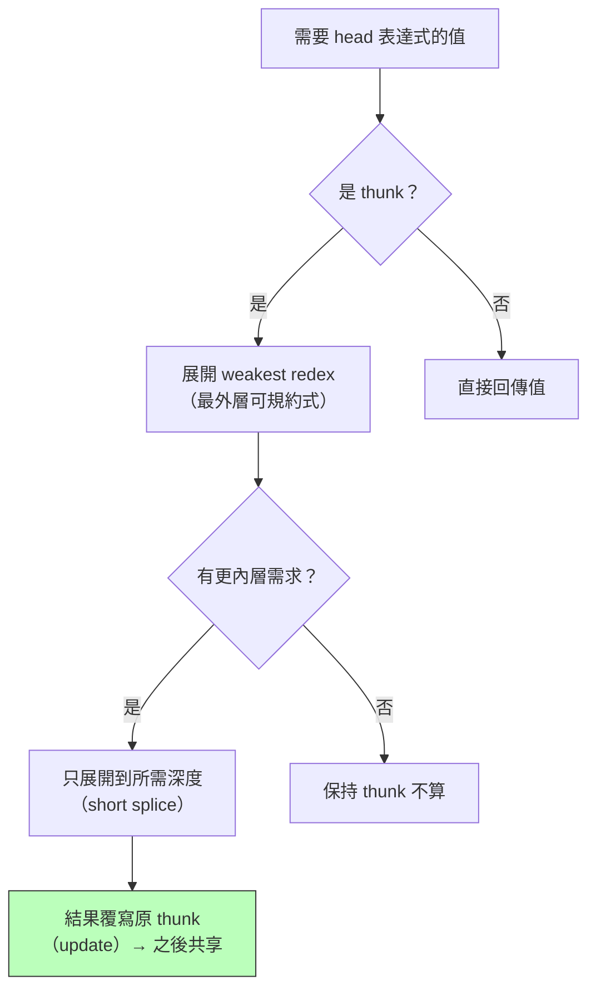

# 3.2 1990 Haskell：惰性求值、thunk 與圖規約

## 前言：為「未來的語言」成立委員會

1987 年，FPCA 會議上，二十多位函數式學者決議：與其繼續方言林立（SASL、KRC、Miranda、LML、Hope……），不如設計一門**開放標準**的純函數式惰性語言，作為研究與教學的共同載體。委員會由 Paul Hudak、Philip Wadler、Simon Peyton Jones 等人領導，1990 年發表 Haskell 1.0，1998 年的 Haskell 98 成為穩定標準，2010 年修訂至今。Haskell 的三個自我約束：**純（purity）、惰性（lazy）、型別化（Hindley-Milner 加強版）**——每一條都與「預設」主流語言相反。

## 惰性求值：call-by-need

第 1.1 節說過，常態序保證「該算的都會算出」，但每次都重新算參數會指數爆炸。Haskell 的答案是 **call-by-need**：第一次需要時才求值，並把結果**記住**（memoization）。實作上是把每個未求值表達式包成 **thunk**（一個閉包＋已求值旗標）：

```text
求值 xs = map f [1..3]（f x = x*10）
    graph:  map f [1..3]          -- thunk 未展開
        ↓ 需要 head
    (f 1) : map f [2..3]          -- 展開一層，f 1 仍是 thunk
        ↓ 需要值
    10 : map f [2..3]             -- f 1 求值為 10，結果寫回（共享）
```



惰性帶來的程式風格革命：

```haskell
-- 無限資料結構與「非嚴格」的組合
ones = 1 : ones                     -- 無限個 1
nats = 0 : map (+1) nats            -- 自然數
primes = sieve [2..]
  where sieve (p:xs) = p : sieve [x | x <- xs, x `mod` p /= 0]

-- Haskell：條件與短路皆免費——若為嚴格求值，此定義會爆棧
ifThenElse True x y = x
```

## 圖規約（graph reduction）：在圖上改寫 λ 項

實作 call-by-need 的標準技術是**圖規約**：把程式表示為共享的圖（不是樹），規約時**就地改寫節點並讓指標共享**。三個關鍵機制：

1. **指標共享**：`let x = 2+3 in x*x` 中 $x$ 只算一次（兩處指到同一 thunk）；
2. **就地更新（update）**：thunk 求值後用其值覆寫自己，共享它的其他位置自動受惠；
3. **弱首規約（weak head normal form, WHNF）**：只展開到「最外層建構子」，內部保持 thunk——這是「需要多少算多少」的機械化。

Simon Peyton Jones 的兩本書（《The Implementation of Functional Programming Languages》1987、《Implementing lazy functional languages on stock hardware: the Spineless Tagless G-machine》1992）把這門技術系統化。GHC（Glasgow Haskell Compiler）至今仍是學術界最持久的編譯器計畫：惰性、優良的型別系統與純度，讓編譯器敢做極端最佳化——**語言純度直接轉化為最佳化自由度**。

### 惰性的代價：空間洩漏與嚴格性標註

誠實的教科書必須說明代價。惰性會造成 **space leak**：

```haskell
-- 反例：foldl 累積了 10 億個 thunk
sumBig = foldl (+) 0 [1..1000000000]   -- 爆棧！
-- 修正：內建強迫求值
sumBig' = foldl' (+) 0 [1..1000000000] -- 常數空間
```

每加一個數，thunk 鏈就多一層「 $(\ldots((0+1)+2)+3\ldots)$ 」，要到最後才一次展開。解法是**嚴格性標註**（`seq`、`foldl'`、bang patterns）——工程師必須對惰性有心理模型。這條經驗後來被遠端用在 Spark（惰性 DataFrame + `cache()`）與 Python 生成器上。

## 程式碼：手寫一個迷你圖規約引擎

```javascript
// 用 JavaScript 模擬 thunk 與 call-by-need
function thunk(exprFn) {
  let evaluated = false, value;
  return {
    force() {
      if (!evaluated) { value = exprFn(); evaluated = true; } // 就地更新
      return value;
    }
  };
}

// 惰性串流：Cons 頭是 thunk，尾也是 thunk
const Cons = (hThunk, tThunk) => ({ h: hThunk, t: tThunk, kind: "cons" });
const takeN = (s, n) => n <= 0 ? [] : [s.h.force(), ...takeN(s.t.force(), n - 1)];

const ones = () => Cons(thunk(() => 1), thunk(ones));   // 無限個 1
console.log(takeN(ones(), 3)); // [1, 1, 1] —— 只算了 3 個

// 共享：x 只求值一次
let count = 0;
const expensive = thunk(() => { count++; return 40 + 2; });
const x = () => expensive.force();
const square = () => x() * x();   // 若 x 是樹，count 會是 2；圖共享 → 1
console.log(square(), count);     // 42 1 ✓
```

## 歷史意義與後續發展

1. **GHC 與生態**：GHC 演化出 STG 機器、Core IR、View Patterns、型別族——成為型別系統研究的實驗床（型別類、GADTs、依值型別式擴充）。
2. **理論產品化**：Parsec（parser combinator）、QuickCheck（性質測試，2000）都從 Haskell 擴散到主流：Rust 的 `proptest`、JS 的 `fast-check` 都是 QuickCheck 子孫。
3. **惰性思維擴散**：Python 生成器、Java Stream（惰性中介操作）、Rust iterator、C# LINQ 的延遲執行，全部是 call-by-need 思想的局部移植——主流語言沒有全面惰性，但都學會了「需要時才算」。
4. **教訓**：預設惰性在實務中常被繞過（`foldl'`、`!` 標註），後代語言（Scala、Idris 2）多改為「預設嚴格、惰性可選」——**歷史又一次顯示：極端純粹的設點未必是終點，但它定義了之後所有折衷的座標系。**

## 重點整理

- Haskell（1990/1998）= 純 + 惰性（call-by-need）+ HM 型別；由 1987 委員會為取代封閉的 Miranda 而設計。
- call-by-need = 常態序 + 共享記憶；thunk 承載未求值表達式，求值後就地更新。
- 圖規約：共享指標 + WHNF 弱首規約，使無限結構與「按需計算」可行。
- 純度→最佳化自由（fusion、strictness analysis）；代價是 space leak 與嚴格性標註的必要性。
- GHC 成為型別理論與最佳化研究的長期實驗床；惰性思想以生成器、Stream、iterator 的形式滲入主流。
