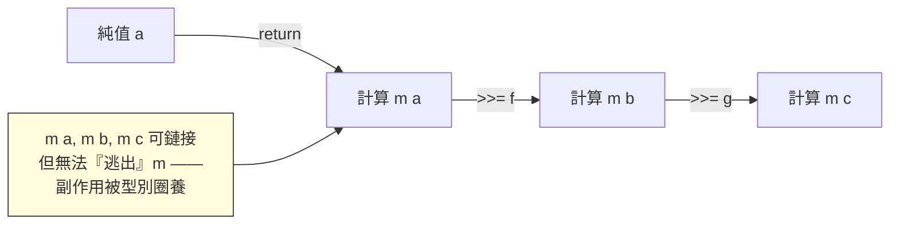

# 3.3 1990s Monad：以純函數處理副作用

## 前言：純度世界裡的 IO 危機

第 3.1 節留下一個懸案：Miranda/Haskell 禁止副作用，但讀檔、印字、隨機數怎麼辦？1980 年代末的解法一個比一個難堪：Turner 的 request/response 對話串列、Haskell 1.x 的 stream-based IO、續體 Passing Style 的交談式 IO——都很難寫、難組合。1990 年前後，**Haskell 的存亡取決於能否找到一個既有純度又有實用 IO 的模型**。

轉機來自兩條數學線：Eugenio Moggi（1991，範疇論學者出身）在論文《Notions of Computation and Monads》中指出——**「計算」本身就是一個範疇論結構（monad）**，各種計算效應（可能失敗、可能有狀態、可能拋例外）各自對應一個 monad。Philip Wadler 把它引入 Haskell（1992 論文《The essence of functional programming》），IO、狀態、例外、parser 由此獲得統一的純函數式處理方式。1995 年 Haskell 1.3 採用 Monad 為 IO 的正式模型，危機解除。

## Monad：定義與法則

Monad 是一個帶兩個操作的型別建構子 $m$：

$$
\text{return} : a \to m\, a \qquad (\gg\!\!=) : m\, a \to (a \to m\, b) \to m\, b
$$

直覺：`return` 把純值「裝進計算」；`>>=`（bind）把「產生 $a$ 的計算」接上「吃 $a$、產生 $b$ 的計算」。**鏈式組合**由此誕生。合法的 monad 必須滿足三條法則：

$$
\begin{aligned}
\text{左單位元：}&\quad \text{return}\; a \gg\!\!= f \;=\; f\; a\\
\text{右單位元：}&\quad m \gg\!\!= \text{return} \;=\; m\\
\text{結合律：}&\quad (m \gg\!\!= f) \gg\!\!= g \;=\; m \gg\!\!= (\lambda x.\, f\, x \gg\!\!= g)
\end{aligned}
$$



最後一點是精髓：**沒有合法函數 $m\, a \to a$**（對 IO 而言）。副作用被關在 `IO` 型別裡，`main :: IO ()` 是唯一的出口——純函數世界與效應世界的邊界由型別系統執行。

## 程式碼：從 IO 到 Maybe 到 State

```haskell
-- IO Monad：印字與讀檔仍是「純的程式」，只是型別裡帶效應
main :: IO ()
main = do
  line <- getLine          -- do 記法是 >>= 的語法糖
  let n = length line
  putStrLn ("你輸入了 " ++ show n ++ " 個字元")
-- 脫糖：getLine >>= \line -> putStrLn (...)

-- Maybe Monad：錯誤處理的純函數式版本
head' :: [a] -> Maybe a
head' []     = Nothing
head' (x:_)  = Just x

safeSqrt :: Double -> Maybe Double
safeSqrt x | x < 0     = Nothing
           | otherwise = Just (sqrt x)

-- bind 自動處理 Nothing 的傳播——呼叫者不用寫 if (x == null)
lookupUser >>= getAvatar >>= validate  -- 任一步失敗整體即 Nothing
```

```javascript
// 用 JavaScript 實作 Maybe monad，理解 bind 的機械
const Just = v => ({ bind: f => f(v), toString: () => `Just(${v})` });
const Nothing = { bind: f => Nothing, toString: () => "Nothing" };

const parse = s => !isNaN(s) ? Just(parseFloat(s)) : Nothing;
const recip = x => x === 0 ? Nothing : Just(1 / x);

// 鏈式：任一步 Nothing 就短路——這是 async/await 與 Optional chaining 的表親
console.log(parse("0.25").bind(recip).toString()); // Just(4)
console.log(parse("abc").bind(recip).toString());  // Nothing
```

### do 記法：把「單子程式」寫得像命令式

Haskell 的 `do` 區塊是純語法糖：

```haskell
do x <- a; y <- b; return (x+y)
-- 脫糖為
a >>= \x -> b >>= \y -> return (x+y)
```

**「分號、臨時變數、看似循序執行」在 Haskell 中不是語言內建，而是 Monad 的語法糖。** 命令式程式設計在這裡被還原為一種特殊的純函數程式設計——這是 1990 年代理論上最漂亮的一次「收編」。

## 歷史意義與後續發展

Monad 是函數式思想外溢到主流的最大單一出口：

1. **async/await（2012-2017）**：JavaScript、Python、C#、Rust 的 async/await 本質上是「對 Promise/Future monad 的 do 記法」。`await` 就是 `>>=`，編譯器的 CPS 變換（4.2 節）就是脫糖機制。**沒有 Haskell 的 monad 實驗，就沒有今天的非同步語法**。
2. **Option chaining**：Rust `?` 運算子、Swift optional binding、C# null-conditional——都是 Maybe monad 的語法化。
3. **效果系統**：Scala 的 ZIO/Cats Effect、Koka/Unison 的 algebraic effects，直接繼承 Moggi 的「計算 = monad」綱領，並試圖修正其兩大痛點（組合不易、整個程式染上 IO 型別）。
4. **教材化**：Wadler 的「Monads for functional programming」、Haskell wiki 的「Monad Tutorial Fallacy」都成為經典——後者警告： Monad 一旦「懂了」就再也無法還原不懂的狀態，所以 tutorial 無窮多。

一句話總結本節的驅動關係：**純度危機 → 範疇論救援 → Monad → 主流語言的 async/await 與 `?`**。理論的勝利往往不是理論家獨享，而是化為千萬工程師不假思索的語法。

## 重點整理

- 純函數式無法直接做 IO；Moggi（1991）以範疇論的 monad 刻畫「計算」，Wadler 引入 Haskell。
- Monad = return + bind，滿足左/右單位元與結合律三法則；IO、Maybe、State、Parser 皆為 monad。
- 沒有合法的 $m\,a \to a$：副作用被型別圈養在 `IO` 中，`main` 是唯一出口。
- `do` 記法是 bind 的語法糖——命令式風格被還原為純函數式。
- 後代：async/await（Promise monad 語法化）、Rust `?`（Result monad）、ZIO 與 algebraic effects。
