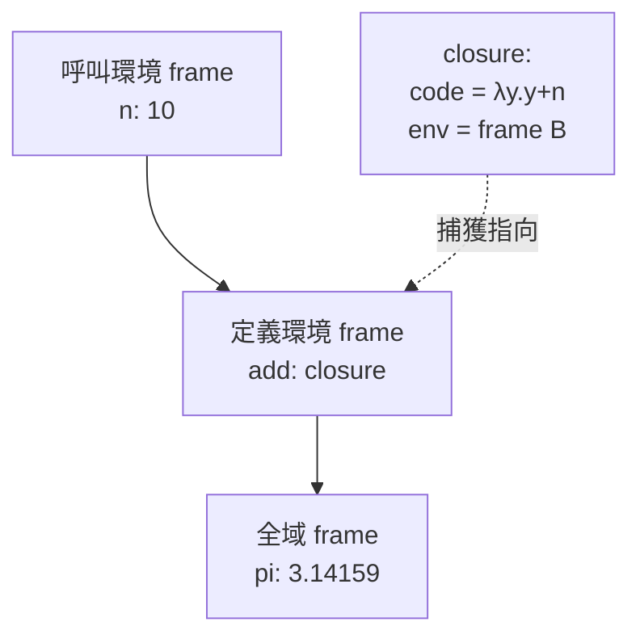

# 4.1 閉包的實作：環境、捕獲與 upvalue

## 前言：從 λ 演算到記憶體

第 1.2 節說過：McCarthy 1960 年的 eval 中，`extend-env` 一行就是閉包的胚胎；Lisp 1.5 的動態作用域是個 bug；Scheme（1975）確立**詞法作用域（lexical scoping）**。本節把視線從語言下移到機器：**當函數「帶著它出生的環境」被傳遞與回傳時，記憶體裡到底要擺什麼？** 這是函數式語言最核心的執行期資料結構——閉包（closure）。

閉包 = 函數碼 + 捕獲的環境。理論定義：

$$
\langle \lambda x.\, e,\ \rho \rangle
$$

其中 $\rho$ 是**定義時**的環境（不是呼叫時的環境）。詞法作用域的正確語義：呼叫時以 $\rho \oplus \{x \mapsto v\}$ 為環境求值 $e$。

## 環境的資料結構：三種演化

### 方案一：alist 與鏈結環境（直譯器時代）

最簡單的環境是「框架鏈」：每個作用域一個 frame（名稱→值的映射），子環境持父環境指標。查詢是鏈上查找，$O(\text{深度} \times \text{框架大小})$。Scheme 直譯器與 JavaScript 引擎的原型都這樣寫。



### 方案二：flat closure（扁平閉包）

鏈結環境的查找太慢。**flat closure** 編譯期分析：確定函數體引用哪些自由變數，**把這些變數的值直接複製進閉包物件**，執行期以固定偏移量讀取，$O(1)$。缺點：複製語義不允許「後續修改共享」。

### 方案三：cell / upvalue（Lua 與現代引擎的標準解）

要同時支援「快取 + 共享修改」（如計數器閉包），把**被多個閉包共享的可變變數提升到堆上的 box（cell）**，閉包儲存 cell 指標。Lua 的術語 **upvalue** 由此而來：閉包物件中的 slot 指向開放（open，還在堆疊上）或封閉（closed，已提升到堆）的 upvalue。

## 程式碼：三個層次的實作

### JavaScript：閉包的正確語義與經典陷阱

```javascript
function makeCounter() {
  let count = 0;              // count 存在堆上（被逃逸的閉包共享）
  return { inc: () => ++count, get: () => count };
}
const c = makeCounter();
c.inc(); c.inc();
console.log(c.get()); // 2 —— 兩個閉包共享同一個 cell

// 經典陷阱（var 時代）：循環變數被「所有」閉包共享
const fs1 = [];
for (var i = 0; i < 3; i++) fs1.push(() => i);
console.log(fs1.map(f => f()));       // [3, 3, 3] —— var 是函數級作用域，單一 cell

const fs2 = [];
for (let i = 0; i < 3; i++) fs2.push(() => i);
console.log(fs2.map(f => f()));       // [0, 1, 2] —— let 每輪新 cell（ES6 的修正）
```

`let` 的語義改動正是「每輪迭代建立新 cell」——語言標準為了閉包的正確性而修改作用域規則，這是執行期模型反過來塑造語法的例子。

### Scheme/直譯器：閉包的資料結構

```scheme
;; 閉包 = (params, body, env)
(define (make-closure params body env) (vector 'closure params body env))

(define (eval e env)
  (match e
    [(? symbol? x) (lookup x env)]
    [`(lambda ,params ,body) (make-closure params body env)]  ; 捕獲當前 env
    [`(,f ,args ...)
     (let ((clo (eval f env)))
       (eval (closure-body clo)
             (extend (closure-params clo)
                     (map (λ (a) (eval a env)) args)
                     (closure-env clo))))]))                  ; 用定義時環境！
```

### Lua 風格的 upvalue（虛擬碼）

```c
// 閉包物件：code + upvalue 陣列
typedef struct { Func *code; Upval **upvals; } Closure;

// upvalue：open 時指向堆疊槽；close 時把值搬到自身並改為 closed
typedef struct Upval { Value *open_ptr; Value closed; bool is_closed; } Upval;

// 當包含該變數的堆疊框要彈出時：
void close_upvals(Frame *f) {
    for (each upval whose open_ptr points into f)
        upval->closed = *upval->open_ptr;   // 抬升到堆
        upval->is_closed = true;
}
```

## 捕獲的細節問題

1. **捕獲值還是捕獲變數？** Java 匿名類別要求 effectively-final（捕值）；C++ 的 `[=]` 捕值、`[&]` 捕引用、可加 `mutable`——工程師要自己選；JavaScript/Python/Scheme 捕變數（cell）。**「捕什麼」沒有唯一正確答案，但捕變數最能忠實實現詞法作用域**。
2. **逃逸分析**：閉包不逃逸時可分配在堆疊上（Go 編譯器、Java JIT、Rust 零成本閉包皆做此最佳化）。Rust 的 `Fn`/`FnMut`/`FnOnce` 三分法，把「如何捕獲」編碼進型別系統——這是本章理論在系統語言的最終形態。
3. **與 GC 的關係**：閉包使環境存活超過其詞法範圍 → 環境必須由 GC 管理。**閉包是 GC 最重要的存在理由之一**（另一個是 ADT/cons），第 1.2 節的 LISP 1.5 GC 在這裡再次出場。

## 歷史意義與後續發展

閉包的實作史就是「函數成為資料」的工程史：

- **Scheme（1975）**：確立詞法作用域 + 閉包的規範語義（Sussman/Steele 的 lambda papers）。
- **JavaScript（1995）**：十天生產的語言直接繼承 Scheme 語義，閉包成為瀏覽器中最常用的抽象工具（事件處理器、模組模式、React hooks 的心理模型）。
- **Rust（2015）**：閉包進入無 GC 世界——捕獲方式進型別系統、配合所有權，閉包不再隱含堆分配。
- **C#（2007 lambda）→ Java 8（2015）**：兩大企業語言先後補上 lambda，內部實作皆為本章所述之編譯期捕獲分析。

理解本章，你就能回答面試題「為什麼循環裡的 `var` 閉包都印出同一個值」，也能理解 React hooks 的 stale closure 問題——**兩者都是「捕變數而非捕值」的語義後果**。

## 重點整理

- 閉包 = 函數碼 + 定義時環境；詞法作用域要求用定義時環境求值函數體。
- 三種實作：鏈結環境（好寫）、flat closure（快、捕值）、cell/upvalue（快且共享修改，Lua/JS/V8）。
- 「捕變數」造成循環 var 陷阱；`let`/block scope 以每輪新 cell 修正。
- 逃逸分析可免堆分配；Rust 以 `Fn`/`FnMut`/`FnOnce` 把捕獲策略編入型別。
- 閉包延長變數生命週期 → 堆 + GC 必要；閉包是 GC 與函數式語言共同演化的樞紐。
