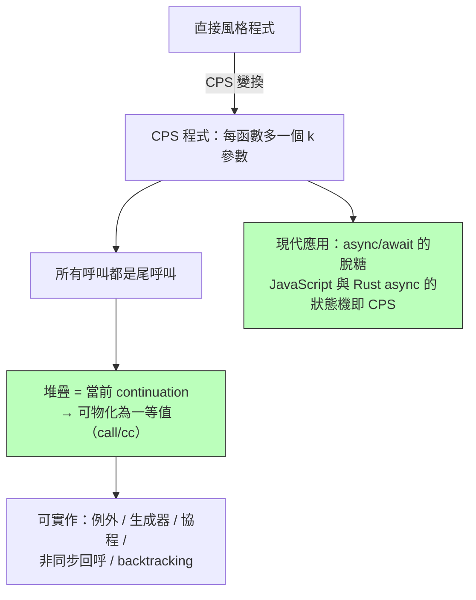

# 4.2 尾端呼叫與 continuation：CPS 變換

## 前言：函數式程式的棧恐懼

命令式語言用迴圈迭代，函數式語言用遞迴。但遞迴在系統層面是堆疊幀的累積——一百萬層遞迴就是一百萬個 frame。如果函數式語言想把迴圈完全表達為遞迴（第 1 章的理論要求），就必須解決：**呼叫者在呼叫後不再做事時，能不能不保留自己的 frame？** 這就是尾端呼叫（tail call）問題。更進一步：能不能把「程式接下來要做什麼」也變成一個值？——這就是 continuation。

## 尾端呼叫與尾端遞迴最佳化（TCO）

尾位置（tail position）= 函數回傳前的最後一個動作。若最後一個動作是呼叫，則呼叫者的 frame 不再被需要，可以**重用**：

```text
;; 尾遞迴：加法發生在遞迴回來之後 → 非尾
(define (sum n) (if (= n 0) 0 (+ n (sum (- n 1)))))   ; 棧深 O(n)

;; 累加器變換（accumulator transformation）：轉為尾形式
(define (sum n acc) (if (= n 0) acc (sum (- n 1) (+ n acc))))  ; 棧深 O(1)
```

Scheme 標準（R5RS/R7RS）**強制要求**實作「proper tail calls」——尾端呼叫不得消耗堆疊。這使 Scheme 中的遞迴就是迴圈：`(do ((i 0 (+ i 1)) ...))` 的 do 迴圈本身以尾遞迴定義。實作上，編譯器把尾呼叫編成 `jmp`（呼叫者 pop 參數後跳轉），而非 `call`。

| 語言 | TCO 保證 |
|---|---|
| Scheme/Racket | 標準強制 |
| ML/OCaml | 自身呼叫多數最佳化；相互遞迴視實作 |
| Haskell | 惰性圖規約本身不堆疊遞迴 |
| JavaScript ES6 | 規格寫了 PTC，但**只有 JSC 實作**（V8 因 devtools 彈出棧追蹤問題放棄）——著名規格與實作分歧 |
| Java/C++ | 無保證；GCJ 有 `@tailrec` 巨集、C++ 提案 P1064 未成 |

## Continuation：「接下來要做的事」的具象化

**Continuation** 是「從此刻到程式結束的剩餘計算」。用數學刻畫：任何表達式都在一個「洞」中等待填值：

$$
\text{在 } (1 + (\,3 \times \square\,)) \times 2 \text{ 中，} 3 \times \square \text{ 的 continuation 是 } \lambda v.\, (1 + v) \times 2
$$

把所有函數改寫成「多帶一個 continuation 參數，算完不回傳而是呼叫它」——**CPS 變換（continuation-passing style）**：

```scheme
;; 直接風格
(define (fact n) (if (= n 0) 1 (* n (fact (- n 1)))))

;; CPS 風格：每個函數多一個 k 參數；乘法也成為 CPS 呼叫
(define (fact n k)
  (if (= n 0) (k 1)
      (fact (- n 1) (λ v (k (* n v))))))

(fact 5 (λ v v))   ; 120 —— k 是「之後要做的事」
```

CPS 的威力：

1. **控制流顯式化**：回傳、例外（呼叫錯誤 continuation）、提前返回、生成器、協程——全部化為「呼叫哪個 continuation」的選擇，不再需要語言特別機制。
2. **所有呼叫皆尾呼叫**：CPS 變換後程式的每個函數呼叫都在尾位置——這正是 Scheme 實作「呼叫/CC 與一等 continuation」的理論基礎：`call/cc` 把「當前 continuation」打包成函數交給你，可以儲存、多次呼叫、跳回去。



## 程式碼：JavaScript 的 CPS 與 async 的聯繫

```javascript
// CPS：callback 風格就是有限度的 CPS！
const fact = (n, k) => n === 0 ? k(1) : fact(n - 1, v => k(n * v));
fact(5, console.log); // 120

// Node.js 的 callback(err, result) 慣例——兩個 continuation：
// 成功走 result，失敗走 err（例外 = 顯式錯誤 continuation）
fs.readFile("a.txt", (err, data) => err ? fail(err) : next(data));

// Promise/async：把 CPS 隱藏回語法糖
async function main() {
  const data = await fs.promises.readFile("a.txt"); // await = call with current continuation
  return next(data);
}
// 編譯器把 async 函數切成 await 點之間的區塊，存成狀態機——
// 這正是 CPS 變換的機械化：每個 await 之後的程式碼就是一個 continuation
```

Rust 的 `async` 編譯成 `Future` 狀態機、JavaScript 的生成器轉 Promise（co 函式庫時代），本質都是 CPS 變換由編譯器代勞。**工程師 2015 年之後寫的非同步程式，是 1970 年代 continuation 理論的工業化產物。**

## call/cc 與古典邏輯（與 2.3 呼應）

Scheme 的 `call/cc` 捕捉「當前 continuation」為可重入的一等值。Griffin（1990）證明：加入 call/cc 的型別系統恰對應**古典邏輯**（Peirce 律 $(A \to B) \to A \to A$ 的居民正是 call/cc）。實務上可重入 continuation 實作昂貴（需整個堆疊的複製或堆化），因此後代多改用**一次性行程**（one-shot continuation）：Lua coroutine、Haskell 的 `ContT`、Node 的 callback 都屬此類。

## 歷史意義與後續發展

1. **編譯器中間表示**：SML/NJ 的全程 CPS 表示（Appel, 《Compiling with Continuations》1992）、CPS + ANF 成為函數式編譯器的標準形態。
2. **例外與效應**：例外 = 錯誤 continuation；algebraic effects（Koka、OCaml 5 效果處理器）是 continuation 的現代正統繼承者。
3. **非同步革命**：async/await 的編譯技術直接源自 CPS；Go 的 goroutine 切換則是「continuation = 可重入棧」的轻量版本。
4. **教訓**：call/cc 的完整威力（可重入、跨跳）在實務中很少被用到，證明**理論構造的表達力超出工程需要**——但它的「化約能力」（一切控制流皆函數呼叫）永久改變了編譯器與非同步的設計。

## 重點整理

- 尾端呼叫可重用 frame；Scheme 標準強制 proper tail calls，遞迴即迴圈。
- 累加器變換把非尾遞迴轉為尾形式。
- CPS：把 continuation 顯式化為函數參數；所有呼叫皆尾呼叫，控制流全顯式。
- call/cc 把 continuation 物化為一等值；型別上對應古典邏輯（Peirce 律）。
- 現代遺產：例外、生成器、coroutine、async/await（編譯器 CPS）、效果系統。
