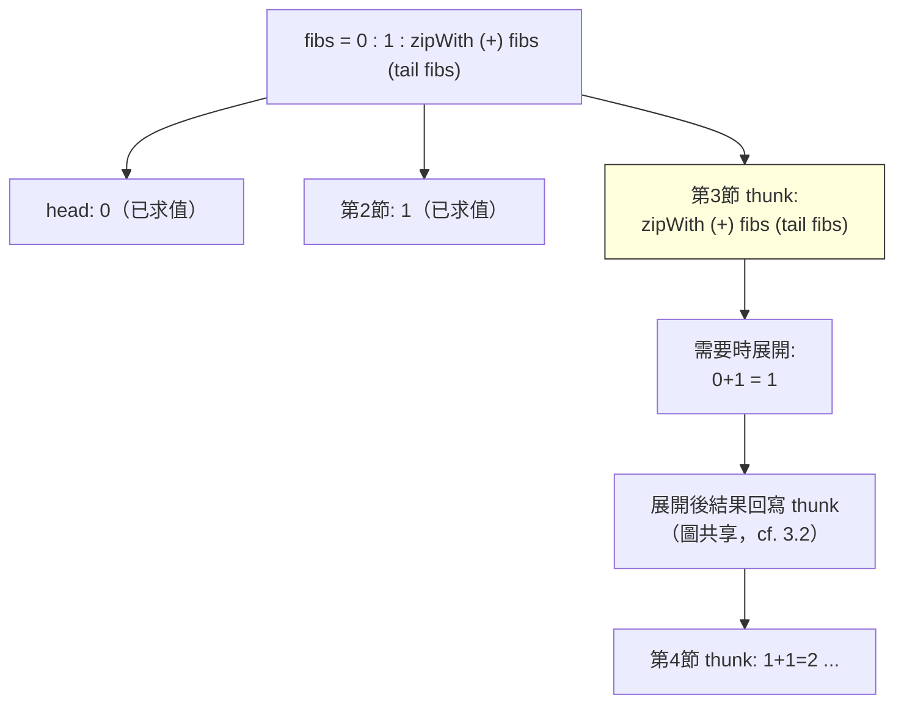

# 4.3 惰性串流與無限資料結構

## 前言：資料不必一次造完

命令式世界裡，「一個列表」意味著「先遍歷建好、再使用」。但數學中的序列（自然數、質數、黎曼 ζ 的部分和）本來就**無限**。若能讓資料結構「在需要時才長出下一節」，那麼無限物件、流式管線、貪心演算法都可以直接以數學式寫出。第 3.2 節已見 Haskell 的 `ones = 1 : ones`；本節深入**惰性串流（lazy stream）**的建構、操作、協變式計算與實作成本。

理論基礎：無限列表是遞迴方程 $L = a : L$ 的**最大不動點**（greatest fixed point）——與第 1.3 節「遞迴函數 = 最小不動點」成對。資料的最小不動點稱歸納型別（inductive），允許無限展開的最大不動點稱**共歸納型別（coinductive）**；證明無限列表的性質用的是**共歸納法**（不動點的觀察等價性），而非結構歸納。

## 核心技術：corecursion（共遞迴）

共遞迴不是「在更小的輸入上遞迴」，而是「從種子不斷長出下一步」：

```haskell
-- 迭代器：從種子 s 不斷套用 f
iterate f s = s : iterate f (f s)

nats     = iterate (+1) 0              -- [0,1,2,...]
fibs     = 0 : 1 : zipWith (+) fibs (tail fibs)
-- fibs 的定義引用自己稍後的版本：自引用的資料版（cf. 1.3 節 Y 組合子）

primes = sieve [2..]
  where sieve (p:xs) = p : sieve [x | x <- xs, x `mod` p /= 0]

take 10 fibs    -- [0,1,1,2,3,5,8,13,21,34]
take 5 primes   -- [2,3,5,7,11]
```

`fibs = 0 : 1 : zipWith (+) fibs (tail fibs)` 值得駐足：兩次自引用，靠 thunk 共享，第 $n$ 項在第一次需要時才合成——**這是 Y 組合子思想在資料結構上的重演：用不動點消解自我引用**。



## 串流的操作代數

無限串流的可用操作構成一個小代數（這個代數後來長成 ReactiveX 的運算子集）：

```haskell
-- 轉換與組合（皆惰性，O(1) 啟動成本）
map, filter, zipWith :: ...

-- 遞增與分頁（無限中取有限）
take 5, dropWhile (<100), span

-- 掃描：把「歷史累積」化為串流
scanl (+) 0 nats     -- [0,1,3,6,10,...] 三角數
```

實作層面的鐵律：**生產者與消費者的速度必須解耦**。消費一個、生產一個（pull 模型），整個管線常數空間；一旦「先收齊再處理」（如 `length xs` 之後又用 `xs`），就可能整條串流物化或造成第 3.2 節的空間洩漏。

## 程式碼：JavaScript 手寫惰性串流

```javascript
// 串流 = thunk(值, 下一個串流 thunk)
const Stream = (headFn, tailFn) => ({ head: headFn, tail: tailFn });
const cons = (h, tf) => Stream(() => h, tf);

const from = n => cons(n, () => from(n + 1));           // 無限自然數
const sMap = (f, s) => cons(f(s.head()), () => sMap(f, s.tail()));
const sFilter = (p, s) => {
  const go = st => p(st.head()) ? st : go(st.tail());
  return go(s);                                          // 丟棄不合格者
};
const sTake = (n, s) => {
  const out = [];
  let cur = s;
  for (let i = 0; i < n; i++) { out.push(cur.head()); cur = cur.tail(); }
  return out;
};

// 埃氏篩：與 Haskell 版同構
const sieve = s => {
  const p = s.head();
  return cons(p, () => sieve(sFilter(x => x % p !== 0, s.tail())));
};
console.log(sTake(10, sieve(from(2))));  // [2,3,5,7,11,13,17,19,23,29]
```

Python 生成器版本（主流語言的惰性最小實作）：

```python
from itertools import count, islice

def sieve(s):
    p = next(s)
    yield p
    yield from sieve(x for x in s if x % p)

print(list(islice(sieve(count(2)), 5)))  # [2, 3, 5, 7, 11]
```

## 歷史意義與後續發展

惰性串流的概念穿透了整個現代軟體：

1. **Unix 管線（1973, McIlroy）**：`cat log | grep ERROR | sort | uniq -c` 是串流組合的先聲——McIlroy 1964 年就寫下「把程式用管線接起來像花園水管」的備忘；Kahn（1974）的程序網絡語義與 Haskell 串流的語義同源。**Unix 管線與函數式串流是同一思想的兩個物種**。
2. **資料庫與大數據**：SQL 的游標、Kafka、Spark RDD 惰性變換鏈（到 action 才執行）、Java Stream 的惰性中介操作——「描述、延後、按需執行」三段式正是 thunk 的框架級翻版。
3. **ReactiveX 與 FRP**：把「串流」從資料推廣到**事件**（5.3 節），運算子 `map/filter/scan/merge` 直接繼承本節的代數。
4. **Python/JavaScript 的生成器**：ES6 的 `function*` 與 yield 是協程式惰性——呼叫者拉動、生產者懸掛，等價於本節的 thunk 串流但以棧切換實現。

回顧驅動關係：數學中的無限序列 → Turner 的惰性列表 → Unix 管線哲學互哺 → Spark/Stream/ReactiveX 的工業化。「無限」從邏輯學的禁忌，變成了資料工程的日常工具。

## 重點整理

- 惰性串流讓無限資料結構可行：只在需要時構造下一節，用完即棄。
- 共歸納：無限列表是最大不動點；`fibs` 的自引用靠 thunk 共享（資料版 Y 組合子）。
- 操作代數（map/filter/zip/take/scan）構成 ReactiveX 運算子集的祖先。
- 空間規律：pull 模型常數空間；過早物化或重複消費會觸發空間洩漏。
- 實作譜系：Haskell 原生、JavaScript/Python 生成器、Java Stream、Spark 惰性變換——同一思想的四種工業化。
