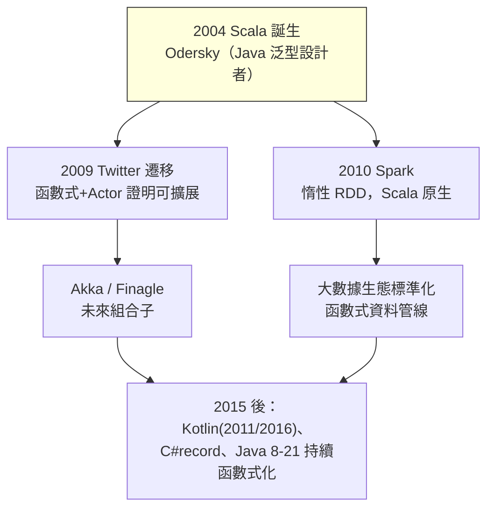

# 5.1 2004 Scala 與 JVM 上的函數式復興

## 前言：Java 世代的天花板

2000 年前後，Java 統治企業開發，但它有一個長期痛點：**語言演化緩慢**。泛型拖到 Java 5（2004）才有；函數字面量（lambda）要到 Java 8（2014）；不可變集合、模式匹配、型別推導更是遙遙無期。同時，多核心 CPU 崛起（2005 前後「免費午餐結束」，Sutter 的著名警告），「執行緒 + 鎖」的命令式共享狀態成為災難源。

Martin Odersky 的履歷使它成為破局者：他參與了 Java 泛型（JSR-14）與 Java 編譯器（javac）的設計。2003 年他先做 Funnel（學術實驗），2004 年推出 **Scala**——「Scalable Language」：跑在 JVM 上、與 Java 完全互操作、**把物件導向與函數式融合**。Odersky 的論證：函數式給你「代數與不可變」，物件導向給你「模組化與封裝」，兩者其實是正交的（ADT ≈ 封閉類別層級、method ≈ 函數記錄欄位），**沒有必要二選一**。

## Scala 的設計要點

1. **一切皆物件**：`1 + 2` 是 `1.+(2)`——運算子即方法，方法即函數值；
2. **函數是一等公民**：`val f: Int => Int = x => x * 2`，高階函數無需 Java 式的匿名類別樣板；
3. **型別推導 + 更強型別**：HM 風格推導、higher-kinded types（`F[_]`，能抽象「容器」本身——這是 5.2 節型別類的載體）、case class + 模式匹配（直接繼承 2.2 節 ADT）；
4. **trait 與 mixin 組合**：介面帶實作、可疊加，取代 Java 的單繼承限制；
5. **隱式（implicits）**：編譯器自動推導型別類實例的機制——功能強大（催生整個 Cats 生態）但也惡名昭彰（隱式地獄），Rust trait 與 Swift protocol 的設計都把 Scala implicits 當反面教材之一。

```scala
// 2004 年 Java 做不到的事，Scala 原生支援
case class Expr(n: Int)                       // ADT（cf. 2.2）
def eval(e: Expr): Int = e match { case Expr(n) => n }

val nums = List(1, 2, 3, 4)
val sq = nums.filter(_ % 2 == 0).map(x => x * x)   // 高階 + 惰性 View 可選
val sum = nums.foldLeft(0)(_ + _)                   // 尾遞迴友善的摺疊

@annotation.tailrec
def fact(n: Long, acc: Long = 1): Long =            // 編譯器驗證尾遞迴（cf. 4.2）
  if (n == 0) acc else fact(n - 1, acc * n)
```

## 惰性求值：call-by-name 與 lazy val

Scala 預設嚴格，但提供兩個受控的惰性機制：

```scala
def if2[A](c: Boolean)(t: => A, e: => A): A = if (c) t else e
//   參數型別 => A = call-by-name：每次使用都重新求值（thunk）

lazy val expensive = { /* 只算一次 */ }   // call-by-need：求值一次並快取（cf. 3.2）
```

這證實了 Haskell 之後的歷史走向：**惰性從「預設」降級為「庫與語法工具」**。

## 驗證範例：case class 與尾遞迴

```scala
sealed trait Shape                              // sealed = 編譯器窮舉檢查
case class Circle(r: Double) extends Shape
case class Rect(w: Double, h: Double) extends Shape

def area(s: Shape): Double = s match {
  case Circle(r) => math.Pi * r * r
  case Rect(w, h) => w * h
  // 少寫任何一個 case，編譯器報 warning —— cf. 2.2 節 exhaustive check
}
```

## JVM 上的函數式生態：從 Twitter 到 Spark

Scala 的商業轉折點是 **Twitter（2009）**：從 Ruby on Rails 遷移到 Scala，公開宣稱以函數式（不可變、actor、Futures）解決擴展性。此後：

- **Akka**（2009）：Actor 模型 + 不可變訊息，Erlang 思想的 JVM 化；
- **Twitter Util / Finagle**：Future 組合子（map/flatMap）——Monad 思想的分散式版本（cf. 3.3）；
- **Apache Spark（2010, AMPLab）**：RDD = 不可變分散式資料集 + 惰性變換鏈，Scala API 為原生語言。Spark 是 Backus「代數最佳化」論證的最大規模實踐：**只有無副作用的變換才能被安全地重新排程與容錯重算**；
- **Kafka、Flink**：串流處理的函數式運算子（cf. 4.3）。



## 歷史意義與後續發展

1. **倒逼 Java 函數式化**：Kotlin（JetBrains，2011 發表、2016 1.0、2017 成 Android 官方語言）以「更平滑的 Scala」自居：null safety、data class、lambda、擴展函數、協程。**Java 8 的 lambda 與 Stream API（2014）直接是 Scala 壓力的產物**；此後 Java 的 record（16）、sealed（17）、pattern matching（21）一路朝 Scala/Kotlin 形態靠攏。
2. **JVM 成為函數式主流平台**：沒有 Scala，函數式仍困在學術圈；Scala 證明「函數式思想可以在企業級、互操作、工具鏈成熟的世界存活」。
3. **implicits 的教訓**：Scala 3（2021）重新設計為 `given/using`，語意更受控——語言設計的迭代本身就是教科書。
4. **多核與資料的合流**：函數式復興的兩大動因——多核並行與大數據管線——都在 Scala 生態中獲得最完整的表達。

## 重點整理

- Scala（2004, Odersky）以「物件 + 函數融合、JVM 互操作」打開企業市場；Twitter（2009）遷移是其正名之戰。
- case class/match 繼承 ADT；higher-kinded types 承載型別類抽象；call-by-name 與 lazy val 提供受控惰性。
- Spark 的惰性 RDD 是「純度→可重排/可容錯」的工業級證明。
- Scala 的成功反哺 Java 8-21 與催生 Kotlin——函數式特徵成為 JVM 的標配。
- implicits 的教訓：強大的隱式推導需要更受控的語法（Scala 3 given/using、Rust trait）。
