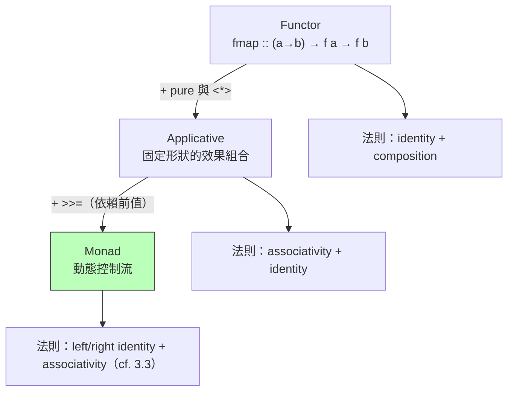

# 5.2 型別類、trait 與 Functor-Applicative-Monad 實務

## 前言：多型不夠用——「操作」也需要多型

到目前為止的多型都是**參數多型**（2.1 節）：`length :: [a] -> Int` 對所有 `a` 一視同仁。但實務常需要**依型別分派行為**：`show :: a -> String` 要對 Int、Bool、自訂型別有不同實作；`==` 要可比較。Haskell 1.x 用 ad-hoc 重載，混亂且不可擴充。1989 年 Wadler 與 Stephen Blott 提出**型別類（type class）**：把「一組操作」定義為型別上的約束，讓編譯器在編譯期分派。這是 ad-hoc 多型的系統化解法，也是 1990s Haskell 對程式語言理論的第二大輸出（第一大是 Monad）。

```haskell
class Eq a where
  (==) :: a -> a -> Bool

instance Eq Int   where x == y = primEqInt x y
instance Eq [a] where            -- 約束傳播：[a] 可比 ← a 可比
  []     == []     = True
  (x:xs) == (y:ys) = x == y && xs == ys
```

注意 `instance Eq [a]`：編譯器自動推出「可比較元素 ⇒ 可比較列表」。**約束傳播**使型別類具有代數組合性，這是 Java 介面做不到的（Java 泛型 2004 才補上 `T extends Comparable<T>` 的受限版本）。

## 從 Functor 到 Monad：抽象階梯

Scala trait / Rust trait / Java 介面承接了型別類的角色，而函數式實務把它們用在同一座「抽象階梯」上：

$$
\text{Functor} \;\subset\; \text{Applicative} \;\subset\; \text{Monad}
$$

```haskell
class Functor f where
  fmap :: (a -> b) -> f a -> f b          -- 「對容器內的每個值套用」

class Functor f => Applicative f where
  pure  :: a -> f a
  (<*>) :: f (a -> b) -> f a -> f b       -- 「包在容器裡的函數」

class Applicative m => Monad m where
  (>>=) :: m a -> (a -> m b) -> m b       -- cf. 3.3
```

三者能力的分界（關鍵在「後續計算能否依賴前面的值」）：

| 抽象 | 能做的事 | 實例 |
|---|---|---|
| Functor | 結構不變的映射 | `fmap` 於 Maybe/列表/Future |
| Applicative | **效果數量固定**的組合 | 同時解析多個欄位、zip 型合併 |
| Monad | **後續計算依賴前面結果**（效果數量可變） | 鏈式查詢、失敗短路、async |



## 程式碼：Rust trait 實作這座階梯

Rust 沒有 higher-kinded types，但以 GATs（generic associated types）可部分模擬；以下用最常見的 `Result` 展示 Monad 實務：

```rust
// Functor：map
let r: Result<i32, String> = Ok(3);
let r2 = r.map(|x| x * 2);                    // Ok(6)

// Applicative 風格：多個 Result 的固定組合
let a = Ok(2) as Result<i32, String>;
let b = Ok(40) as Result<i32, String>;
let c = a.and(b).map(|x| x + 1);              // Ok(41)

// Monad 風格：? 運算子 = bind 的語法糖（cf. 3.3）
fn parse_and_sqrt(s: &str) -> Result<f64, String> {
    let n: f64 = s.parse().map_err(|e| e.to_string())?;   // bind，失敗即短路
    if n < 0.0 { Err("negative".into()) } else { Ok(n.sqrt()) }
}
```

Scala/Cats 的版本更接近 Haskell 原貌：

```scala
import cats.implicits._

// Applicative：驗證多個欄位，累積所有錯誤（Monad 做不到！）
case class User(name: String, age: Int)
val v1: ValidatedNel[String, String] = "".validNel         // 假設來自輸入
val v2: ValidatedNel[String, Int]    = (-1).invalidNel
(v1, v2).mapN(User.apply)   // Invalid(NonEmptyList(...)) —— 錯誤同時回報
```

## 實務分界：什麼時候用哪一層

1. **能用 Applicative 就別用 Monad**：Applicative 結合律使組合可**靜態分析**（Free Applicative 用於優化、平行發射、解析器疊加）； Monad 的依賴性使一切必須序列化。
2. **驗證錯誤累積 vs 失敗短路**：Monad（`Either` 的 `>>=`）短路；Applicative（`Validated`）累積——表單驗證的標準答案。
3. **Tagless Final 風格（Scala）**：以 `F[_]: Monad` 抽象效應容器，程式不綁定具體 IO，測試換 `Id`/測試 monad——依賴注入的函數式版本。

## 歷史意義與後續發展

1. **Rust trait**（2010s）：型別類思想的系統語言化（`Iterator` 的組合子鏈、`?` 運算子、`From`/`Into`），並以 orphan rule 控制實例衝突——直接回應 Haskell 型別類的孤兒實例問題。
2. **Java/Swift/Kotlin**：`Stream.map`（Functor）、`Optional.map/flatMap`（Monad）、`flatMap` 進入 Java 介面——**Monad 成為方法名**，語法糖與抽象名稱已滲透到最企業的語言。
3. **Cats / ZIO / fp-ts / Arrow**：整個生態以 F-A-M 階梯為綱；TypeScript 的 fp-ts 與 Rust 的 `futures` 都在複製這套詞彙。
4. **理論延伸**：Functor-Applicative-Monad 之上還有 Traversable、Free Monad（語法樹與直譯器分離——CQRS/事件溯源的理論基礎）與 effect systems（5.3 及 3.3 的後續）。

一句話總結：**型別類把「抽象行為」變成可組合、可推導、可查表的一等公民；F-A-M 階梯則是 Moggi 計算理論（3.3）的實務化版本**——你今天寫的每個 `.map()`，都是 1989 年那篇論文的後代。

## 重點整理

- 型別類（Wadler & Blott, 1989）= 編譯期分派的 ad-hoc 多型，約束可傳播（`Eq a ⇒ Eq [a]`）。
- Functor → Applicative → Monad：能力差異在「後續是否依賴前值 / 效果數量是否可變」。
- 各層皆有代數法則；法則使組合可驗證、可最佳化（Free Applicative、fusion）。
- Applicative 可累積錯誤（表單驗證）、可靜態分析；Monad 短路、可動態控制流。
- Rust trait、Scala trait/Cats、Java flatMap 皆為此體系的實務化身。
