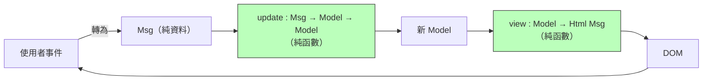

# 5.3 函數式反應式程式設計（FRP）與 Elm

## 前言：事件是「時間中的值」

GUI 與互動程式的本質痛點：**狀態會隨時間改變，而改變會經由回呼傳播**。命令式寫法中，一個按鈕的 disabled 狀態要由多個事件處理器各自手動同步——不一致的幽靈狀態到處滋生。1997 年，Conal Elliott 與 Paul Hudak（Haskell 的設計者之一）發表 **Fran**（Functional Reactive Animation），提出兩個時間性抽象：

- **Behavior**：連續的時間函數，$t \mapsto a$（如滑鼠位置）；
- **Event**：離散的事件串流，時間點上的值序列（如點擊）。

**FRP 的核心主張：把「時間變化的值」變成普通的一等值**——可以 map、filter、組合，就像第 4.3 節的串流，只是維度加了時間。如此一來「按鈕何時 disabled」不再是命令式同步，而是一個宣告式表達式：

```haskell
-- 概念式：buttonEnabled 永遠等於這個函數的當前值
buttonEnabled = not <$> isSavingBehavior <*>&& hasChanges
```

## Elm：把 FRP 做成一門語言，再把語言做成一個架構

**Elm**（Evan Czaplicki，2012 學位論文《Elm: Concurrent FRP for Functional GUIs》）把 FRP 推向實用。Czaplicki 的關鍵工程判斷：完整 FRP（時間連續、信號可自由組合）會造成取捨困難與意外組合，**不如收斂到極簡的模型**。Elm 經歷 0.8→0.17 的大改版，最終定型的模型只有兩個概念：

- **訊息（Msg）**：描述「發生了什麼」的純資料（ADT，cf. 2.2）；
- **單向資料流**：所有變化都沿同一條路走。

## Elm 架構（The Elm Architecture）：Model–Update–View

```elm
-- Elm 0.19
type Msg = Increment | Decrement | SetInput String

type alias Model = { count : Int, input : String }

update : Msg -> Model -> Model            -- 純函數：舊狀態+訊息 → 新狀態
update msg model =
  case msg of
    Increment       -> { model | count = model.count + 1 }
    Decrement       -> { model | count = model.count - 1 }
    SetInput s      -> { model | input = s }

view : Model -> Html Msg                  -- 純函數：狀態 → 視圖
view model =
  div []
    [ button [ onClick Decrement ] [ text "-" ]
    , text (String.fromInt model.count)
    , button [ onClick Increment ] [ text "+" ]
    ]

main = Browser.sandbox { init = { count = 0, input = "" }
                       , update = update
                       , view = view }
```



這個迴圈有驚人的工程性質：**除錯器可以記錄所有 Msg，重播任何歷史時刻**（Elm 的 time-travel debugger 2016）；**update/view 皆純 → 可測試性與可推理**；無空指標（Elm 型別系統無 null）。代價是樣板與表達力限制——但 Elm 團隊視「不會出錯」優先於「寫起來短」。

## 程式碼：同一架構的 JavaScript 化身

Elm 架構 2015 年後被前端世界整批吸收：

```javascript
// Redux（2015, Dan Abramov 自承架構直接源自 Elm）的縮影
const reducer = (state, action) => {          // = update
  switch (action.type) {
    case "increment": return { ...state, count: state.count + 1 };
    case "setInput":  return { ...state, input: action.payload };
    default:          return state;
  }
};
store.dispatch({ type: "increment" });        // = Msg
const ui = view(store.getState());            // = view（React render）

// RxJS：FRP 另一支（Elliott/Hudak 的串流血統）
const count$ = clicks$.pipe(scan(c => c + 1, 0));   // Behavior 的近似
count$.subscribe(c => el.textContent = c);          // scan = cf. 4.3 的 scanl
```

React（2013）雖非直接源自 Elm，但其「UI = f(state)、單向資料流、不可變更新」的哲學與 Elm 同構；Hooks 時代的 `useReducer` 就是 Elm 的 update 函數。**Elm 證明了「狀態模型可以整個函數式化」，然後整個前端生態搬走了它的模型。**

## 歷史意義與後續發展

1. **Fran（1997）→ Elm（2012）→ Redux（2015）/React 慣例**：FRP 的理論（Behavior/Event）被工程裁剪為「單向資料流 + 純 reducer」，成為前端的預設心智模型。
2. **RxJS/ReactiveX**：FRP 的另一支（事件串流血統，cf. 4.3），Bacon.js、Rx.NET→RxJS 影響了 Angular 的預設非同步模型。
3. **Elm 的型別輸出**：Elm 無 null、編譯器錯誤訊息友善（「此分支漏了 Increment」）——它的錯誤訊息設計成為 Rust、TypeScript strict 模式的標竿。
4. **伺服器端回聲**：Phoenix LiveView（Elixir）、htmx 的「以訊息/部分更新取代手動同步」同樣是單向資料流思想的伺服器版。

回顧本書的因果鏈，FRP 是最長鏈的終點之一：λ 演算（1936）→ Haskell 純度（1990）→ 串流代數（4.3）→ Behavior/Event（1997）→ Elm 架構（2012）→ Redux/React 生態（2015）→ 今天每個前端應用的狀態管理。**一個關於「時間中的值」的理論，最後變成了瀏覽器裡的日常。**

## 重點整理

- FRP（Elliott & Hudak 1997, Fran）：Behavior（連續時間函數）與 Event（離散串流），讓「隨時間變化的值」成為可組合的一等值。
- Elm（2012）以 Model–Update–View 單向資料流簡化 FRP：訊息是 ADT，update/view 皆純函數。
- 純度帶來時間旅行除錯、無 null 型別與頂級錯誤訊息。
- Elm 架構 → Redux/React useReducer；FRP 串流支 → RxJS/Angular。
- 命令式回呼同步被宣告式資料流取代——前端工程的一致性問題獲得代數解。
