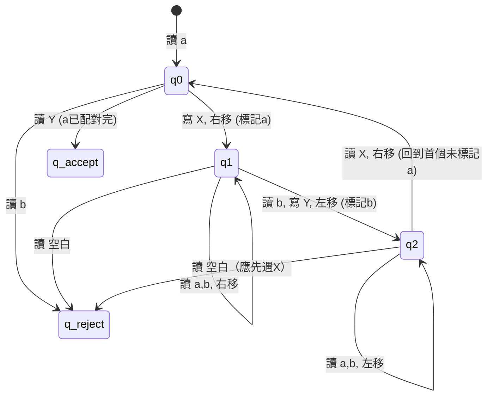

# 1.2 1936圖靈機與可計算函數

## 前言：為什麼需要圖靈機？

哥德爾不完備定理雖然劃定了形式系統的極限，卻並未直接回答希爾伯特的**判定問題（Entscheidungsproblem）**。要否定判定問題，關鍵在於精確定義「有效的機械程序（effective procedure）」是什麼。

1936 年，艾倫·圖靈（Alan Turing）發表了《論可計算數及其在判定問題上的應用》（*On Computable Numbers, with an Application to the Entscheidungsproblem*）。他提出的**圖靈機（Turing Machine）**，首次用一個極簡的抽象裝置刻劃了「人類在紙上遵循規則進行計算」的完整過程。

與同期的 $\lambda$ 演算（Church）和遞迴函數（Gödel–Kleene）相比，圖靈機最具直觀性：它模擬的是一個計算者，一步一步地讀寫紙帶上的符號，決定下一步該做什麼。這種對「人類計算行為」的分析，使圖靈機成為定義**有效可計算（effectively computable）**的最具說服力的模型。

## 圖靈機的基本定義

### 元件構成

一台標準圖靈機 $M = (Q, \Sigma, \Gamma, \delta, q_0, q_{accept}, q_{reject})$ 由以下部分組成：

- $Q$ ：有限的狀態集合（有限記憶）
- $\Sigma$ ：輸入字母表（ $\textvisiblespace \notin \Sigma$ 通常代表空白）
- $\Gamma$ ：紙帶字母表，且 $\Sigma \subseteq \Gamma$
- $\delta: Q \times \Gamma \to Q \times \Gamma \times \{L,R\}$ ：轉移函數，決定在 $(q, a)$ 時，寫入 $b$ 、移動至 $q'$ 、左右移動磁頭
- $q_0 \in Q$ ：初始狀態
- $q_{accept}, q_{reject} \in Q$ ：接受與拒絕狀態，兩者互斥且為「停機」狀態

### 運作模型

圖靈機的運作可想像為：

1. **紙帶（Tape）**：無限長的序列，初始僅輸入字串 $w$ 位於左端，其餘為空白 $\textvisiblespace$ 。
2. **磁頭（Head）**：讀寫紙帶上當前格子的符號，並可向左或向右移動一格。
3. **有限控制（Finite Control）**：根據當前狀態與讀到的符號，執行 $(q', b, D)$ ：將當前格子改寫為 $b$ 、切換到狀態 $q'$ 、向 $D \in \{L,R\}$ 移動。
4. **停機（Halt）**：一旦進入 $q_{accept}$ 或 $q_{reject}$ ，機器停止並給出判定結果。

圖靈機與實際電腦最關鍵的對比在於：實體電腦的記憶體有限，而**理論上的圖靈機假設紙帶無限**，此舉純粹是為了刻劃「只要時間允許、空間足夠，演算法原則上能做什麼」的計算能力邊界，而非模擬實體限制。

## 圖靈機的計算能力

### 可計算函數

對於函數 $f: \Sigma^* \to \Sigma^*$ ，若存在圖靈機 $M$ ，對每個輸入 $w$ ，最終停在 $q_{accept}$ 且紙帶內容為 $f(w)$ ，則稱 $f$ 為**圖靈可計算（Turing-computable）**的部分函數。若對所有 $w \in \Sigma^*$ 都停機，則稱為**全函數**。

### 可判定語言

一個語言 $L \subseteq \Sigma^*$ 稱為**圖靈可判定（Turing-decidable）**，若存在圖靈機 $M$ 對任意 $w$ ： $w \in L \implies M$ 接受； $w \notin L \implies M$ 拒絕。此類圖靈機又稱**決策器（decider）**。

若僅保證 $w \in L$ 時接受，但 $w \notin L$ 時可能永遠不停止，則稱為**圖靈可辨識（Turing-recognizable）**，亦稱**半可判定（semi-decidable）**。

## 圖靈機的狀態圖與運作範例

讓我們以最簡單的例子理解其運作：判定語言 $L = \{a^n b^n \mid n \ge 1\}$ 。直覺演算法是「交替消去最左邊的 a 與最右邊的 b」，若最終消盡且配對正確即接受。



此圖展示了有限狀態控制如何引導磁頭在紙帶上掃描、改寫、折返。雖然狀態數很少，卻足以檢查 $a^n b^n$ 這個非正則語言，清楚說明圖靈機的計算能力遠超有限自動機。

## 通用圖靈機（Universal Turing Machine）

圖靈最具革命性的構想之一，是**通用圖靈機 $U$ **。通用圖靈機能接受任意圖靈機 $M$ 與其輸入 $w$ 的編碼 $\langle M, w \rangle$ 作為輸入，並模擬 $M$ 對 $w$ 的整個運作過程。

形式上：

$$
U(\langle M, w \rangle) = \begin{cases}
\text{accept}, & \text{若 } M(w)=\text{accept}\\
\text{reject}, & \text{若 } M(w)=\text{reject}\\
\text{loop}, & \text{若 } M(w) \text{ 不停機}
\end{cases}
$$

這個觀念在現代看來極為自然（即「電腦能執行任何程式」），但在 1936 年卻是石破天驚的抽象：**一台固定的機器，竟能模擬任意計算程序**。

通用圖靈機的概念直接啟發了**儲存程式概念（stored-program concept）**。馮·諾伊曼在 1945 年《First Draft of a Report on the EDVAC》中明確地吸收了圖靈機的思想：將程式與資料一同存放在記憶體中，中央處理器依序解讀並執行指令。EDVAC 與後繼的 IAS 電腦正是這個思想的實現。可以說：**通用圖靈機是理論模型，馮·諾伊曼架構是工程實現**。

## 對角線法與停機問題的預告

圖靈在論文中運用哥德爾的對角線技術，證明了**停機問題（Halting Problem）**是不可判定的。簡要思路如下：

假設存在決策器 $H(\langle M, w \rangle)$ ，對所有 $M,w$ 判定 $M(w)$ 是否停機。構造一台對角機器 $D$ ：

$$
D(\langle M \rangle) = \begin{cases}
\text{loop}, & \text{若 } H(\langle M, \langle M \rangle \rangle)=\text{accept}\, (\text{即 }M(\langle M\rangle)\text{ 停機})\\
\text{accept}, & \text{若 } H(\langle M, \langle M \rangle \rangle)=\text{reject}\, (\text{即 }M(\langle M\rangle)\text{ 不停機})
\end{cases}
$$

現在考慮 $D(\langle D \rangle)$ ：若 $D(\langle D \rangle)$ 停機，則根據定義 $H(\langle D,\langle D\rangle\rangle)=\text{accept}$ ，故 $D(\langle D \rangle)$ 應該 loop——矛盾；反之亦然。因此 $H$ 不存在。

此處的自我指涉與哥德爾構造 $G$ 的邏輯結構幾乎同型：**都是利用對角線讓機器/公式審視自身行為，從而產生自我否定**。

## Church–Turing 論題

同期，阿隆佐·丘奇（Alonzo Church）提出了 $\lambda$ 演算作為另一種計算模型。克林（Stephen Kleene）則系統化了遞迴函數理論。令人驚奇的是，三種模型儘管定義截然不同，卻被證明在計算能力上**完全等價**：

- 圖靈機可計算 $\Leftrightarrow$ $\lambda$ 可定義 $\Leftrightarrow$ 一般遞迴函數可計算

基於此等價性，丘奇與圖靈獨立地提出了以下論斷：

> **Church–Turing 論題（Church–Turing Thesis）**：一個函數是有效可計算的，若且唯若它是圖靈可計算的（或等價地 $\lambda$ 可定義、一般遞迴函數）。

須特別指出：這不是一個可由數學證明的定理，而是一個**經驗性/哲學性論題**。其論據是：無論人們再提出任何其他精確的計算模型（暫存器機、RAM 機、現代程式語言、量子計算模型的經典部分等），其計算能力都不超過圖靈機。這個論題是計算理論的基石：**我們用圖靈機的計算能力界定了「演算法」的邊界**。

## 從圖靈機到實務的互相驅動

圖靈機的影響遠不止理論：

- **儲存程式概念**：通用圖靈機→馮·諾伊曼架構。現代電腦的核心原理幾乎全源自此。
- **自動計算的哲學**：圖靈在 1950 年的「機器能思考嗎」（Turing Test）一文中，進一步探討計算與智能的關係，直接促成 AI 領域的誕生。
- **程式語言理論**： $\lambda$ 演算不僅與圖靈機等價，更成為函數式語言（LISP、Haskell、ML）的數學基礎。編譯器實作也大量借鑑自自動機理論。
- **計算複雜性**：圖靈機成為度量「時間」「空間」資源的標準計算模型。多帶圖靮機、非確定圖靮機等變體，分別對應了現實硬體與複雜性類別的探討。
- **密碼學與安全**：不可判定性與計算困難性（complexity）成為現代密碼學的理論根基。若停機問題可判定，許多密碼假設也將不成立。

## 圖靈機模擬器的虛擬碼概念

為了具體理解通用圖靈機的精神，以下以偽代碼描述一個極簡的圖靈機模擬器核心邏輯：

```text
function simulate(TM M, string w):
  tape = list of w padded with blanks
  head = 0
  state = q0
  while state not in {q_accept, q_reject}:
    if head out of bounds: extend tape
    symbol = tape[head]
    (nextState, writeSym, dir) = delta(state, symbol)
    tape[head] = writeSym
    state = nextState
    head = head + 1 if dir==R else head - 1
  return state
```

儘管這段虛擬碼用現代資料結構表達，卻忠實反映了圖靈機的三大動作：讀、寫、移動。事實上，任何現代 CPU 指令集加上無限記憶體的抽象，原則上都足以模擬此迴圈。這正是 Church–Turing 論題最具說服力的直覺佐證。

## 小結

1936 年的圖靈機不僅為「有效計算」下了第一個精確定義，更為整個計算機科學奠定了形式基礎。通用圖靈機預示了可程式電腦的可能性，停機問題則開啟了不可判定性理論的大門。

從歷史的「互相驅動」觀點來看：**邏輯問題（判定問題）催生了計算模型（圖靈機），計算模型反過來啟發了工程實作（馮·諾伊曼架構），而工程實作最終又回饋理論，孕育出程式語言、編譯器與複雜性理論**。下一節將探討 $\lambda$ 演算、遞迴函數與 Church–Turing 論題如何將這三條路線統一成一體。