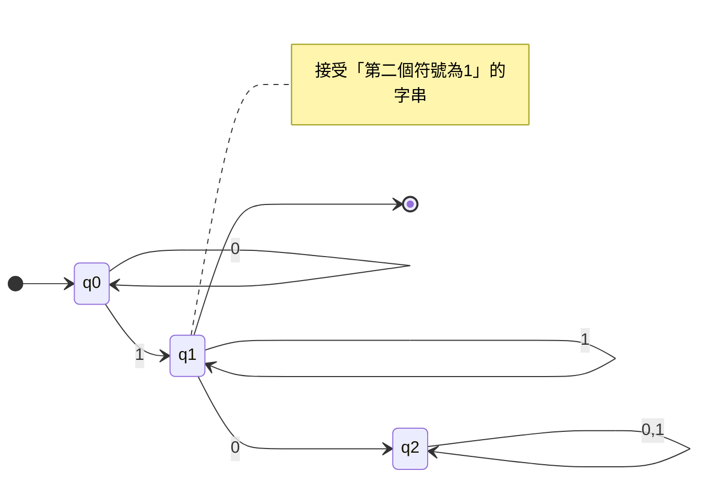
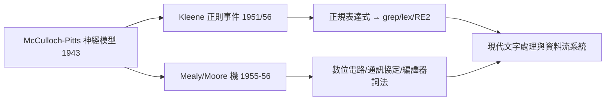

# 2.1 1943 有限狀態機：從神經模型到自動機

## 前言：大腦與計算的相遇

有限狀態機（Finite State Machine, FSM）的形式化，竟同時誕生於神經生理學的模型之中。1943 年，神經生理學家 McCulloch 與天才邏輯學家 Walter Pitts 發表〈神經活動中內在概念的邏輯演算〉，提出神經元的抽象模型：每個神經元是二值開關，收到足夠的激勵輸入就「放電」。他們證明：**這樣的神經網路可以實現命題邏輯**，而「帶時間延遲的網路」恰好對應於有限狀態自動機。

這篇論文的意義遠超神經科學：它首度把「記憶」刻劃為**有限狀態的迴圈**，把「計算」刻劃為狀態的轉移序列。1943 年，馮諾伊曼在給 Wiener 的信中稱讚這是「繼圖靈之後最重要的進展」。

## 有限自動機的形式定義

> **定義**：確定性有限自動機（DFA）是一個五元組 $M = (Q, \Sigma, \delta, q_0, F)$，其中 $Q$ 是有限狀態集、$\Sigma$ 是字母表、$\delta : Q \times \Sigma \to Q$ 是轉移函數、$q_0$ 是起始狀態、$F \subseteq Q$ 是接受狀態集。

擴充轉移函數至字串：$\hat{\delta}(q, \epsilon) = q$，$\hat{\delta}(q, wa) = \delta(\hat{\delta}(q, w), a)$。機器接受字串 $w$ 若 $\hat{\delta}(q_0, w) \in F$。被接受的字串集合 $L(M)$ 稱為 $M$ 認得的**語言**。

非確定性版本（NFA）允許 $\delta : Q \times \Sigma \to 2^Q$ 與 $\epsilon$-轉移：同一輸入可以有多條出路，只要**存在**一條路徑到達接受狀態就算接受。



## 關鍵性質：沒有記憶的計算

有限自動機與圖靈機的本質差別只有一個：**沒有可寫的儲存**。狀態集 $Q$ 是有限的，因此機器對「過去」的全部記憶被壓縮為固定數量的位元。這帶來兩個直接推論：

1. **必然停機**：讀入長度 $n$ 的輸入恰好走 $n$ 步——FSM 的所有判定問題都是可解的（連通性、空語言、等價性皆可在多項式時間解決）；
2. **能力受限**：任何需要「無限計數」的語言都超乎其外，例如 $\{0^n 1^n \mid n \ge 0\}$。

第 2 點的精確刻劃（泵引理、Myhill–Nerode 定理）是 2.3 節的主題；此處先看一個直觀論證：要記住「已讀入多少個 0」需要 $n$ 個不同的狀態，而 $n$ 無界、狀態有限——鴿籠原理必然使兩個不同計數落入同一狀態，之後機器再也無法區分它們。

## NFA 與 DFA：指數爆炸與等價性

NFA 看似強大（可以「猜」路徑），但 Rabin 與 Scott 在 1959 年證明：**NFA 與 DFA 語言能力完全相同**。轉換用**子集建構（subset construction）**：DFA 的狀態 = NFA 狀態的子集。

```python
def nfa_to_dfa(nfa):
    """子集建構：DFA 狀態為 NFA 狀態集合"""
    start = eps_closure(nfa, {nfa["start"]})
    dfa, worklist = {}, [frozenset(start)]
    seen = {frozenset(start)}
    while worklist:
        S = worklist.pop()
        dfa[S] = {}
        for a in nfa["alphabet"]:
            T = eps_closure(nfa, {t for q in S
                                   for t in nfa["delta"].get((q, a), [])})
            dfa[S][a] = T
            if T not in seen:
                seen.add(T); worklist.append(T)
    accept = {S for S in seen if S & set(nfa["accept"])}
    return dfa, accept
```

最壞情況下 $n$ 個狀態的 NFA 需要 $2^n$ 個 DFA 狀態（如「第 $n$ 個符號（倒數）是 1」的語言），但實務上大多數 NFA 轉出的 DFA 遠小於指數界——這個「最壞指數、平均溫和」的現象，是正規表達式引擎選擇直譯 NFA（如 RE2、Rust regex）或編譯 DFA（如 lex）的工程核心取捨。

## 從神經元到工程：FSM 的譜系

McCulloch–Pitts 模型經過數條路徑演化為現代工程實務：

- **Mealy 機（1955）與 Moore 機（1956）**：把輸出繫於「轉移」或「狀態」，成為數位電路設計（序列邏輯）的標準模型。今日 Verilog 中幾乎每個控制單元都是一個狀態機。
- **Kleene（1951/1956）**：在 McCulloch–Pitts 網路上定義「正則事件」，證明其與自動機等價——這是下一節的 Kleene 定理。
- **通訊協定**：TCP 的連線狀態（LISTEN/SYN_SENT/ESTABLISHED/…）是一張教科書級的狀態圖；編譯器的詞法分析器、UI 事件處理、遊戲 AI 的行為樹，本質都是 FSM。
- **神經網路的迴響**：McCulloch–Pitts 的神經元模型經 Rosenblatt 的感知器（1958）演化為今日的深度學習——歷史在八十年後繞了一圈：可微分的「狀態機」（神經圖靈機、state-space models）正在嘗試把兩支傳統重新合流。



## 虛擬碼：一個通用 DFA 直譯器

```c
/* DFA 直譯器：現代詞法分析器編譯產物的核心迴圈 */
typedef struct {
    int  n_states;
    int  (*delta)[ALPHABET];  /* delta[q][c] = 下一狀態, -1 為死狀態 */
    char accepting[128];
} DFA;

bool dfa_run(const DFA *m, const char *input) {
    int q = 0;                    /* 起始狀態 */
    for (const char *p = input; *p; p++) {
        int c = (unsigned char)*p;
        if (c >= ALPHABET) return false;
        q = m->delta[q][c];
        if (q < 0) return false;  /* 進入死狀態,提前失敗 */
    }
    return m->accepting[q];
}
```

注意這個迴圈每個輸入位元組只做**常數工作**、無分支預測噩夢、可完全展開——這就是為什麼高效能字串匹配（國際基因資料庫的比對、入侵偵測系統）至今仍以自動機為底層。

## 歷史意義與後續發展

- 有限自動機確立了「計算模型譜系」的研究方法：給機器加一個堆疊（→下推自動機，第 3 章）、加一條紙帶（→圖靈機），能力的階層隨資源而變。這個「資源換能力」的視角日後成為複雜性理論（第 5 章）的主旋律。
- 正則語言的理論直接商品化為 lex/flex、正規表達式、以及現代每個程式語言的 regex 函式庫。
- 在理論端，Büchi 自動機（1962）把 FSM 推廣到無限字串，成為模型檢查（model checking，Clarke/Emerson/Sifakis，2007 年圖靈獎）的基礎——晶片與軟體的形式驗證今日每年都在工業界擋下數千個設計錯誤。

## 重點整理

- FSM 起源於 1943 年 McCulloch–Pitts 的神經模型：記憶 = 有限狀態，計算 = 狀態轉移。
- DFA/NFA 定義正則語言；NFA 與 DFA 等價，子集建構最壞 $2^n$ 個狀態。
- FSM 無限記憶不可得：$\{0^n1^n\}$ 不可辨識，鴿籠原理是所有下界證明的原型。
- 工程譜系：神經模型 → Mealy/Moore 電路、Kleene → 正規表達式、TCP 協定與詞法分析。
