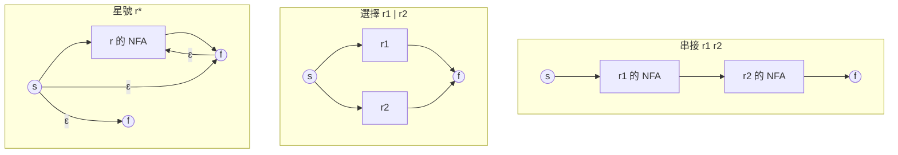
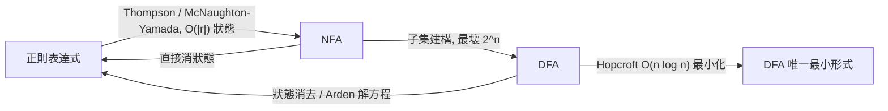

# 2.2 1956 Kleene 定理：正則表達式與自動機的等價性

## 前言：從「神經事件」到「正則表達式」

1951 年，Stephen Kleene 在 RAND 公司的報告中研究 McCulloch–Pitts 神經網路能「辨識」哪些事件，定義了**正則事件**（regular events）的代數描述系統。1956 年他將其發表為論文〈神經網路與自動機的表示事件〉，證明了本章最重要的等價性：

> **Kleene 定理**：語言 $L$ 可被有限自動機辨識 $\iff$ $L$ 可由正則表達式描述。

這個定理把「機器」（DFA/NFA）與「描述」（正則表達式）統一起來。其實務影響無遠弗屆：Ken Thompson 在 1968 年把正則表達式編譯為 NFA 而寫出 `ed` 的搜尋功能，直接催生了 `grep`（1974）與後來所有 regex 引擎——今天每個工程師每天使用的工具，理論基礎正是 1956 年的這篇論文。

## 正則表達式的語法

給定字母表 $\Sigma$ ，正則表達式歸納定義如下，每個表達式 $r$ 對應一個語言 $L(r)$ ：

| 構件 | 記法 | 語言 |
|---|---|---|
| 空語言 | $\emptyset$ | $\emptyset$ |
| 空字串 | $\epsilon$ | $\{\epsilon\}$ |
| 字元 | $a$ | $\{a\}$ |
| 串接 | $r_1 r_2$ | $L(r_1) \cdot L(r_2)$ |
| 選擇 | $r_1 \mid r_2$ | $L(r_1) \cup L(r_2)$ |
| 星號 | $r^*$ | $\bigcup_{n \ge 0} L(r)^n$ |

**例子**： $\Sigma = \{0,1\}$ 上的 $(0|1)^* 1 (0|1)$ 表示「倒數第二個符號是 1」的語言； $(0|1)^* 11 (0|1)^*$ 表示「某處出現連續兩個 1」。

## 方向一：正則表達式 → NFA（Thompson 建構）

1968 年 Thompson 的建構（思想可溯至 McNaughton–Yamada 1960）對表達式的語法樹做結構歸納，每個子表達式造出一個帶唯一起始與接受狀態的 NFA 片段：



片段之間用 $\epsilon$ -轉移黏合，總狀態數 $O(|r|)$ ——**線性於表達式長度**。這就是 Thompson 引擎的骨幹：

```python
def thompson_compile(r):
    """r 為解析好的語法樹, 回傳 NFA (狀態用遞增整數)"""
    match r:
        case ("char", c):
            s, t = new_state(), new_state()
            return s, t, {(s, c): {t}}
        case ("union", r1, r2):
            s1, t1, d1 = thompson_compile(r1)
            s2, t2, d2 = thompson_compile(r2)
            s, t = new_state(), new_state()
            d = {**d1, **d2,
                 (s, EPS): {s1, s2}, (t1, EPS): {t}, (t2, EPS): {t}}
            return s, t, d
        case ("concat", r1, r2):
            s1, t1, d1 = thompson_compile(r1)
            s2, t2, d2 = thompson_compile(r2)
            d = {**d1, **d2, (t1, EPS): {s2}}      # 直接相連
            return s1, t2, d
        case ("star", r1):
            s1, t1, d1 = thompson_compile(r1)
            s, t = new_state(), new_state()
            d = {**d1, (s, EPS): {s1, t}, (t1, EPS): {s1, t}}
            return s, t, d
```

## 方向二：NFA → 正則表達式（狀態消去法）

反向轉換經典方法是 **狀態消去法（state elimination）**（Brzozowski–McCluskey，簡化自 McNaughton–Yamada 1960）：逐步刪除自動機的內部狀態 $k$ ，每刪一個就用正則表達式「縫合」經過它的路徑：

$$
R_{ij} \mathrel{+}= R_{ik}\, (R_{kk})^*\, R_{kj}
$$

其中 $R_{ij}$ 是「從 $i$ 到 $j$ 、不經過更高編號狀態」的路徑標籤之正則表達式。演算法結束時， $R_{sf}$ 即為所求。這其實就是 **Floyd–Warshall 最短路徑演算法**把「加法換成並集、乘法換成串接」的版本——圖論與自動機在此共用同一個代數骨架（半環上的動態規劃）。

```python
def dfa_to_regex(dfa):
    """狀態消去法"""
    # R[i][j]: 從 i 到 j 的正則表達式 (字串)
    R = initial_edge_labels(dfa)          # 唯一起始 s, 加入新終態 f
    for k in all_inner_states(dfa):       # 逐一消去
        for i in range(len(R)):
            for j in range(len(R)):
                if R[i][k] and R[k][j]:
                    loop = R[k][k] or ""
                    R[i][j] = union(R[i][j],
                                    concat(R[i][k], star(loop), R[k][j]))
    return R[start][final]
```

## 方向三：DFA → 正則表達式的代數法（Arden 引理）

另一條路是**解線性方程組**。對每個狀態 $q$ 寫出語言方程：

$$
L_q = \bigcup_{a \in \Sigma} a \cdot L_{\delta(q,a)} \;(+\; \epsilon \text{ 若 } q \in F)
$$

**Arden 引理**：方程 $X = A X \mid B$ 且 $\epsilon \notin L(A)$ 有唯一解 $X = A^* B$ 。以高斯消去法解出 $L_{q_0}$ 即得答案。這個「代數觀點」日後在 KV/Brézouard 等理論中發展成完整的自動機代數。

## 等價性的完整地圖



注意右下角的重要事實：**每個正則語言有唯一的最小 DFA**（Myhill–Nerode 定理的推論，見 2.3 節），且可在 $O(n \log n)$ （Hopcroft 1971）時間求出。這給了等價性一個演算法化的表述：兩個正則表達式等價 $\iff$ 其最小 DFA 同構——**可判定且可計算**。

## 實務：grep 為何這樣設計

Thompson 1968 年的論文〈正則表達式搜尋演算法〉是實務驅動理論的典範。兩種引擎策略：

1. **回溯法（backtracking）**：直接在 NFA 上做 DFS，最壞 $O(2^n)$ ——Perl/PCRE/Python `re` 的做法，支援反向引用（backreferences）但可能災難性回溯（catastrophic backtracking）。
2. **自動機法**：NFA→DFA 後線性掃描， $O(n)$ 但最壞指數狀態——Thompson/grep/RE2/Rust regex 的做法，不支援反向引用但保證線性。

反向引用 $((a|b)\1)$ **超出正則語言**（它等於 $\{ww\}$ 的子集，證明需泵引理），因此自動機法天生不支援——理論邊界直接變成 API 差異。這是「理論刻劃能力邊界 → 工程師據此選型」的教科書案例。

## 歷史意義與後續發展

- **文字處理工業化**：grep、sed、awk、lex、PCRE、Rust regex——整條工具鏈建在 Kleene 定理之上。
- **字串演算法**：正則匹配的線性演算法推動了 Aho–Corasick（1975，多模式匹配）等資料結構，成為 IDS、殺毒引擎的核心。
- **資料庫與查詢**：SQL 的 `LIKE`、XPath、JSON Schema 的 pattern 都是正則語言的後裔；圖資料庫的 regular path queries 則把它推廣到圖上。
- **理論後續**：Kleene 定理確立了「描述 vs 機器」雙重視角，成為語言理論的方法論。Chomsky 階層（第 3 章）正是把這個方法推廣到各層語言的產物。

## 重點整理

- Kleene 定理：正則表達式 ≡ 有限自動機，三個方向各有標準建構（Thompson、子集建構、狀態消去/Arden）。
- Thompson 建構線性於 $|r|$ ；子集建構最壞 $2^n$ ；狀態消去法是 Floyd–Warshall 在半環上的化身。
- 最小 DFA 唯一存在，使「等價性」成為可判定且可計算的問題。
- Thompson 1968 → grep；引擎選型（回溯 vs 自動機）由理論能力邊界（反向引用非正則）直接決定。
