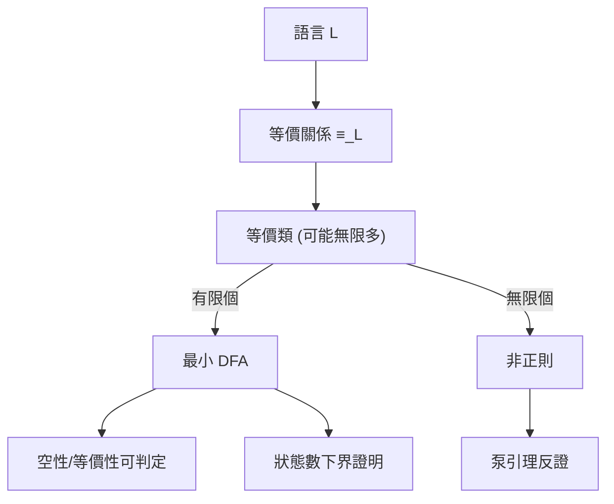

# 2.3 泵引理與 Myhill–Nerode 定理

## 前言：證明「不可能」的方法論

前兩節展示了有限自動機能做什麼；這一節回答同樣重要的問題：**如何證明它不能做什麼？** 這個問題不只是理論潔癖——工程師經常需要回答「這個日誌格式/這個 XML/這個協定能不能用 regex 處理？」，而能給出證明而非憑感覺，正是理論的價值。

證明不可辨識性有兩把標準武器，性格迥異：

1. **泵引理（pumping lemma，Bar-Hillel–Perles–Shamir 1961）**：反證法的武器，好用但只是必要條件；
2. **Myhill–Nerode 定理（1958）**：給出**充要條件**，既能證不可辨識，又能證狀態數下界、並導出最小 DFA 的唯一性。

## 泵引理

> **泵引理**：若 $L$ 是正則語言，則存在整數 $p \ge 1$ （泵長度），使得任何 $w \in L$ 、 $|w| \ge p$ ，都可寫成 $w = xyz$ 滿足：
> 1. $|xy| \le p$ ；
> 2. $|y| \ge 1$ ；
> 3. 對所有 $i \ge 0$ ， $x y^i z \in L$ 。

**證明（鴿籠原理）**：設 DFA 有 $p$ 個狀態。讀 $w$ 的前 $p$ 個符號至少經過 $p+1$ 個狀態（含起始），必有兩個狀態重複，設為讀完 $x$ 後與讀完 $xy$ 後的狀態。中段的 $y$ 把狀態「自環」帶回原處，故 $y$ 可重複任意次（ $i$ 次甚至零次）而不改變最終狀態。

```mermaid
flowchart LR
    q0((q0)) -- x --> qA((q))
    qA -- y --> qA
    qA -- z --> qF((qf))
    q0 -- "x(y^i)z" -.-> qF
```

### 應用：證明 $L = \{0^n 1^n\}$ 非正則

反證：設 $L$ 正則、泵長度 $p$ 。取 $w = 0^p 1^p \in L$ ， $|w| = 2p \ge p$ 。由條件 1,2， $y$ 完全落在前段的 0 之中： $y = 0^k$ ， $k \ge 1$ 。取 $i = 0$ ： $x z = 0^{p-k} 1^p$ ，其中 0 比 1 少——**不在 $L$ 中**，矛盾。故 $L$ 非正則。 $\blacksquare$

### 泵引理的陷阱

泵引理是**必要條件而非充分條件**：滿足泵性質的非正則語言存在（例如 $\{0^i 1^j \mid i \ne j\}$ 與其補集的組合巧妙構造）。用泵引理「證明正則」是經典錯誤。要證正則，請直接給出 DFA/NFA 或正則表達式。

## Myhill–Nerode 定理：右不變等價關係

換一個視角：與其問「機器有幾個狀態」，不如問「**有多少本質上不同的過去**」。定義字串 $x, y$ 的關係：

$$
x \equiv_L y \iff \forall z \in \Sigma^*: \; xz \in L \iff yz \in L
$$

即 $x$ 與 $y$ 作為「前綴」無法被任何後綴 $z$ 區分。這是 $\Sigma^*$ 上的等價關係，且**右不變**（ $x \equiv y \Rightarrow xz \equiv yz$ ）。

> **Myhill–Nerode 定理**：下列三數相等：
> 1. 認得 $L$ 的 DFA 的最小狀態數；
> 2. $\equiv_L$ 的等價類個數；
> 3. 任何認得 $L$ 的 DFA 的狀態數之下界。

**證明骨架**：任何 DFA $M$ 的狀態誘導出一個右不變等價（兩字串到達同一狀態則不可區分），其類數 $\le |Q_M|$ ，故 (3) ≥ (2)。反過來，用等價類本身當狀態，可構造認得 $L$ 的 DFA $\mathcal{D}_L$ ，其狀態數恰為 (2)，故 (2) ≥ (1)，且 $\mathcal{D}_L$ 是最小的、並在同構意義下唯一。

### 應用一： $\{0^n 1^n\}$ 的乾淨證明

考慮前綴 $0^0, 0^1, 0^2, \dots$ ：取 $z = 1^n$ ，則 $0^n z \in L$ 但 $0^m z \notin L$ （ $m \ne n$ ）。故 $0^i \not\equiv 0^j$ （ $i \ne j$ ），等價類無限多個 → **非正則**，且最小 DFA（若存在）需要無限多狀態。這個證明比泵引理更直接，且給出「為什麼」：**每個已讀入的 0 數都是一個不可合併的記憶狀態**。

### 應用二：狀態數下界

對 $\Sigma = \{0,1\}$ 上的語言「第 $n$ 個符號（從倒數數）為 1」：字串 $\epsilon, 0, 00, \dots, 0^{n-1}$ 兩兩可區分（後綴 $1 0^k$ 即可區分 $0^k$ 與 $0^{m}$ ），故任何 DFA 至少需要 $2^n$ 個狀態——這正是子集建構指數下界的獨立證明，也解釋了為何某些 regex 的 DFA 編譯註定爆炸。

## 虛擬碼：DFA 最小化（Hopcroft / 等價類合併）

Myhill–Nerode 的代數對應到演算法就是 **DFA 最小化**：反覆細分「行為相同」的狀態集合，直到穩定。

```python
def minimize_dfa(Q, Sigma, delta, q0, F):
    """Moore/Hopcroft 風格: 反覆分割等價類"""
    P = [set(F), set(Q) - set(F)]          # 初始: 接受 vs 非接受
    changed = True
    while changed:
        changed = False
        newP = []
        for S in P:
            # 按 (是否在F, 各字元落入的塊) 分組
            groups = {}
            for q in S:
                sig = (q in F,) + tuple(
                    block_of(P, delta[q][a]) for a in Sigma)
                groups.setdefault(sig, set()).add(q)
            newP.extend(groups.values())
            if len(groups) > 1: changed = True
        P = newP
    return P          # 每個塊 = 最小DFA的一個狀態 (Myhill-Nerode 類)
```

每輪迭代把區分性「向左傳播一格」；至多 $n$ 輪收斂，總時間 $O(n^2 |\Sigma|)$ （Moore）；Hopcroft 的巧妙分割策略達 $O(n \log n)$ （1971，至今近最優）。

最小化有重大實務價值：lex/flex 產生的表驅動詞法分析器、協定實作的狀態壓縮、以及**等價性檢查**（兩個 regex 是否等價？最小化後比較同構即可）。

## 正則語言的封閉性與判定性

Myhill–Nerode 視角還統一了正則語言的代數性質：

- **封閉性**：對並、串接、星號、補、交、反轉、同態皆封閉（NFA 建構 + De Morgan + 狀態翻轉）。
- **可判定性**：空性（從 $q_0$ BFS 是否可達 $F$ ）、有限性、等價性、包含性——全部多項式時間可解。
- **代數刻劃**： syntactic monoid（語法么半群，正是 $\equiv_L$ 的商）有限 $\iff$ $L$ 正則——Myhill–Nerode 的么半群表述，通往 Eilenberg 的自動機代數理論。



## 歷史意義與後續發展

- **下界技術的源頭**：鴿籠 + 區分集（distinguishing set）的論證模式被原樣移植到通訊複雜性（communication complexity）與電路下界——複雜性理論（第 5 章）中「證明某問題需要更多資源」的所有嘗試，精神上都是 Myhill–Nerode 的後代。
- **泵引理的譜系**：上下文無關語言也有泵引理（Bar-Hillel 1961 同一篇！），甚至有跳泵引理（ogden's lemma）等加強版；每個語言層級幾乎都有一個對應的「 pumping」式必要條件。
- **模型檢查與描述複雜性**：最小自動機的唯一性使「規格的規範形式」成為可能，支撐了硬體等價性檢查工具（如 Synopsys Formality）。
- **資料串流**：正則語言在串流上只需 $O(1)$ 記憶體——網路設備（NIDS）以硬體 DFA/FPGA 實作深度封包檢測，正是因為 Myhill–Nerode 保證了狀態空間有限（儘管可能大）。

## 重點整理

- 泵引理：正則語言的長字串必有可「泵」的中段 $y$ ；是必要條件，只能用於反證。
- Myhill–Nerode 定理：最小 DFA 狀態數 = $\equiv_L$ 等價類數 = 任何 DFA 的下界；給出充要條件。
- $\{0^n1^n\}$ 非正則的兩種證法中，Myhill–Nerode 版本揭示了本質：每個計數都是一個記憶狀態。
- DFA 最小化演算法（Moore/Hopcroft）是定理的計算化身，支撐詞法分析、等價性檢查與規格驗證。
