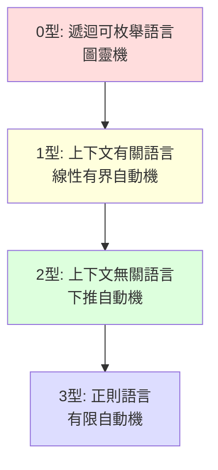

# 3.1 1956 Chomsky 階層：語言、文法與機器的對應

## 前言：語言學家闖進計算的世界

1956 年，MIT 的語言學家喬姆斯基（Noam Chomsky）發表〈語言描述的三模型〉。他的動機來自語言學而非計算機：行為主義把語言視為刺激—反應的集合，喬姆斯基反駁道——兒童能理解並產出**從未聽過**的句子，因此語言知識必是一套**有限規則生成無限句子的系統**，即「文法」。

要科學地比較不同文法的能力，需要一個分類框架。喬姆斯基按「生成規則受限的程度」把文法分為四型，並證明它們分別對應四種計算模型。這個 **Chomsky 階層**意外地成為語言學、計算機科學、編譯器工程三界通用的地圖。

## 四型文法與對應機器

文法 $G = (V, \Sigma, P, S)$ ：非終端符號集 $V$ 、終端符號集 $\Sigma$ 、生成規則 $P$ 、起始符號 $S$ 。四型的差別只在生成規則的形式限制：

| 型別 | 規則形式 | 語言類 | 認知機器 |
|---|---|---|---|
| 3 型（正則） | $A \to aB$ 或 $A \to a$ | 正則語言 | 有限自動機 |
| 2 型（上下文無關） | $A \to \alpha$ （左端單一非終端） | CFL | 下推自動機 |
| 1 型（上下文有關） | $\alpha A \beta \to \alpha \gamma \beta$ （ $|\gamma| \ge |A|$ ） | CSL | 線性有界自動機 |
| 0 型（無限制） | 任意 $\alpha \to \beta$ | 遞迴可枚舉語言 | 圖靈機 |



每往下一型，規則多一個限制、機器少一項資源、語言類嚴格縮小。**資源與能力的對應**是這張表最深刻的訊息：

- 正則：有限狀態（無記憶體）；
- CFL：一個堆疊（後進先出，無隨機存取）；
- CSL：長度受限的紙帶；
- r.e.：無限紙帶。

## 為什麼堆疊恰好配上下文無關？

考慮語言 $\{a^n b^n\}$ ：正則失敗（2.3 節證明），因為需要無限計數。但「一個堆疊」就夠了：讀到 $a$ 就壓入、讀到 $b$ 就彈出一個配對——堆疊的深度就是計數器。**後進先出**恰好匹配巢狀結構（`((()))`、HTML 標籤、`if...{...}` 內嵌 `if...{...}`）。

反過來，語言 $\{ww \mid w \in \{a,b\}^*\}$ （先讀一半、後半比對）需要**先進先出**或隨機存取，一個堆疊不夠——CFL 也有它的極限（3.2 節用 CFL 泵引理證明）。

自然語言正是這張地圖最好的測試場：英語的 center-embedding（"The rat the cat the dog chased killed died"）需要無界巢狀，接近但可能超出 CFL 的描述範圍——這場「自然語言是否 CFL」的辯論（Shieber 1985 對瑞士德語的著名證明）至今仍啟發著計算語言學。

## 生成文法 vs 自動機：兩種等價描述

Chomsky 階層的每一層都有「描述」與「機器」兩面，與 Kleene 定理（2.2 節）的方法論一脈相承：

- **正則層**：正則表達式 ≡ DFA/NFA（Kleene）；
- **CFL 層**：上下文無關文法 ≡ 下推自動機（Chomsky 1956；Chomsky–Schützenberger 1963 完整證明）；
- **CSL 層**：文法 ≡ 線性有界自動機（Kuroda 1964）；
- **r.e. 層**：文法 ≡ 圖靈機（即「文法生成 ≡ 計算」）。

雙視角各有用途：**文法**適合人類撰寫規格（BNF、編程語言手冊），**自動機**適合演算法分析（判定、解析、複雜度）。

## 無限語言與有限規則：文法的本質

所有四型文法都是**有限的規則集**，卻能生成**無限**的語言——靠的是**遞迴規則**。例如正則文法 $S \to aS \mid b$ 生成 $a^*b$ ；CFL 文法

$$
S \to a S b \mid \epsilon \quad \text{生成 } \{a^n b^n\}
$$

「非終端符號在推導中再生自己」正是遞迴的文法化身，與 1.3 節 Y 組合子的自我應用、哥德爾的自指句遙相呼應：**無限來自有限的自指**。

## 虛擬碼：文法推導與語言枚舉

```python
def derive(grammar, target, max_depth=20):
    """廣度優先枚舉 0 型文法的推導 (判定問題的樸素半演算法)"""
    frontier = [grammar["start"]]
    for depth in range(max_depth):
        for sym_seq in frontier:
            if sym_seq == target:
                return True                     # 找到推導
        frontier = [rewrite(g, pos)             # 套用每條規則於每個位置
                    for g in frontier
                    for rule in grammar["rules"]
                    for pos in match_positions(g, rule)]
    return "unknown"     # 注意: r.e. 語言的成員判定無演算法全解!

def rewrite(seq, pos):
    lhs, rhs = pos.rule
    return seq[:pos.i] + rhs + seq[pos.i + len(lhs):]
```

注意 `unknown` 分支的深意：對 0 型文法，成員問題是半可判定的（屬於則可枚舉到，不屬於則可能跑不完）；對 1 型（CSL）成員問題是**可判定的**（PSPACE 完全）；對 2 型是 $O(n^3)$ 可解（3.3 節 CYK）；對 3 型是線性。**語言層級 = 解析問題的複雜度階層**——這正是喬姆斯基分類對工程最實用的預測力。

## 歷史意義與後續發展

- **BNF 與 ALGOL 60**：喬姆斯基的同事、語言學家 Victor Yngve 與 MIT 的關係，使 BNF（Backus–Naur Form，1959–1960）直接採用了上下文無關文法的記法。ALGOL 60 報告用 BNF 定義了史上第一個**形式化語法**的程式語言——程式語言從此有了數學規格（3.2 節詳述）。
- **編譯器結構**：詞法分析（正則）與語法分析（CFL）的分工直接來自階層的頭兩層——「能將就就便宜」是工程鐵律：能用 regex 就不用 parser。
- **形式驗證**：1 型與其上的文法理論發展成重寫系統（term rewriting）、程式分析的字串抽象。
- **語言學之外**：生物序列（RNA 二級結構是 CFL！）、圖像文法、音樂理論，都借用 Chomsky 階層描述結構層次。

## 重點整理

- Chomsky 階層按規則限制分四型，對應正則/CFL/CSL/r.e. 語言，機器為 FSM/PDA/LBA/圖靈機。
- 每一層 = 「多一項記憶資源」；堆疊配巢狀結構正是 CFL 的本質。
- 遞迴規則使有限文法生成無限語言——與自指、遞迴函數一脈相承。
- 層級直接決定解析複雜度：線性／立方／PSPACE／不可判定，BNF 與 ALGOL 60 把 CFL 層商品化。
