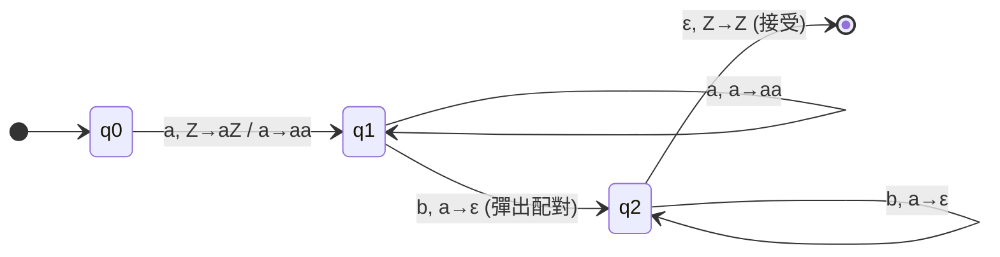
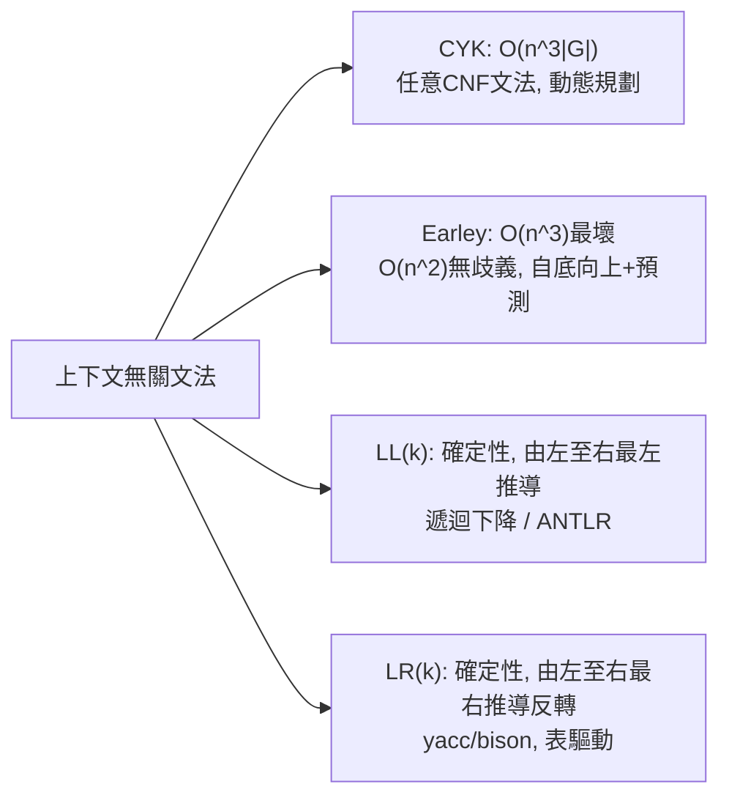

# 3.2 下推自動機與 ALGOL 60 的語法革命

## 前言：FORTRAN 之後，語言需要一張「身分證」

1957 年 FORTRAN 問世，證明了高階語言可行，但它有一個尷尬的問題：**FORTRAN 沒有精確的語法定義**——它的「標準」就是 IBM 的實作。工程師想寫另一家的編譯器，只能逆向工程 IBM 的編譯器行為。

1958 年，歐美聯合委員會啟動 ALGOL 計畫，目標是設計一門「演算法的通用語言」。1958 年 Zurich 報告仍有含糊之處；1960 年巴黎會議產出的 **ALGOL 60 報告**做出劃時代決定：用 **BNF（Backus–Naur Form）**把整個語言的語法**形式化**。Backus 在 1959 年的演講中引入此記法（受 Emil Post 系統與 Chomsky 工作的影響），Peter Naur 將其整理進報告。

這份報告的另一個關鍵發現是：ALGOL 60 的語法**不是正則的**——它有巢狀的 begin/end、有 `{a^n b^n}` 式的宣告配對。程式語言正式跨入了**上下文無關**的世界，而解析它的機器就是**下推自動機**。

## 下推自動機（PDA）

> **定義**：非確定性下推自動機是七元組 $M = (Q, \Sigma, \Gamma, \delta, q_0, Z_0, F)$ ，其中 $\Gamma$ 是堆疊字母表、 $Z_0$ 是初始堆疊符號，轉移函數為
> $$\delta : Q \times \Sigma_\epsilon \times \Gamma_\epsilon \to 2^{Q \times \Gamma^*}$$
> 依「當前狀態、輸入符號、堆疊頂」決定「新狀態、堆疊頂的替換字串」。

PDA = 有限自動機 + 一個堆疊。**非確定性**是本質的：對 CFL 而言 NDA 嚴強於確定性 PDA（例：偶回文 vs 需要中途猜中點的語言），這與正則層「NFA≡DFA」形成鮮明對比——也是為什麼「確定性 CFL 語言（DCFL）」是 CFL 的真子集，而 LR(1) 恰好刻劃 DCFL（見 3.3 節）。

### 例：認得 $\{a^n b^n\}$ 的 PDA



虛擬碼版（堆疊操作顯式化）：

```text
STACK := [Z0];  state := q0
讀入 a: push(a)             # 記帳
讀入 b: if STACK.top() == a then pop() else reject
輸入結束: accept iff STACK == [Z0]
```

### 文法 ⇄ PDA 的互換

Chomsky–Schützenberger（1963）證明 CFL ≡ NDA：

- **文法 → PDA**：以「廣度優先猜測最左推導」模擬——堆疊上放待展開的文法符號，非確定性選規則；終端符號與輸入比對。
- **PDA → 文法**：以「堆疊高度為 2 的片段」為非終端，構造規則 $[p A q] \to a [r B s]$ 對應 PDA 的單步轉移（三重歸納證明，教科書最難的建構之一）。

## ALGOL 60：BNF 與語法革命的細節

ALGOL 60 報告用 BNF 寫下如下的文法（節選，符號 `::=` 即今日的 `→`）：

```text
<程式>       ::= <區段> | <複合敘述>
<複合敘述>   ::= begin <敘述串列> end
<敘述串列>   ::= <敘述> | <敘述串列> ; <敘述>
<敘述>       ::= <無條件敘述> | <for敘述> | <程序敘述>
<無條件敘述> ::= <指定敘述> | <複合敘述> | <if敘述> | ...
<if敘述>     ::= if <布林式> then <無條件敘述>
```

注意 `<複合敘述> ::= begin <敘述串列> end`：敘述串列中又可出現複合敘述——**遞迴巢狀**，正則文法寫不出來（正則文法只能右線性遞迴，無法配對 begin/end）。這一個規則就把程式語言推進了 CFL 層。

ALGOL 60 還留下兩個影響深遠的遺產：

1. **遞迴程序**：ALGOL 60 是第一個原生支援遞迴的主流語言（FORTRAN 明文禁止），其代價是引發堆疊框架（stack frame）的設計——Dijkstra 與 Bauer 的「實作遞迴需要執行期堆疊」報告，催生了現代呼叫慣例。
2. **程式語言的數學化**：語法有 BNF、語意靠報告文字——前者大成功，後者的模糊處（call-by-name 的確切含義）反而刺激了指稱語意學（Scott–Strachey）的誕生。

## 解析：從「識別」到「建造語法樹」

PDA 是**識別器**（回答是/否），但編譯器需要**解析器**（產生推導樹）。實務演算法分兩大陣營：



- **LL**：自頂向下，適合手寫遞迴下降（GCC 前端、clang 部分採用）；
- **LR**：自底向上，表驅動，由工具自動產生（yacc/bison，1975）；
- **CYK/Earley**：一般化、可處理歧義文法，用於自然語言處理。

詳情在 3.3 節展開；此處的理論重點是：**LR(k) 恰好刻劃確定性 CFL（Knuth 1965）**——即「一個堆疊 + 逐符號前瞻 + 不回溯」能解析的最大語言類。編譯器工程師說「我的語言是 LALR(1)」，其實是在報告它在 Chomsky 階層與確定性子層級中的確切位置。

## CFL 泵引理：證明 $\{ww\}$ 不是上下文無關

> **CFL 泵引理**（Bar-Hillel–Perles–Shamir 1961）：若 $L$ 是 CFL，存在 $p$ 使任何 $w \in L$ 、 $|w| \ge p$ 可寫成 $w = uvxyz$ ，滿足 $|v y| \ge 1$ 、 $|vxy| \le p$ ，且 $u v^i x y^i z \in L$ 對所有 $i \ge 0$ 。

**應用**：證明 $L = \{ww \mid w \in \{a,b\}^*\}$ 非 CFL。取 $w = 0^p 1 0^p 1 0^p$ （更精確的教科書取法為 $w = 0^p 1^p 0^p 1^p$ 的變體）；泵之中段 $vxy$ 長度 $\le p$ ，至多觸及兩個「段」，故泵浦後 $v,y$ 只在某兩段內增長，破壞四段的 0/1 計數對稱——矛盾。 $\blacksquare$

實務意涵：**形如 $w w$ 的重複檢查不能只用一個 CFG 表達**。這解釋了為什麼程式語言都把「變數先宣告後使用」「型別匹配」這類**上下文條件**從語法中剝出來，交給**語意分析**（符號表）處理——Chomsky 階層再一次直接劃定了編譯器的分工。

## 歷史意義與後續發展

- **編譯器理論成形**：ALGOL 60 的 BNF + PDA 理論 + LR 分析（Knuth 1965, DeRemer 1969–71）構成「編譯原理」教科書的語法章節，五十年不變。
- **工具化**：yacc（Johnson, 1975）把 LR 生成自動化，UNIX 的 shell、C 編譯器、無數 DSL 由它而生；今日 ANTLR、Lark、bison 仍活躍。
- **自然語言處理的迴流**：Earley 演算法（1970）原為解析自然語言而生；統計革命後 CFG 被機率化（PCFG），再到今日的神經解析器——但 CYK 的動態規劃結構仍在解碼演算法（如 PCR 錨點）中復活。
- **理論深化**：確定性 CFL、視覺圖文法、多堆疊自動機（embarrassingly， $\{ww\}$ 可被兩個堆疊辨識）——「堆疊數 vs 語言能力」的研究持續到今日（trains of stacks、深生成模型）。

## 重點整理

- PDA = FSM + 堆疊；NDA≡CFL（Chomsky–Schützenberger），且非確定性在此層有本質威力。
- ALGOL 60 用 BNF 形式化語法，證明程式語言本質是 CFL（巢狀 begin/end 超出正則）。
- LR(k)=確定性 CFL（Knuth），LL/LR/CYK/Earley 是解析的四象限；語意檢查因 $ww$ 非 CFL 而被迫分層。
- ALGOL 60 引發遞迴 + 執行期堆疊、指稱語意學、yacc 三條工程與理論的支線。
