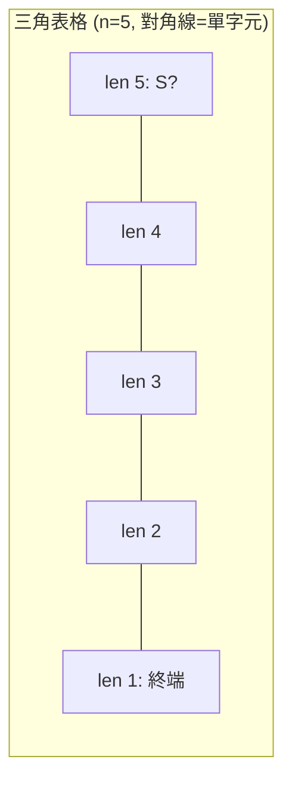
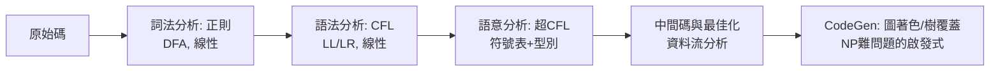

# 3.3 CYK、Earley 與 LR 分析的編譯器理論

## 前言：把「解析」變成演算法

有了文法（描述）與 PDA（機器），工程師還缺一樣東西：**高效的解析演算法**——把原始碼字串變成語法樹，且要快、要能定位錯誤、要能處理歧義。1950 至 1970 年代，三條獨立的研究線給出了三個劃時代答案：

1. **CYK**（Cocke–Younger–Kasami，1960–61）：任意 CFL 的 $O(n^3)$ 動態規劃，理論基準；
2. **Earley**（1970）：一般化的自頂向下表格法，無歧義文法可達 $O(n^2)$；
3. **LR(k)**（Knuth 1965，DeRemer 的 LALR 實用化 1969–71）：線性時間的確定性解析，成為 yacc 的心臟。

三者共同的方法論是**表格法（chart parsing）**：把「部分解析結果」記在二維表中，避免重複計算——這正是 1.3 節 μ 算子之外的另一面：**用空間換取對非確定性的控制**。

## CYK 演算法

前提：文法先轉為 **Chomsky 範式（CNF）**——所有規則形如 $A \to B C$ 或 $A \to a$（任何 CFG 可多項式轉換）。核心遞迴式：

$$
T[i, j, A] = \bigvee_{i < k < j} \bigvee_{A \to B C} \big( T[i, k, B] \wedge T[k, j, C] \big)
$$

$T[i,j,A]$ 表示「子字串 $w_i \dots w_{j-1}$ 可由 $A$ 推導」。按子串長度由短到長填表，答案看 $T[0, n, S]$。



```python
def cyk(grammar, tokens):
    """grammar: CNF 文法, 回傳可否推導 (含建樹可擴充)"""
    n = len(tokens)
    T = [[set() for _ in range(n + 1)] for _ in range(n + 1)]
    for i, tok in enumerate(tokens):                     # len 1
        T[i][i + 1] |= {A for A, rhs in grammar.items()
                        if tok in rhs}
    for span in range(2, n + 1):                         # 子串長度
        for i in range(n - span + 1):
            j = i + span
            for k in range(i + 1, j):                    # 切分點
                for A, rhs in grammar.items():
                    for B, C in rhs:
                        if B in T[i][k] and C in T[k][j]:
                            T[i][j].add(A)
    return grammar["S"] in T[0][n]                       # 或 T[0][n]

# 動態規劃結構與 Floyd-Warshall、矩陣乘法同構:
# 三重迴圈 = (切分點, 生成規則, 關聯測試)
```

CYK 是**完全泛用**的：任何 CFG 都能處理，因此成為自然語言解析（搭配 PCFG 的 Viterbi 版本）、RNA 二級結構預測（Nussinov 演算法同一骨架）的基礎。$O(n^3 |G|)$ 的成本在編譯器裡太奢侈，但作為理論基準與歧義文法的兜底方案不可取代。

## Earley 演算法：帶預測的自頂向下表格法

Earley（1970）不要求範式，用「Earley 項」$(A \to \alpha \cdot \beta, i)$ 表示「從位置 $i$ 開始、期望匹配 $\alpha \beta$、目前 $\alpha$ 已完成」。三個操作：

```python
def earley(grammar, tokens):
    n = len(tokens)
    chart = [[] for _ in range(n + 1)]
    chart[0].append(Item("S'", "· S", 0))
    for i in range(n + 1):
        j = 0
        while j < len(chart[i]):
            item = chart[i][j]
            if item.at_dot_is_nonterminal():            # 預測
                for rule in grammar[item.next_sym()]:
                    add(chart[i], Item(rule, "·rhs", i))
            elif item.at_dot_is_terminal():             # 掃描
                if i < n and tokens[i] == item.next_sym():
                    add(chart[i+1], item.advance())
            else:                                        # 完成
                for it in chart[item.start]:
                    if it.at_dot_is(item.lhs):
                        add(chart[i], it.advance())
            j += 1
    return any(it.lhs == "S'" and it.dot_at_end()
               and it.start == 0 for it in chart[n])

# 複雜度: 一般 O(n^3); 無歧義文法 O(n^2); 幾乎所有
# 程式語言文法 O(n) — Earley 自適應, 只在歧義處付代價
```

Earley 的「預測」使它自頂向下避免了與目標無關的推導（CYK 會白算），而「完成」操作使它不會陷入左遞迴（純 LL 的死穴）。它是**自適應**的：文法越接近確定性，跑得越快。

## LR(k)：Knuth 的定理與 yacc 的誕生

Knuth 1965 年的論文〈論從左至右的語言翻譯〉定義了 **LR(k)**：由左至右掃描、以**最右推導的反向**歸約、前瞻 $k$ 個符號。他的兩大定理：

> 1. LR(k) 文法恰可由確定性下推自動機（DPDA）解析——LR(1) = DCFL。
> 2. LR(k) 解析是線性時間，且任何 LR(k) 文法等價於某 LR(1) 文法（對語言而言 LR(1) 已完備）。

Knuth 的原始建構表太大（$2^n$ 量級），實用化由 DeRemer（1969：SLR；1971：LALR）完成。**LALR(1)** = 先合併同核心狀態、再求前瞻集——表大小從指數壓到 $O(n)$ 級，代價是可能多出「歸約—歸約衝突」（錯誤較晚發現）。1975 年 Johnson 把 LALR(1) 包裝成 **yacc**，從此「寫文法 → 自動得解析器」成為工程常態。

### LR 的移進—歸約循環

```mermaid
flowchart LR
    S[狀態堆疊 + 符號堆疊] --> M{action 表}
    M -- shift --> P1[讀入符號 push 狀態]
    M -- reduce "A→β" --> P2[彈出 |β| 個符號<br/>push A, goto 表查新狀態]
    P2 --> M
    M -- accept --> OK[語法樹完成]
    M -- error --> E[報告錯誤位置]
```

```text
例: 文法 E → E + T | T,   T → num
輸入 num + num 的棧演變 (LR 歸約 = 最右推導倒帶):
  [num]        shift          → T   reduce T→num
  [T +]        shift +
  [T + num]    shift          → T   reduce T→num
  [T + T]      reduce E→E+T   → E   accept
```

### LL vs LR：兩種工程哲學

| | LL(k) | LR(k)/LALR |
|---|---|---|
| 推導方向 | 最左 | 最右（反向） |
| 需要消除左遞迴 | 是 | 否 |
| 錯誤定位 | 早且清楚 | 稍晚（LALR 衝突） |
| 典型工具 | 手寫遞迴下降、ANTLR | yacc、bison |
| 能力 | 真子集 | LR(1) = DCFL（最強確定性） |

實務上兩者都在線性時間內完成；選擇取決於錯誤訊息品質（LL 優）、文法自由度（LR 優）與工具鏈。現代趨勢（如 Go、Rust、clang）回歸**手寫遞迴下降**——工程師願意為精確的錯誤提示與 IDE 支援付出人力。

## 編譯器理論的完整分工

Chomsky 階層把編譯器前端的每一站都分配到了正確的理論層級：



而且**後端不止於解析**：暫存器配置是圖著色（NP 完全）、指令選擇是樹覆蓋（NP 難）——編譯器工程師在 Chomsky 階層的「可解區」完成前端，在「NP 難區」用啟發式完成后端。第 5 章的複雜性理論將解釋為什麼後端只能啟發式。

## 歷史意義與後續發展

- **yacc 與 UNIX 文化**：文法即程式（declarative spec）的哲學影響了整個工具鏈設計；GNU bison、SQL parser、shell 語法皆 LALR。
- **LL 的文藝復興**：遞迴下降 + PEG（parsing expression grammar, Ford 2004）在 DSL 與現代編譯器中復活——「理論最強」與「工程最適」的張力永存。
- **GLR 與歧義解析**：Tomita（1984）把 LR 表擴展為可分叉的圖結構（GLR），處理歧義文法，用於自然語言與程式碼搜尋（如 Sourcegraph）。
- **理論統一**：CYK = 半環上的矩陣乘法；解析複雜度與布爾矩陣乘法等價（Valiant 1975：把 CFG 成員判定歸約到矩陣乘）——今日最快的 CFG 解析速度跟著矩陣乘法的突破走。

## 重點整理

- CYK：CNF + 區間動態規劃，$O(n^3|G|)$，全泛用；與 Floyd–Warshall/矩陣乘法同構。
- Earley：預測+掃描+完成的表格法，自適應複雜度，無歧義 $O(n^2)$、多數程式文法 $O(n)$。
- Knuth 1965：LR(k)=DPDA=DCFL，線性解析；DeRemer LALR(1) 壓表實用化 → yacc(1975)。
- 編譯器前端各站按階層配理論（regex/CFG/超CFL），後端最佳化落入 NP 難域而改用啟發式。
