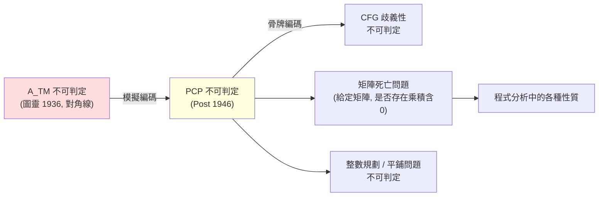

# 4.2 1946 Post 對應問題與歸約技術

## 前言：一個「撲克牌」遊戲藏著不可判定性

Emil Post 在 1946 年發表〈遞迴不可解性的一個一般形式〉，提出了一個表面上是「拼字遊戲」的問題。**Post 對應問題（Post Correspondence Problem, PCP）**：給定有限組「骨牌」，每張骨牌上半與下半各寫一個字串，例如：

| | $t_1$ | $t_2$ | $t_3$ | $t_4$ |
|---|---|---|---|---|
| 上 | `ab` | `b` | `a` | `baa` |
| 下 | `a` | `aba` | `b` | `a` |

問題：能否挑出骨牌序列（**允許重複**），使上排串接等於下排串接？上例有一解：$t_1 t_2 t_1 t_3$：上排 `ab b ab a` = `abbaba`，下排 `a aba a b` = `aabaab`？逐一核對：上 `ab|b|ab|a` = `abbaba`，下 `a|aba|a|b` = `aabaab`——不相等，讀者可自行搜尋正確解（此例實際可解，解為 $t_1 t_3 t_2 t_1 t_4$ 等多種）。

Post 證明了一個驚人的事實：

> **定理（Post 1946）**：PCP 不可判定。

PCP 的價值不在自身，而在它作為**歸約的中繼站**：它形式簡單到令人發笑（比「圖靈機模擬」簡單得多），卻完整保留了不可判定性。1946 年之後，無數不可判定性證明都走「圖靈機 → PCP → 你的問題」這條流水線。**歸約（reduction）從此成為不可判定性理論的標準生產技術**。

## 歸約：不可判定性的接力棒

> **定義（多一歸約）**：$A \le_m B$ 意謂存在可計算函數 $f$ 使 $w \in A \iff f(w) \in B$。

推論鏈：$A \le_m B$ 且 $B$ 可判定 → $A$ 可判定。逆否形式（本節主角）：

$$
A \text{ 不可判定} \;\land\; A \le_m B \;\Longrightarrow\; B \text{ 不可判定}
$$



每一次歸約都是一次「**把計算編碼進目標問題的結構裡**」的創造。PCP 之後，理論家常把某新問題先歸約到 PCP（省去重造圖靈機模擬），如同用現成的插座而不必重接發電廠。

## PCP 不可判定的證明骨架

直接證明需把圖靈機的**計算歷史**編碼進骨牌。技術要點（以 $\text{PCP} \ge A_{TM}$ 方向，即從 $A_{TM}$ 歸約到 PCP）：

1. 對輸入 $\langle M, w\rangle$，構造一組骨牌，其上下串接分別代表「$M$ 在 $w$ 上的計算歷史」與「合法檢查後的歷史」；
2. 每張骨牌編碼一步轉移：配置 $uqv$（$q$ 為狀態、讀寫頭在 $q$ 右側）到下一步配置的片段；
3. **上排領先、下排追趕**的設計：開始骨牌使上排多一個「#」，下排的轉移骨牌逐步把上排的配置「複製並更新」成下一配置；只有當 $M$ **接受**（出現接受配置）時，特殊骨牌才能讓兩排最終追平；
4. 因此：$M$ 接受 $w$ $\iff$ 存在匹配序列。

這個「讓兩排賽跑、接受時才能平手」的技巧，是所有計算歷史編碼證明（包括 Cook–Levin 中對時間軸的排列，5.2 節）的共同核心。

## 修改版 PCP 與 CFG 歧義性

**MPCP（修改版）**：要求匹配序列以第一張骨牌開頭。Post 證明 $\text{PCP} \le_m \text{MPCP}$、$\text{MPCP} \le_m \text{PCP}$（$A_{TM} \le_m \text{MPCP}$ 更直接），故兩者同樣不可判定。

經典應用——**CFG 歧義性不可判定**（Cantor–???；正式歸約見 Floyd 1962）：

- 對給定 PCP 實例 $\{t_i, b_i\}$，構造文法生成語言 $\{ t_{i_1} t_{i_2} \cdots t_{i_k} \, \mathtt{c} \, (i_1 i_2 \cdots i_k)^R \}$ 與 $\{ b_{i_1} \cdots b_{i_k} \, \mathtt{c} \, (i_1 i_2 \cdots i_k)^R \}$ 的並集；
- 並集文法歧義 $\iff$ 存在字串使上排 = 下排 $\iff$ PCP 有解。

工程意涵：**不存在演算法能把所有歧義文法改寫成無歧義文法**——LR 生成器（yacc）報告的「衝突」若無法手動消解，有時是**數學上不可能自動解決**的，工具只能啟發式警告。

## 不可判定性的其他著名出口

從 PCP（或直接從 $A_{TM}$）出發的歸約清單，展示這條流水線的覆蓋面：

| 問題 | 不可判定性來源 | 備註 |
|---|---|---|
| CFG 歧義性 | PCP | Floyd 1962 |
| 兩個 CFG 交是否空 | CFG 泵引理/PCP | CFL 交運算會掉出 CFL |
| 矩陣死亡問題（$4 \times 4$ 整數矩陣半群） | PCP | Paterson 1970 |
| Wang 平鋪問題（給定磁磚能否平鋪平面） | 圖靈機模擬 | Berger 1966 |
| Hilbert 第十問題（丟番圖方程整數解） | 遞迴函數理論 | Matiyasevich 1970 |
| 一階邏輯有效性 | $A_{TM}$ | Church–Turing 1936 |

**Hilbert 第十問題**值得特別一提：是否存在演算法判定任意多項式方程 $p(x_1,\dots,x_n)=0$ 是否有整數解？Matiyasevich（補齊 Davis–Putnam–Robinson 的框架）證明：**每一個 r.e. 集合都是某個丟番圖方程的解集**。這把「計算」與「數論」焊接起來——不可判定性滲透到最古老的數學問題之中。

## 虛擬碼：PCP 求解器的邊界

對**有限深度**的 PCP，可以廣度優先搜尋：

```python
def pcp_search(tops, bottoms, max_len=64):
    """半演算法: 有解則可找到, 無解則可能跑不完
       (PCP 不可判定 => 無法既完備又必然終止)"""
    from collections import deque
    q = deque([(0, 0, [])])          # (上排長, 下排長, 骨牌序列)
    while q:
        up, down, seq = q.popleft()
        if up == down and seq:
            return seq               # 找到匹配
        if up >= max_len or down >= max_len:
            continue                 # 剪枝 (啟發式, 非完備)
        for i, (t, b) in enumerate(zip(tops, bottoms)):
            if up == 0 or down == 0 or True:
                # 關鍵: 部分匹配才值得擴展——上下排一長一短時,
                # 短的一方必須是長方的前綴, 否則此分支永死
                nu, nd = up + len(t), down + len(b)
                if prefix_compatible(t, b, up, down):
                    q.append((nu, nd, seq + [i]))
    return None
```

「prefix_compatible 剪枝」在實務上大幅加速（許多分支立即可判死），但**不能**提供完備性保證——最壞情況搜尋無界。這正是不可判定性在工程上的真實面目：可以更聰明，不能更完備。

## 歷史意義與後續發展

- **方法論標準化**：Post 之後，「不可判定」不再需要每次從圖靈機徒手模擬；歸約使不可能性證明變成**可組合的工程**。
- **朝上與朝下**：同樣的歸約技術反轉後成為**複雜性理論**的核心——NP 完全（5.2 節）就是「歸約 + 語言類」的乘積；Karp 1972 年的 21 個問題清單是 Cook–Levin 之後的 PCP 式中繼站。
- **密碼學**：公鑰密碼學的安全性證明是「歸約」的正面用途——「若能破解則可解某難題」。歸約同時是**不可能性**（不可判定、下界）與**可靠性**（安全歸約）的通用語法。
- **PCP 的出人意表後代**：理論電腦科學中另有一個縮寫 PCP——**Probabilistically Checkable Proof**（機率可驗證證明，1990–92）。PCP 定理（$\mathrm{NP} = \mathrm{PCP}(O(\log n), O(1))$）用「常數次查詢即可驗證 NP 證明」重新證明了近似難度，成為 2000 年後難度理論的基石——兩個 PCP 皆源自 Post 的問題意識：**證明/匹配可以被多麼壓縮地檢查**。

## 重點整理

- PCP：骨牌上下串接匹配問題，Post 1946 證明不可判定；形式極簡，是歸約的理想中繼站。
- 多一歸約 $A \le_m B$ 傳遞不可判定性；計算歷史編碼（賽跑+接受時平手）是通用技術。
- 出口清單：CFG 歧義性、矩陣死亡、平鋪、Hilbert 第十問題、一階邏輯有效性——皆為 PCP/$A_{TM}$ 的後代。
- 歸約技術向下產出不可判定性清單，向上反轉為 NP 完全與密碼學安全證明的方法論。
