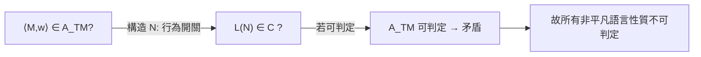
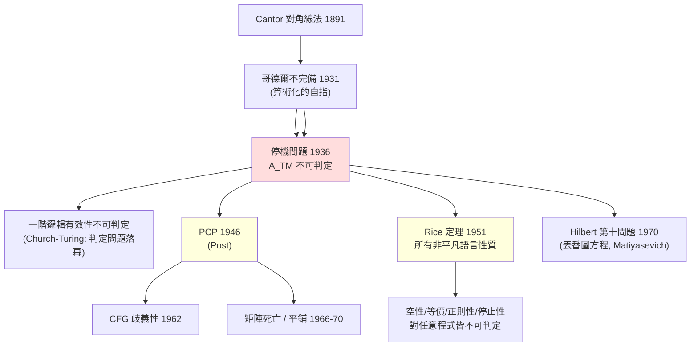

# 4.3 1951 Rice 定理與不可判定問題全景

## 前言：一個定理終結一整類問題

到 1950 年代初，人們已陸續證明停機問題、判定問題等不可判定。每證一個都要重新設計歸約，勞師動眾。1951 年，Henry Rice 發表了一個震撼性的「總結算」：

> **Rice 定理**：設 $\mathcal{C}$ 是圖靈機語言的任一**非平凡**性質（即：有些 r.e. 語言具有 $\mathcal{C}$ 、有些不具），則
> $$L_{\mathcal{C}} = \{ \langle M \rangle \mid L(M) \in \mathcal{C} \}$$
> 不可判定。

翻譯成工程語言：**任何一個只關心「程式做什麼」（語言行為）而不關心「程式怎麼寫」（語法實現）的問題，都不可判定。** 空語言？不可判定。等於某特定語言？不可判定。是不是正則？不可判定。會不會輸出 42？不可判定。Rice 定理一擊把整個程式行為分析的領域宣告為「一般無解」。

## 證明：歸約技術的漂亮示範

證明只用兩個固定語言作為錨點。設 $\mathcal{C}$ 非平凡，取 $\emptyset \notin \mathcal{C}$ 與某個 $L_0 \in \mathcal{C}$ （取反可假設其一；若 $\emptyset \in \mathcal{C}$ 則對補性質論證）。

給定 $\langle M, w \rangle$ ，構造機器 $N$ ：

```text
N(x):
    先模擬 M(w) (若不停機, N 也不停機)
    模擬結束後, 跑 L0 的枚舉器, 逐字輸出
```

則 $L(N) = L_0$ （若 $M$ 接受 $w$ ）或 $L(N) = \emptyset$ （若不停機）。故：

$$
\langle M, w \rangle \in A_{TM} \iff L(N) \in \mathcal{C} \iff \langle N \rangle \in L_{\mathcal{C}}
$$

若 $L_{\mathcal{C}}$ 可判定，則 $A_{TM}$ 可判定，矛盾。 $\blacksquare$

構造的精髓：把「停機與否」**藏進**一個行為開關——不停機時 $N$ 的語言是空的、停機時是 $L_0$ 。任何語言性質都會被這個開關觸動，因此無一倖免。



## 定理的精確適用範圍（工程師必讀的細則）

Rice 定理有三個常見誤用，值得劃清界線：

1. **只適用語言性質**。語法性質可判定：「這個程式有沒有 10 行以內」可判（看原始碼）；「變數命名是否符合規範」可判。靜態分析中**所有**能做的檢查，幾乎都是語法/結構性質。
2. **只適用 r.e. 語言的全體圖靈機**。限定模型後可判定：正則表達式的等價性、CFG 的空性皆可解——第 2、3 章正是這些「島嶼」。
3. **不否定半判定**。 $L(M) = \emptyset$ 不可判定，但其「正例」半可判定（枚舉直到接受即知非空）；反之空性不能半判定。Rice 的精細版（r.e. 索引集的算術階層位置，Myhill 1955、Shapiro）告訴你每個性質落在 $\Sigma_k$ 的哪一層——「有多不可判定」本身就是可測量的。

## 不可判定問題全景圖

把 1936–1970 年代的主要不可能定理排成一張譜系圖：



各行都可再往下延伸（程式終止性、等價性、緩衝區溢位判定、Android app 行為驗證……），但骨架不變：**對角線發明一次，歸約複製到處**。

## 為什麼理論仍然有建設性：可判定的島嶼

Rice 定理的「毀滅性」反而是設計的指南針。它逼出了四條系統性的退路，每一條都長成了獨立的技術工業：

### 退路一：換模型（抽象解釋 / 抽象域）

程式的**精確**行為不可判定，但**保守近似**可以。抽象解釋（Cousot & Cousot 1977）把無限狀態映到有限抽象域（符號 ±、區間、多面體），保證**終止**且**只會誤報、不會漏報**——安全分析的語意就是「寧可錯殺」。

### 退路二：限資源（有界驗證）

「 $n$ 步內是否接受？」可判定（直接模擬）。Bounded Model Checking 把驗證問題變成 SAT 求解；只要接受「僅覆蓋 $n$ 步內的行為」，就重獲完備性。

### 退路三：限結構（模型檢查）

有限狀態系統 + 時序邏輯規格（CTL/LTL）：模型檢查（Clarke–Emerson–Quielle 1981; Sifakis）**完全可判定**且可自動生成反例，工業化為硬體驗證標配（2007 圖靈獎）。其擴展（pushdown 系統、timed automata 的 PSPACE 可判定性）持續把島嶼外擴。

### 退路四：限義務（半決策與證明輔助）

不讓機器「自動判定」，讓它**檢查人給的證明**：證明檢查是可判定的（機械地驗證每一步），因此 Coq/Lean 能承載不可判定的真理——人機分工繞過 Rice 定理。這條線直接追溯到哥德爾：定理不可證明性是「全自動證明」的牆，而「證明可機檢」是另一扇門。

```text
Rice 定理 → 不可判定的汪洋
   ├─ 換模型:   抽象解釋 (Astrée 驗證 Airbus 航電, 零漏報)
   ├─ 限資源:   BMC → SAT/SMT (CBMC, KLEE)
   ├─ 限結構:   模型檢查 (SPIN, NuSMV, 工業硬體驗證)
   └─ 限義務:   證明檢查器 (Coq 驗證 CompCert 編譯器, seL4 核心)
```

## 歷史意義與後續發展

- **靜態分析與軟體工程的邊界**：每個 linter/分析器工具的說明書其實都在回答「這檢查是語法性質（Rice 不適用）還是行為性質（只能啟發式）」。soundness–completeness–decidability 三角是程式分析理論的公理。
- **安全性**：Rice 定理 ⇒ 不存在判定「此程式惡意」的演算法 ⇒ 防毒、入侵偵測、混淆與反混淆的軍備競賽是**數學必然**，不是技術暫時落後。
- **資料庫與知識表示**：一階邏輯不可判定，但 SQL 的 SELECT（實為邏輯子集）可判定——查詢語言的設計就是「圈島嶼」；Datalog、描述邏輯（OWL 的子集）皆是可控片段。
- **人工智慧**：「判定任意程式是否對齊人類價值」也是語言/行為性質——對齊理論家援引 Rice 定理論證全自動對齊驗證不可能，必須退到退路四（形式規格 + 人類監督）。

## 重點整理

- Rice 定理：任何非平凡的「語言性質」（行為性質）對圖靈機全體不可判定；證明是「行為開關」歸約。
- 三條適用細則：只管行為、只管圖靈機全體、不管半判定性——誤用常見，細則即指南。
- 四條建設性退路（換模型/限資源/限結構/限義務）分別長成抽象解釋、BMC、模型檢查、證明檢查器。
- Rice 定理把「不可能」從一個個定理升級為**全域地圖**，直接塑造靜態分析、安全與形式驗證的工程格局。
