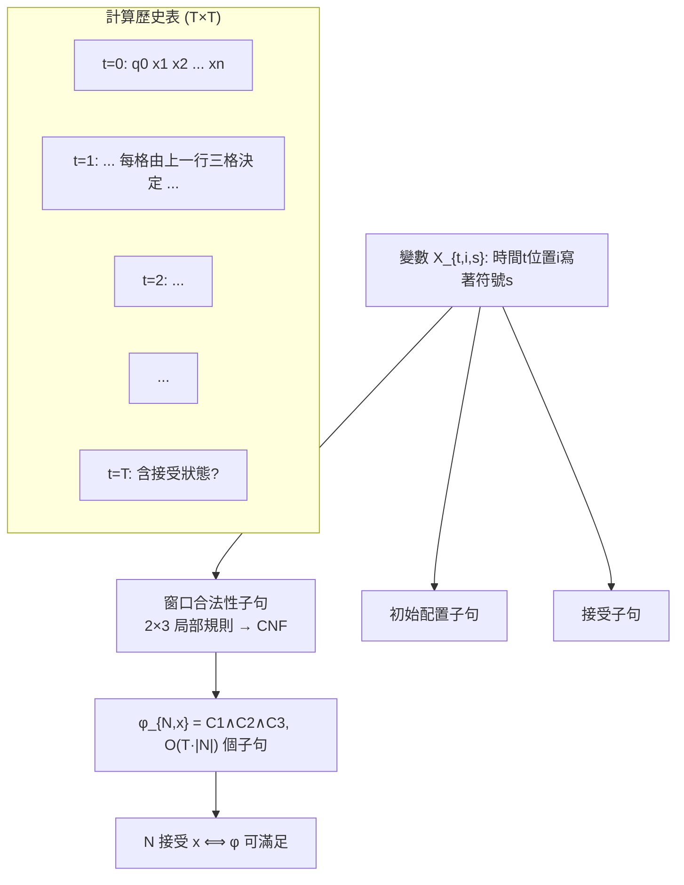
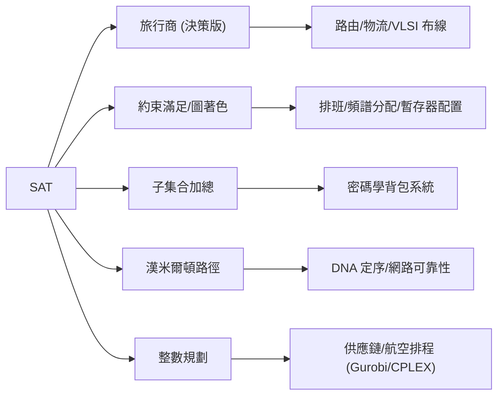

# 5.2 1971 Cook–Levin 定理與 NP 完全

## 前言：第一個 NP 完全問題

1971 年 5 月，Stephen Cook 在 ACM STOC 會議宣讀〈定理證明程序的複雜性〉。論文的核心發現可以一句話說完：

> **Cook 定理**：SAT（布爾可滿足性）是 NP 完全的——NP 中的**每一個**問題都可以多項式時間歸約到 SAT。

一年前（1970），蘇聯的 Leonid Levin 獨立得到等價結果（著名的 p-歸約與「通用搜尋問題」）。1972 年，Richard Karp 發表〈組合問題之間的可歸約性〉，一口氣把 **21 個經典問題**（整數規劃、漢米爾頓迴路、圖著色、集合覆蓋、子集合加總……）歸約到 SAT 或彼此之間——NP 完全理論自此爆炸性展開。今日已知的 NP 完全問題超過三千個，橫跨組合、代數、排程、生物資訊、遊戲。

這個理論徹底改變了工程界的問題觀：**遇到一個慢問題，先問「它是 NP 完全的嗎？」**——答案決定了你該設計多項式演算法、還是該做近似/啟發式/參數化。

## NP 與多項式歸約的定義

> **定義**：$\mathrm{NP}$ = 可在多項式時間內**驗證**（憑證長度多項式）的決策問題類
> $$L \in \mathrm{NP} \iff \exists\, V, p:\; x \in L \iff \exists c, |c| \le p(|x|),\; V(x, c) = \text{accept}$$
> 等價定義：$\mathrm{NP} = \bigcup_k \mathrm{NTIME}(n^k)$（非確定性多項式時間）。

> **定義**：$L$ 是 **NP 完全**的，若 (1) $L \in \mathrm{NP}$；(2) 對所有 $A \in \mathrm{NP}$，$A \le_p L$（多項式時間多一歸約）。

「驗證容易、求解可能很難」是 NP 的直覺：數獨的解容易檢查、難以找出。$A \le_p B$ 則說「B 至少和 A 一樣難」——與 4.2 節不可判定性的歸約同構，只是把「可計算」換成「多項式時間可計算」。**歸約第二次成為理論的發動機**（第一次是 Post）。

## Cook–Levin 證明：把計算歷史壓成布爾公式

要證明 SAT 完全，需對**任意** NP 機器 $N$ 與輸入 $x$，構造公式 $\varphi_{N,x}$ 使：

$$
N \text{ 接受 } x \text{（某條計算路徑）} \iff \varphi_{N,x} \in \text{SAT}
$$

構造的核心是**計算歷史的表格編碼**：$N$ 的執行可畫成一張 $T \times T$ 的表格（$T = n^k$，行是時間步、列是紙帶格子）：



- **變數**：$X_{t,i,s}$ = 「時間 $t$、位置 $i$ 的格子是符號 $s$」，共 $O(T^2)$ 個；
- **初始子句**：強制第一行是初始配置；
- **接受子句**：某行某格出現接受狀態；
- **轉移子句**：圖靈機轉移是**局部**的（一格由上一行相鄰三格決定），每個 $2 \times 3$ 窗口的合法模式寫成常數個 CNF 子句。

公式的總大小 $O(T \cdot |N|)$ = 多項式。關鍵洞察：**計算 = 局部一致的二維符號結構**（這正是 4.2 節 Wang 平鋪的正面用法！）。「存在合法的滿足指派」恰好對應「存在接受的計算歷史」——非確定性的「猜」被翻譯為「存在指派」。

## Karp 的 21 個問題與歸約的工程學

Cook 定理只需證一次；之後每個新問題只需一條歸約。Karp 1972 年的清單示範了歸約的多樣性（節選）：

| 從 | 到 | 技巧 |
|---|---|---|
| SAT | 3-SAT | 子句等價改寫（局部替換） |
| 3-SAT | 团（Clique） | 變數×文字 → 圖的頂點，相容字對連邊 |
| Clique | 頂點覆蓋 | 補圖翻轉 |
| 3-SAT | 子集合加總 (SUBSET-SUM) | 以進位隔離的十進位大數編碼 |
| 3-SAT | 3-著色 | 真/假/基底三色 + 變數子句匣（gadget） |

「**Gadget 建構**」（把一個邏輯約束焊成小圖）是 NP 完全證明的手工藝核心。實務流程：

```text
遇到疑似難問題 P:
  1. 找一個已知 NP 完全問題 A, 其結構與 P 相似
  2. 構造多項式時間轉換 f: A 的實例 → P 的實例
     且解一一對應 (等值歸約)
  3. 寫下正確性證明 (兩方向)
  4. 結論: P 是 NP 難的 → 除非 P=NP, 別指望多項式精確演算法
     → 轉向: 近似比 / FPT / 啟發式 / 特殊圖類 / 隨機化
```

## NP 完全的工程版圖



兩個值得深究的工程迴響：

1. **SAT 求解器的逆襲**：理論上 SAT 是最難的，實務上現代 SAT/SMT 求解器（Conflict-Driven Clause Learning, 1996–）竟能處理工業級數萬變數的實例——**最壞複雜性 ≠ 實際難度**，複雜性理論因此發展出平滑分析（Spielman–Teng）與平均情況理論來解釋。
2. **密碼學的雙刃**：Karp 清單中的 Knapsack 曾被做成公鑰密碼（Merkle–Hellman 1978），數年後被 LLL 演算法攻破——NP 難不等於密碼學安全（需要**平均情況**困難，見 5.3 節）。

## P vs NP 的現狀

Cook–Levin 把千萬個問題的命運綁在一個問題上：

$$
\mathrm{P} \stackrel{?}{=} \mathrm{NP}
$$

- 大多數理論家相信 $\mathrm{P} \ne \mathrm{NP}$（Paul-Goldwasser 2002 與 Gasarch 2019 兩次調查：約 80–90%）；
- 已知的牆（見 5.3 節）：相對化、代數化、自然證明——三大障礙各自封殺一類證明技術；
- 但歸約已給出巨大的**條件性知識**：只要任何一個 NP 完全問題有多項式演算法，全部三千個問題同時變容易——「**集體風險**」本身就是 Karp 歸約的實務價值。

## 歷史意義與後續發展

- **P/NP 成為科學界公認的最深未解問題**：Clay 研究所七個百萬美元問題之一；「證明 P≠NP 的策略」本身已成理論（5.3 節障礙理論）。
- **近似演算法工業**：頂點覆蓋 2-近似、TSP Christofides 1.5-近似、MAX-3SAT 7/8（Håstad 1997，PCP 定理的應用——**可近似性**成為 NP 完全之後的第二張地圖）。
- **參數化複雜性**（Downey–Fellows 1990s）：「難，但難在參數上」——FPT 演算法把 NP 完全問題按結構難度再分層。
- **形式驗證與編譯器**：5.1 節提過暫存器配置是圖著色（NP 完全）；BMC 把驗證化為 SAT——Cook 的表格編碼今日直接活在 z3 的每一次求解裡。

## 重點整理

- Cook–Levin 1971：SAT 是 NP 完全；證明 = 把任意 NP 計算壓成局部一致的布爾公式（計算歷史表格法）。
- Karp 1972 的 21 問題確立歸約為「難度傳播」的標準技術；gadget 建構是證明的手工藝。
- NP 完全 = 驗證易、求解難；遇到慢問題先定位座標，再選近似/FPT/啟發式。
- P vs NP 未解，三大障礙（相對化、自然證明、代數化）界定了證明的已知極限；SAT 求解器的實務強勢提醒「最壞難度」不是全貌。
