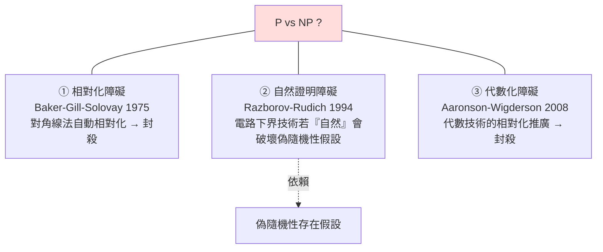

# 5.3 隨機性、互動與 P vs NP 的現代進展

## 前言：確定性不是唯一的世界觀

前兩節的地圖（P ⊆ NP ⊆ PSPACE ⊆ EXPTIME，階層定理保證真分離存在於高處）都是**確定性**世界觀。1980 年代起，三個「額外資源」改寫了地圖，也改寫了 P vs NP 的進攻路線：

1. **隨機性**：允許擲硬幣的演算法（機率類 BPP）；
2. **互動**：證明者與驗證者的對話（互動式證明 IP）；
3. **非均勻性**：給每個輸入長度「發放提示」（電路類 P/poly）。

驚人的是：這三個資源最終被證明**大多可以免費獲得或證明無益**——「隨機性無用論」（derandomization）、「IP=PSPACE」——而這些結果反過來構成了 P vs NP 的三大障礙。本節的故事：**理論家如何系統性地排除自己的武器，從而知道為什麼這個問題如此之難。**

## 隨機性：BPP 與去隨機化

> **定義**： $\mathrm{BPP}$ = 多項式時間、擲硬幣、錯誤率 ≤ 1/3 的判定問題類。

隨機演算法的工程勝利不需等理論：**素性測試**（Miller–Rabin 1976，隨機、極快）、**MinHash**、**Monte Carlo 積分**、**負載平衡**（隨機選機器勝過任何確定性策略）、**跳躍表**。隨機性在實務中常常「白拿」。

理論上的大逆轉：

- **Sipser–Gács–Lautemann（1983）與 Adleman（1978）**： $\mathrm{BPP} \subseteq \mathrm{P/poly}$ （隨機性可用「按長度發放固定提示」模擬）；
- **Impagliazzo–Wigderson（1997）**：若存在 $E = \mathrm{TIME}(2^{O(n)})$ 中需要 $2^{\Omega(n)}$ 電路大小的問題，則 $\mathrm{BPP} = \mathrm{P}$ 。

換言之：**除非密碼學假設（單向函數/偽隨機生成器存在）是錯的，隨機性不提供本質計算能力**。而密碼學界普遍相信偽隨機性存在——所以主流觀點是 $\mathrm{BPP} = \mathrm{P}$ 。這是「密碼學假設反哺複雜性理論」的著名迴路。

## 互動：IP = PSPACE 與零知識

> **定義**： $\mathrm{IP}$ = 驗證者（多項式時間、隨機）與全能證明者經多輪對話後能以高機率驗證的語言類。

互動式證明打破「靜態憑證」的框架。1990–1992 年的里程碑：

> **Shamir（1992）**： $\mathrm{IP} = \mathrm{PSPACE}$ 。

技巧是 **算術化（arithmetization）**：把布爾公式換成有限域上的多項式，證明者逐步說服驗證者「#SAT 的值」正確（和檢查協定、低度測試）。互動讓驗證者能檢查**指數大**的對象的多項式摘要——NP 的靜態驗證被推廣到 PSPACE 的動態驗證。

互動還催生兩個直接工業化的分支：

1. **零知識證明**（Goldwasser–Micali–Rackoff 1985）：證明「我知道秘密」而不洩漏秘密本身。2016 年起實用化：zk-SNARK 用於 Zcash 隱私交易、以太坊 rollup 擴容——每次你聽到「Web3 的零知識證明」，那正是 IP 理論 + PCP 定理 + 傅立葉變換的工程化身。Goldwasser 與 Micali 獲 2012 年圖靈獎。
2. **MIP = NEXP**（Babai–Fortnow–Lund 1991）：兩個**不能串供**的證明者能讓指數級問題被驗證——多證明者模型成為區塊鏈輕節點驗證的理論原點。

## PCP 定理：可近似性革命

第 4.2 節預告的另一個 PCP：**機率可驗證證明**。

> **PCP 定理**（Arora–Safra 1992; Arora–Lund–Motwani–Sudan–Szegedy 1998）：
> $$\mathrm{NP} = \mathrm{PCP}(O(\log n), O(1))$$
> 任何 NP 證明都可編碼，使驗證者只讀**常數個位元**、用 $O(\log n)$ 個隨機位元即可驗證（完備性 1、可靠性 ≤ 1/2）。

這個「奇蹟般的壓縮」的推論是難度理論的地震：若一個最佳化問題能在 PCP 下保持「解的品質與證明被拒位元相關」，則近似它到某比率也是 NP 難的：

$$
\text{MAX-3SAT 可近似到 } 7/8 + \epsilon \text{ 即 } \mathrm{P} = \mathrm{NP} \quad (\text{Håstad 1997})
$$

由此誕生了**近似難度地圖**：頂點覆蓋 $2 - \epsilon$ 難、集合覆蓋 $(1-o(1))\ln n$ 難、圖著色 $n^{1-\epsilon}$ 難——工程師「該投資多好的啟發式」如今有理論價格標。PCP 定理的長證明（原始 500 頁 → Dinur 2006 組合式 40 頁）也改寫了複雜性證明的美學。

## P vs NP 的三大障礙：已知的「此路不通」

- **① 相對化**（4.1、5.1 節已見）：任何「只數步數」的論證給所有神諭世界同樣答案，但不同神諭下 $\mathrm{P}^A$ 與 $\mathrm{NP}^A$ 關係不同——純對角線出局。有趣的是：IP=PSPACE 證明**非相對化**（算術化使用了神諭無法觸及的代數結構）——障礙理論同時指出了突破口。
- **② 自然證明**：Razborov–Rudich 證明：若一個證明電路下界的技術同時 (a) 對多數函數有效、(b) 易於計算，則它可以**破解偽隨機生成器**——與密碼學假設矛盾。所以有效的下界技術必須「不自然」。
- **③ 代數化**：把 ① 推廣到代數模型，封殺了算術化的天真擴展；僅存的希望是「利用非相對化又非代數化的結構」（如 2015 年 Mulmuley 的幾何複雜性理論 GCT，把 P vs NP 化為代數幾何的表示論問題——尚在長征）。

## 進展的正面清單（1971 之後真正證明的）

儘管 P vs NP 未解，周邊的已知結果相當豐富：

- $\mathrm{P} \subseteq \mathrm{BPP} \subseteq \mathrm{P/poly} \subseteq \mathrm{PSPACE}$ （且主流相信前兩者相等）；
- $\mathrm{IP} = \mathrm{PSPACE}$ 、 $\mathrm{MIP} = \mathrm{NEXP}$ 、 $\mathrm{PCP}$ 定理、 $\mathrm{PH} \subseteq \mathrm{P/poly} \Rightarrow \mathrm{PH} = \Sigma_2^P$ （Karp–Lipton）；
- 時間階層（5.1）： $\mathrm{P} \subsetneq \mathrm{EXPTIME}$ ，故 $\mathrm{P} \ne \mathrm{NP}$ 與 $\mathrm{NP} \ne \mathrm{EXPTIME}$ 至少一個成立；
- 平均情況：Levin 的平均 NP 完全理論；Impagliazzo 的五個世界（Algorithmica/Heuristica/Pessiland/Minicrypt/Cryptomania）——「難」有多種等級，密碼學存在性本身是中間難度假設。

## 歷史意義與後續發展

- **密碼學現代化**：隨機性（BPP）、平均難度、PCP、零知識共同構成「現代密碼學的複雜性地基」——安全證明 = 歸約到假設難題（4.2 節歸約的正面用途）。P vs NP 一旦意外解決（P=NP），現代密碼學幾乎全數崩塌，同時最佳化與 AI 的組合搜尋問題一夜解決——這就是為什麼它是「最重要的未解問題」。
- **隨機演算法工業**：即使 $\mathrm{BPP} = \mathrm{P}$ 被證明，實務上隨機演算法仍因**簡單**而常用——理論等價性從未使工程放棄好用的工具。
- **量子計算的定位**： $\mathrm{BQP}$ （量子多項式時間）已知 $\mathrm{BQP} \subseteq \mathrm{PSPACE}$ ，且不會超過可計算性邊界（Church-Turing 物理版仍穩）；質因數分解 ∈ BQP（Shor 1994）但 SAT 未見量子多項式演算法——量子性更像「第四種資源」，其與隨機性/互動的互動（QPCP、QMA）是當前前沿。
- **對齊與科學問題**：P vs NP 的哲學地位——「創造 vs 檢查」的鴻溝——被廣泛類比於數學發現、藝術創作與 AI 生成；雖屬類比，它持續為跨領域提供概念框架。

## 重點整理

- 隨機性（BPP）：實務大贏家；理論上在去隨機化假設下 BPP=P——隨機性多半「可免費模擬」。
- 互動（IP）：IP=PSPACE，算術化是非相對化證明的範例；零知識證明已工業化（zk-SNARK）。
- PCP 定理：常數查詢驗證 NP，催生可近似性難度地圖，連接難度與密碼學。
- 三大障礙（相對化、自然證明、代數化）界定證明技術的已知極限；P vs NP 需要繞過三者的新數學，當前最系統的嘗試是幾何複雜性理論。
