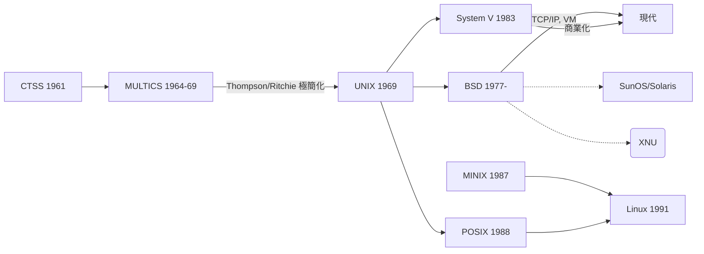

# 1.2 1960年代 MULTICS 與 UNIX（1969）的分岔革命

## 分時（Time-Sharing）：讓一台電腦服務許多人

1950年代末的批次系統有一個致命的體驗缺陷：程式師把整疊卡片交出去，可能要等好幾個小時才拿回結果，而結果可能只是漏了一個逗號。電腦昂貴所以要「榨乾 CPU」，但人的生產力同樣昂貴。這個矛盾催生了**分時系統（time-sharing）**的想法：讓多個使用者透過各自的終端機「同時」使用電腦，OS 極快地在使用者之間輪轉 CPU，因為人在思考與打字時 CPU 正好可以服務別人——**以人為緩衝，化解 I/O 與 CPU 的不匹配**。

里程碑包括：

- **CTSS**（MIT，1961，Fernando Corbató 領導）：第一個展示給大量使用者的分時系統，用一個簡單的輪轉排班器與磁鼓交換（swap）使用者行程。
- **Dartmouth Time-Sharing System, DTSS**（1964）：讓 BASIC 語言與分時結合，普及了「互動式程式設計」文化。

## MULTICS（1964–1969）：宏偉的野心

**MULTICS**（Multiplexed Information and Computing Service）是 MIT、奇異公司（GE）與貝爾實驗室的合作計畫（1964 年啟動，目標平台為 GE-645），堪稱作業系統史上最雄心勃勃的工程。它幾乎一次到位地納入了當代所有先進概念：

1. **單一樹狀檔案系統**：所有檔案（包括裝置、目錄）掛在同一棵樹上，目錄可以像檔案一樣被掛載——今日 Linux 的 `/` 與 `mount` 直接繼承於此。
2. **分段＋分頁的虛擬記憶體**：每個行程擁有龐大（當時想像 2^18 段）的位址空間，段提供邏輯保護、頁提供實作機制。
3. **動態連結**：副程式在第一次呼叫時才連結進來。
4. **以高階語言（PL/I）撰寫 OS**：當時普遍認為 OS 必須用組語，MULTICS 證明了高階語言可行。
5. **環形保護（protection rings）**：8 個特權環，第 0 環最特權——Intel x86 的 ring 0/3 即源於此。

然而 MULTICS 追求「電腦公用事業（computer utility）」般的完美，工程不斷膨脹：程式碼巨大、GE-645 效能不彰、開發時程屢屢延後。貝爾實驗室在 1969 年退出計畫。

## UNIX（1969）：極簡主義的分岔

### 誕生故事

MULTICS 退出後，貝爾實驗室的 **Ken Thompson** 手邊只剩一台閒置、效能低落的 DEC PDP-7，但他仍想繼續玩在 MULTICS 上寫的太空旅行（Space Travel）遊戲。1969 年夏天（妻子休假帶小孩回娘家的一個月），Thompson 在 PDP-7 上用組語寫出了小型 OS 的核心：檔案系統、行程機制、shell 與一組小工具。貝爾實驗室的同事 **Brian Kernighan** 開玩笑地把這個「閹割版 MULTICS」命名為 **UNICS**（UNiplexed Information and Computing Service），後來拼成 **UNIX**。

1971 年，Thompson 與 **Dennis Ritchie** 把 UNIX 移植到 PDP-11，並為專利部門的文字處理需求找到第一個實際用途。1973 年，Ritchie 以他自己為此目的設計的 **C 語言**重寫 UNIX 核心——這是劃時代的一步：OS 首次變成**可攜**的。1974 年 Ritchie 與 Thompson 在 CACM 發表〈The UNIX Time-Sharing System〉，UNIX 從此傳遍學術界（貝爾實驗室受反壟斷判決限制不能賣軟體，於是以象徵性費用附原始碼授權大學，意外造就了開放文化）。

### UNIX 哲學：與 MULTICS 的對照

UNIX 的成功並非因為功能比 MULTICS 多，而是因為**取捨**截然不同：

| 面向 | MULTICS | UNIX |
|---|---|---|
| 設計哲學 | 宏偉、功能完備 | 極簡、能做就好 |
| 位址空間 | 段＋頁 | 平坦分頁（後繼 BSD 才加回虛擬記憶體） |
| 檔案系統 | 龐大、支援複雜存取控制 | 簡單 inode、樹狀結構 |
| 程式介面 | 大而全的系統呼叫 | 小而正交：`open/read/write/close` 一體適用於檔案、裝置、pipe |
| 複用機制 | 內建複雜功能 | **組合小工具**：`cat | grep | wc` |

「一切皆檔案」與「小程式透過 pipe 組合」，使 shell 成為一種**可程式化的組合語言**——從編譯器角度，UNIX shell 是第一個真正普及的腳本語言；而 `pipe` 則把「生產者—消費者」的同步抽象包裝成了語法符號 `|`。

### 分岔：BSD、System V 與開源

- 1970年代末，**Berkeley** 的 Bill Joy 等人發展出 **BSD**（Berkeley Software Distribution），加入 vi、C shell、TCP/IP（1983 年 4.2BSD，使 UNIX 成為網際網路的母語）與虛擬記憶體（3BSD，DARPA 資助）。
- AT&T 於 1983 年（反壟斷判決生效、貝爾解體後）推出商業版 **System V**。
- 1980年代的「UNIX 戰爭」（BSD vs. System V，及後來的 OSF/1 vs. Unix International）反而促進標準化：POSIX（1988）誕生，定義可攜的系統呼叫介面。
- 1987 年 Andrew Tanenbaum 為教學寫出 **MINIX**；1991 年 Linus Torvalds 以 MINIX 為起點寫出 **Linux** 核心，與自由軟體基金會的 GNU 工具鏈（gcc 等）合流，成為今日統治伺服器、手機（Android）與超級電腦的系統。歷史在此完成一個閉環：UNIX 的血統經由教學與開源，繁殖出了整個現代運算世界。

## 為什麼「分岔」是關鍵詞

本節標題強調「分岔革命」，因為 UNIX 的歷史展示了軟體演化的重要機制：



MULTICS 失敗於工程複雜度，UNIX 成功於簡單與可攜，但兩者共同塑造了今日 OS 的所有核心概念：行程、樹狀檔案系統、shell、權限模型。**作業系統的教科書概念，幾乎都是在 1960 年代被發明、在 1970 年代被 UNIX 定型的。**

## 系統呼叫範例：UNIX 的極簡介面

UNIX 將所有 I/O 收斂為四個基本系統呼叫，這是「小而正交」哲學的最好展示：

```c
// 同一組呼叫，適用於普通檔案、終端機、pipe、socket
int fd = open("input.txt", O_RDONLY);   // 取得描述子
char buf[512];
ssize_t n;
while ((n = read(fd, buf, sizeof(buf))) > 0)
    write(STDOUT_FILENO, buf, n);       // 寫到標準輸出
close(fd);
```

反觀管道組合：

```sh
cat access.log | grep "404" | awk '{print $7}' | sort | uniq -c | sort -rn
```

每一支程式只做一件事、以文字流為介面——這種「組合性（composability）」正是函式式程式設計所追求的管道（pipeline）思想，比 MapReduce 早了三十年出現在 shell 裡。

## 重點整理

- 分時系統（CTSS 1961）為了改善人的生產力而生；MULTICS（1964）整合了虛擬記憶體、樹狀檔案系統、動態連結與保護環。
- UNIX（Thompson 1969，Ritchie 1973 以 C 重寫）以極簡、可攜、「一切皆檔案」與管道組合哲學勝出。
- C 語言是為了寫 UNIX 而生的，OS 與編譯器在此深度綁定：ABI、呼叫慣例、libc 至今仍是兩界的共同邊界。
- BSD/System V 分岔與 POSIX 標準化，經由 MINIX 傳到 Linux，構成現代 OS 的族譜。
