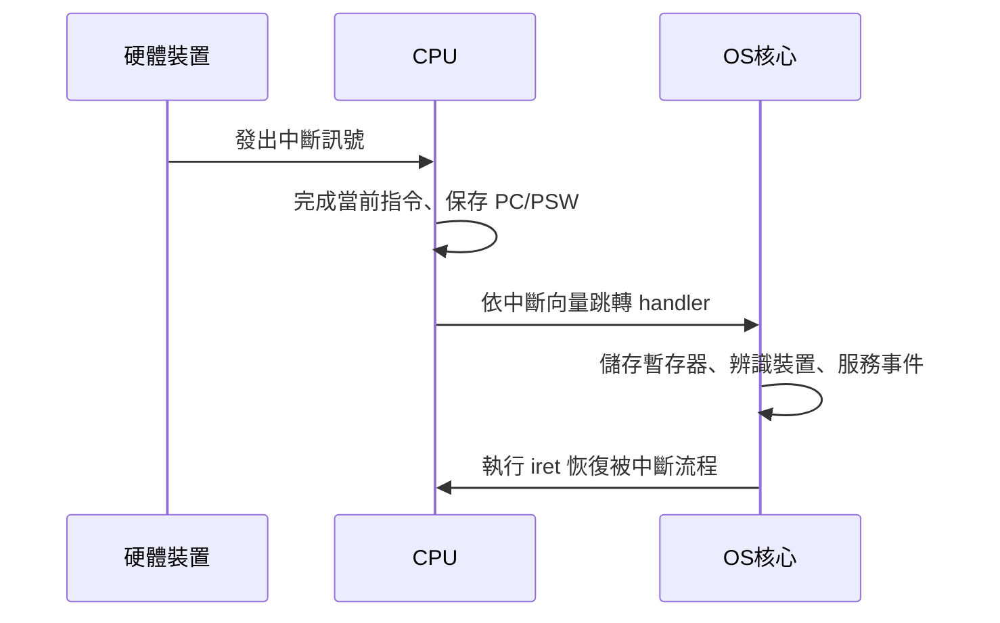
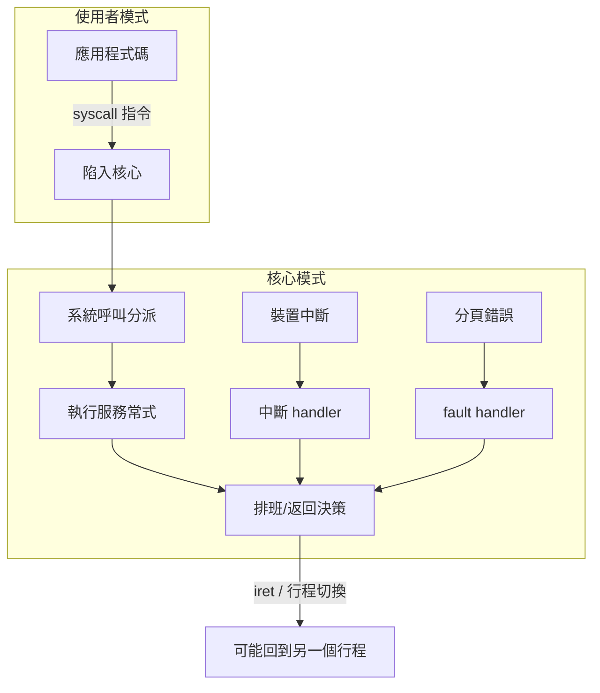

# 1.3 作業系統的核心概念（中斷、模式切換、系統呼叫）

## 引言：OS 的三根支柱

前兩節回顧了歷史；本節抽出貫穿所有現代作業系統的三個機制性支柱：**中斷（interrupt）**、**模式切換（mode switch）**與**系統呼叫（system call）**。它們共同回答一個根本問題：**作業系統只是一個程式，它憑什麼「管理」其他程式？** 答案是：CPU 硬體給予它特權，而中斷與陷阱（trap）是其他程式把控制權「交還」給它的唯一合法通道。

## 中斷：一切事件驅動的起點

### 什麼是中斷

**中斷**是一個硬體訊號，使 CPU 在每條指令執行完畢後，暫停目前控制流程、保存狀態、跳到一個預先登記的處理常式。若無中斷，OS 只能用「輪詢（polling）」——不斷主動詢問裝置「好了沒？」——這會浪費大量 CPU 循環。

中斷可分為兩大類：

1. **非同步中斷（硬體中斷）**：來自外部裝置（計時器、磁碟、網卡、鍵盤），與目前執行的指令無關。
2. **同步例外（exception / trap）**：由目前指令本身觸發，包括：
   - **系統呼叫陷阱**：程式主動要求 OS 服務；
   - **錯誤（fault）**：如分頁錯誤（page fault）、除以零——可修復後重執行該指令；
   - **中止（abort）**：致命錯誤。

歷史上，中斷機制早在 1950 年代就出現於 UNIVAC 1103 等機器（1950 年代初的 I/O 中斷），而 **vectored interrupt（向量式中斷）**——不同裝置跳到不同處理常式位址——則在 1960 年代隨 IBM System/360 成熟。計時器中斷尤為關鍵：它讓 OS 得以**強制**從不合作的使用者程式手中取回控制權，是分時系統成立的物理前提。

### 中斷處理流程



虛擬碼描述一個精簡的中斷分派迴路：

```c
// 硬體視角（每條指令後自動執行）
while (true) {
    fetch_execute_one_instruction();
    if (interrupt_pending && interrupts_enabled) {
        old_pc = pc; old_flags = flags;       // 硬體自動保存
        pc = interrupt_vector[device_id];      // 跳到 handler
        mode = KERNEL;                         // 提升特權
    }
}

// OS handler 視角
void interrupt_handler(void) {
    save_all_registers();
    enum event e = identify_interrupt();
    handle(e);                    // 例如：喚醒等待 I/O 的行程
    restore_registers();
    return_from_interrupt();      // iret/eret，可能同時切換行程
}
```

## 特權模式與模式切換

### 為什麼需要兩個世界

如果使用者程式可以直接執行「關閉中斷」或「把磁碟資料讀到任意位址」的指令，任何保護都蕩然無存。因此 1960 年代以降，CPU 提供至少兩種**特權模式**：

- **核心模式（kernel mode / supervisor mode，x86 的 ring 0）**：可執行全部指令，包括特權指令（操作頁表暫存器、中斷遮罩、I/O 埠）。
- **使用者模式（user mode，ring 3）**：只能執行一般指令；存取非法位址或執行特權指令會觸發例外。

**模式切換**有兩個方向：使用者→核心只能透過**陷阱（trap：系統呼叫或例外）**或**中斷**；核心→使用者則由陷阱返回指令（`iret`、`eret`、`sysret`）完成，通常同時恢復行程的暫存器與 PC。

MULTICS 的八環保護（上節）與現代 ARM 的 EL0–EL3，都是這個二元模型的精細化。近年火熱的 **RISC-V** 則以 M/S/U 三模式（Machine/Supervisor/User）承襲同一思想。

## 系統呼叫：使用者世界的「門」

### 機制

**系統呼叫**是使用者程式請求核心服務的正式介面。其流程：

1. 使用者程式把系統呼叫號碼與參數放入約定的暫存器（如 Linux x86-64：`rax`=號碼、`rdi/rsi/rdx`=參數）。
2. 執行陷阱指令（x86-64 為 `syscall`，較舊的 x86 為 `int 0x80`）。
3. CPU 切到核心模式，跳到系統呼叫分派表（一個以號碼為索引的函式指標陣列）。
4. 核心執行服務常式，結果放回暫存器。
5. `sysret` 返回使用者模式，繼續執行。

```c
// glibc 中 write 的包裝（簡化；實際為內嵌組語）
long syscall_write(int fd, const void *buf, size_t len) {
    long ret;
    asm volatile (
        "syscall"
        : "=a"(ret)                 // 輸出：rax
        : "a"(1),                   // 輸入：rax = 1 (SYS_write)
          "D"(fd), "S"(buf), "d"(len)
        : "rcx", "r11", "memory"    // syscall 會破壞 rcx, r11
    );
    return ret;
}
```

### 「庫函式 vs. 系統呼叫」——與 C 語言/編譯器的交界

`printf` 是庫函式不是系統呼叫，它做格式化後才呼叫 `write`；`fork` 則幾乎是系統呼叫的直接包裝。**libc（如 glibc、musl）正是「編譯器世界」與「OS 世界」的條約**：編譯器依循 ABI（System V AMD64 ABI）決定參數放哪些暫存器、誰保存哪些暫存器；libc 則把這些約定包裝成 C 函式。理解這一點，就理解了為什麼換編譯器（gcc→clang）通常沒事，但換 libc（glibc→musl）可能產生行為差異——因為 libc 一半是編譯器的配套、一半是 OS 的介面。

此外，**虛擬機（VM）領域與此完全同構**：Java 的 JNI、WASM 的 host function 呼叫、JVM 中「Java 程式呼叫 JVM 內建服務」，本質上都是「被管理的執行環境中，向管理者請求服務」的系統呼叫。gVisor、WASM 等沙箱技術甚至重新實作了一整套「系統呼叫表」以攔截並審查每個請求。

## 核心控制流程總覽

把三個概念串起來，一個現代 OS 的執行光譜如下：



關鍵洞察：**使用者程式永遠不會「呼叫」作業系統然後直接回來——所有回到使用者的路徑都經過排班器的檢查**。這正是 OS 能實施排班、優先權與資源管制的根源。

## 從測量角度看成本

模式切換雖然是單一指令（`syscall`），但伴隨的周邊成本可觀：旁路執行管線、清空部分微架構狀態、核心必須保存/恢復暫存器、可能觸發 TLB 相關的隔離措施（如 KPTI）。一次系統呼叫的總成本約為數百奈秒，比一次普通函式呼叫（數奈秒）高兩個數量級。這解釋了許多系統設計決策：

- **vDSO**：Linux 把 `gettimeofday` 等只讀計算的呼叫映射到使用者空間的共用頁，完全避開陷入。
- **批次化與非同步介面**：`io_uring`（2019，Jens Axboe）用共用環形緩衝把成千上萬次系統呼叫壓縮成零次陷入，是近十年最重要的 Linux I/O 演進。
- **JVM/JIT 的去虛擬化**：與 vDSO 同理，VM 執行環境也會把「熱的服務請求」內聯化以降低管理開銷。

## 重點整理

- 中斷使 OS 由被動程式變成事件驅動的管理者；計時器中斷是分時系統的物理基礎。
- 特權模式以硬體強制劃分權力：使用者→核心只能透過陷阱/中斷，無法跳過。
- 系統呼叫是使用者世界的唯一服務窗口，其介面（號碼、ABI）由 libc 與核心共同定義。
- 中斷、模式切換與系統呼叫的成本，直接塑造了緩衝、批次化與非同步 I/O 的設計。
