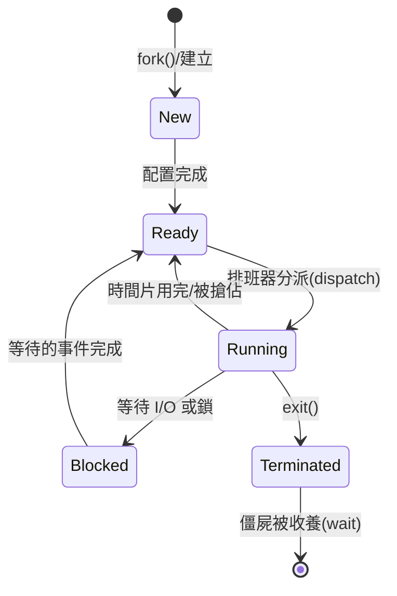

# 2.1 行程抽象與狀態機

## 行程：一個執行中的程式

**行程（process）**是「執行中的程式」這句話太過簡略，不足以說明它作為作業系統核心抽象的分量。精確地說，行程是**資源分配的基本單位**：作業系統把 CPU、記憶體、檔案、裝置……這些資源打包，附在一個帳本上，這個帳本就是行程。

一個行程包含：

- **位址空間**：程式碼（text）、資料（data）、堆疊（stack）、堆（heap）。
- **執行狀態**：程式計數器（PC）、通用暫存器、狀態旗標。
- **OS 記錄**：打開的檔案描述表、訊號處理狀態、帳戶資訊（使用者、時間）、排班資訊。

這些資訊集中在核心的資料結構 **PCB（Process Control Block，行程控制表）**中。歷史上，這個概念在 1960 年代由 MIT 的 **Fernando Corbató** 團隊在 CTSS 與 MULTICS 中發展出雛形；「process」一詞的推廣則常歸功於 MULTICS 的文件。Unix 把它精煉為兩個優雅的系統呼叫：`fork()` 與 `exec()`。

## 為什麼需要這個抽象：與編譯器/虛擬機的關聯

行程抽象的三個構成要素——**獨立位址空間、私有暫存器狀態、明確的生命週期**——正是所有「執行環境」抽象的原型：

| 概念 | 行程 | 執行緒 | Java 執行緒 | WASM 實例 | Actor |
|---|---|---|---|---|---|
| 隔離單位 | 位址空間 | 共享位址空間 | 共享 JVM 堆 | 線性記憶體 | 郵箱 |
| 通訊方式 | pipe/socket/IPC | 共享記憶體＋鎖 | 共享物件＋監視器 | 訊息傳遞 | 訊息傳遞 |

編譯器在這個抽象中扮演什麼角色？編譯器產生目標碼時，必須假設自己「擁有一個獨占的機器」：平坦的位址空間、私有的暫存器、可用的堆疊。正是 OS 的行程抽象（配合虛擬記憶體，見第 4 章）**兌現了這個謊言**——每個行程都真的得到一個獨占機器的幻覺。這是「抽象層各自為政、合起來成真」的系統設計典範。

## 行程狀態機

教科書標準的**五狀態模型**（源自 1960 年代分時系統的實作經驗）：



各狀態與事件：

- **Ready（就緒）**：萬事俱備，只差 CPU。位於就緒佇列。
- **Running（執行）**：CPU 正在執行它。單 CPU 下同一時刻只有一個。
- **Blocked（阻塞）**：等待無法自力完成的事件（磁碟 I/O、網路、鎖、`waitpid`）。即使給它 CPU 也沒用，所以必須與 Ready 嚴格分開。
- **New / Terminated**：建立與結束的過渡狀態；UNIX 中已結束但父行程尚未 `wait()` 收屍的行程稱為**殭屍（zombie）**——它只剩 PCB 殘骸，等著被收割退出碼。

一個重要的觀察：**行程在 Blocked 時不需要 CPU，但佔著記憶體**。早期記憶體昂貴，1968 年代出現了**中期排班（medium-term scheduling）**：把 Blocked（或長期不被選中的）行程整個換出到磁碟（swap out），騰出記憶體給別人，需要時再換入。這個「掛起（suspended）」維度擴充了狀態機（Ready-suspended、Blocked-suspended），也為後來的虛擬記憶體鋪路——當分頁普及後，swap 整個行程的做法被「換出個別分頁」取代，但概念血統相同。

## 建立：fork 與 exec 的 UNIX 設計

UNIX 把「建立一個新行程」拆成兩步，這個看似奇怪的設計是歷史上最漂亮的 API 之一：

```c
#include <unistd.h>
#include <stdio.h>

int main(void) {
    pid_t pid = fork();            // 複製自己
    if (pid < 0) {
        perror("fork"); return 1;
    }
    if (pid == 0) {                // 子行程：fork 回傳 0
        execlp("ls", "ls", "-l", (char *)NULL); // 換成新程式
        perror("exec");            // 只有失敗才會到這裡
        _exit(127);
    } else {                       // 父行程：fork 回傳子 PID
        int status;
        waitpid(pid, &status, 0);  // 等待並收屍
        printf("child exit status = %d\n",
               WEXITSTATUS(status));
    }
    return 0;
}
```

`fork` 幾乎完整複製呼叫者（記憶體內容、檔案描述表），唯一有意義的差別是回傳值；`exec` 則把目前行程的位址空間**整個替換**成新程式，PCB 中的帳號、PID、開啟檔案等資源屬性保留。拆成兩步的好處：

1. **組合性**：在 fork 與 exec 之間，可以自由重導 stdin/stdout（shell 的 `cmd < in > out` 就是這樣實作的）、設定環境變數、關閉檔案。
2. **shell 得以存在**：shell 本身就是一個平凡的使用者行程，讀一行指令 → fork → 子行程 exec → 父行程 wait，如此循環。今日的容器（`clone` with namespaces）、執行緒（`clone` with shared address space）都是 fork 的家族變體。

代價是複製整個位址空間看起來昂貴。現代核心以**寫時複製（copy-on-write, COW）**解決：fork 時不複製分頁，只把父子兩邊的頁表項都標成唯讀；任一方寫入時觸發分頁錯誤，核心才真正複製那一頁。COW 是「分頁錯誤處理常式被用來實作語意」的經典例子，也是第 4 章虛擬記憶體威力的預告。

## 核心虛擬碼：排班器眼中的行程

```c
struct pcb {
    pid_t        pid;
    uint64_t    *pagetable;     // 位址空間根
    cpu_context  regs;           // 暫存器快照（切換時保存/恢復）
    enum { READY, RUNNING, BLOCKED, ZOMBIE } state;
    struct queue *wait_queue;    // 若 Blocked，掛在哪個事件佇列
    int          fd_table[NFD];  // 開啟檔案
    int          exit_code;
    struct pcb  *parent;
};

// 事件完成時喚醒
void wakeup(struct event *ev) {
    while (!queue_empty(ev->waiters)) {
        struct pcb *p = dequeue(ev->waiters);
        p->state = READY;
        enqueue(ready_queue, p);   // 從 Blocked 轉回 Ready
    }
}

// 行程結束
void sys_exit(int code) {
    current->exit_code = code;
    current->state = ZOMBIE;
    wakeup(current->parent->child_done); // 通知父親
    reparent_children_to_init();
    schedule();                          // 交出 CPU，永不返回
}
```

## 實測：行程的生成與消亡

在 Linux 上可以觀察狀態機的運行：

```sh
# 殭屍行程實驗
python3 -c "
import os, time
pid = os.fork()
if pid == 0:
    os._exit(7)          # 子行程變殭屍，因父親不收屍
time.sleep(60)           # 期間 ps -o stat= -p <pid> 可見 Z
"
```

`ps` 中的 `R/S/D/Z` 分別對應 Running/Ready+Blocked/不可中斷 Blocked/殭屍——教科書狀態機活生生列在系統中。`D` 狀態（uninterruptible sleep）是一個現代補充：某些 I/O 等待連訊號都不能打斷，因為打斷可能破壞驅動程式的不變式。

## 重點整理

- 行程是資源分配的單位，PCB 集中記錄其全部狀態；五狀態模型是理解排班與 I/O 互動的基礎。
- Blocked 與 Ready 的區分是排班理論的關鍵：Blocked 的行程給 CPU 也沒用。
- fork/exec 的拆分與 COW，展現「機制（mechanism）與政策（policy）分離」的設計智慧。
- 行程抽象是所有執行環境（執行緒、VM、WASM）的原型；編譯器假設的「獨占機器」正是由它兌現。
