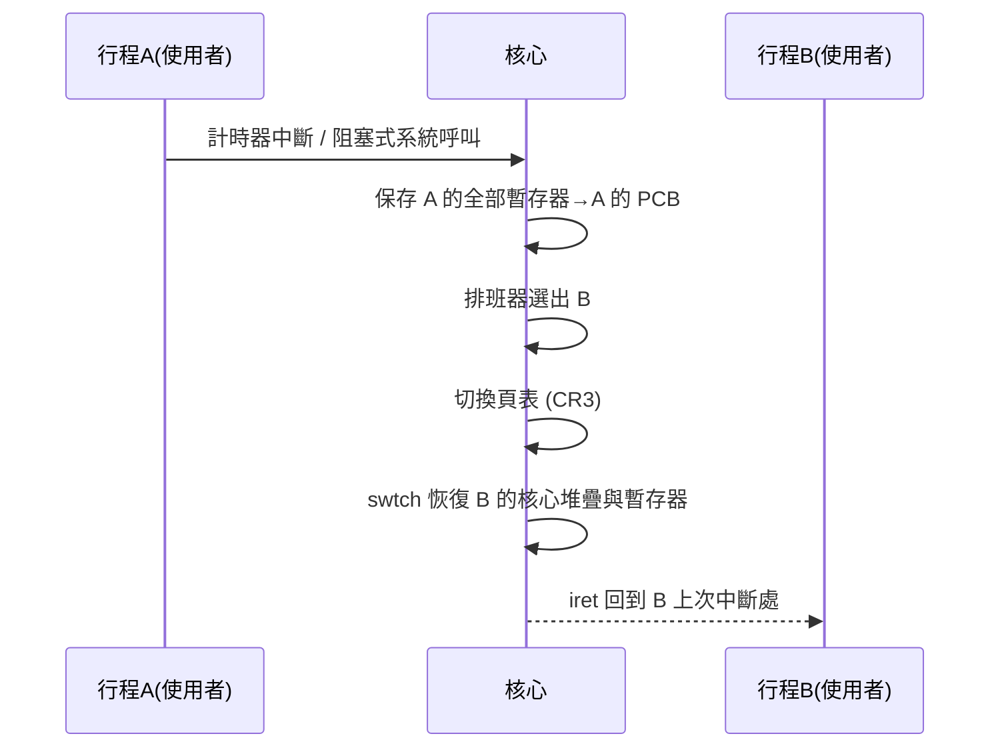

# 2.3 執行緒與 context switch 的實作

## 從行程到執行緒：為什麼要再切細一點

行程解決了「隔離」，但代價是**建立、切換、通訊都昂貴**：fork 要複製（即使 COW 也要操作整張頁表）、行程間通訊要經過核心。1960 年代末到 1970 年代，系統研究者意識到許多併發任務（如一個伺服器同時服務多個連線）其實**共享位址空間也無妨**，隔離需求沒那麼高。於是誕生了**執行緒（thread）**概念：同一個行程內多條執行流，**共享位址空間與資源，但各自擁有**：

- 執行狀態：暫存器組、PC、堆疊。
- 排班屬性：優先權、狀態。

「各自擁有堆疊」是最容易被低估的一點：兩條執行緒可以在同一個函式裡、用同一份程式碼與全域變數，但各自的區域變數互不干擾——因為區域變數住在堆疊上，而堆疊是私有的。這也解釋了為什麼執行緒的同步問題全部出在**堆與全域變數**（見第 3 章）。

歷史上，執行緒的研究與實作在 1980 年代繁盛：威斯康辛的 Tahiti、CMU 的 Mach（1985）以執行緒為核心抽象，Sun 於 1990 年代推出 Solaris 執行緒與後來統一的 **POSIX Threads（pthreads，IEEE 1003.1c，1995）**標準。Linux 核心採取激進做法：不區分行程與執行緒，只有 `task_struct`，執行緒只是「共享某些資源的行程」——由 `clone()` 的旗標（`CLONE_VM`、`CLONE_FILES` 等）逐項指定共享什麼。這個「機制留在核心、政策交給函式庫」的設計使 NPTL（Native POSIX Thread Library，2003，Ingo Molnár 等人）能高效實作 pthreads。

## context switch 到底在切什麼

**context switch** 是把 CPU 從一個執行單元轉到另一個的動作，其成本決定了併發粒度的下限。分層來看：

1. **執行緒切換（同行程）**：保存/恢復**暫存器組**（含 PC、堆疊指標、 callee-saved 暫存器）。這是最便宜的情形。
2. **行程切換（跨行程）**：在暫存器之外，還要切換**位址空間**——重新載入頁表基底暫存器（x86 的 `CR3`）。這導致 TLB 大量失效（見 4.3），隱性成本往往高於顯性成本。
3. **浮點/向量暫存器（XMM/AVX）**：由延遲保存機制（lazy FPU，僅在用到時才保存）處理，AVX-512 等大暫存器組使「真的用到了才保存」非常重要。

### 核心切換程式碼（RISC-V 風格簡化）

```asm
# void swtch(context_t **old, context_t *new)
# 只需保存 callee-saved 暫存器：呼叫慣例保證 caller-saved
# 暫存器會在函式呼叫時被 C 編譯器自行處理！
swtch:
    sd ra, 0(a0)        # 回返位址
    sd sp, 8(a0)        # 堆疊指標
    sd s0, 16(a0)       # s1..s11 callee-saved
    sd s1, 24(a0)
    ...
    sd s11, 96(a0)
    ld ra, 0(a1)        # 載入新執行緒的狀態
    ld sp, 8(a1)
    ld s0, 16(a1)
    ...
    ret                 # "return" 到新執行緒上次被切走的位置
```

這裡藏著一個編譯器與 OS 協作的深刻例子：switch 程式碼**只需保存 callee-saved 暫存器（s0–s11、ra、sp）**，因為函式呼叫慣例（ABI）已保證 caller-saved 暫存器在跨函式呼叫時可被覆寫——C 編譯器產生的呼叫點早已假設如此。**呼叫慣例的設計，直接決定了 context switch 需要保存多少東西**。這是「編譯器 ABI 決定 OS 成本」的最佳實例。

## 核心層的完整切換流程

```c
// 排班主函式（簡化，仿 xv6）
void schedule(void) {
    struct task *prev = current, *next;
    disable_preempt();
    next = pick_next_task();          // 政策：RR/CFS/...
    if (next != prev) {
        // 1. 執行緒層：保存暫存器
        swtch(&prev->context, next->context);
        // 2. 位址空間層（若不同行程）
        switch_mm(prev->mm, next->mm);
        // 3. 隱性成本在此發生：TLB 被沖掉/降效
    }
    enable_preempt();
}
```

從「一個行程在跑」到「另一個行程在跑」的完整觸發路徑：



量級：現代 Linux 一次同行程執行緒切換約 1–2 微秒，跨行程再附加 TLB 重填成本；相比之下函式呼叫僅約 1 奈秒——**三個數量級的差距**。這就是「不要用執行緒做百萬級併發」的物理根源。

## 使用者層執行緒（green threads）與兩層排班

既然核心切換貴，能否完全在使用者空間實作執行緒？可以——**使用者層執行緒**（又稱 green threads、協程 coroutine 的祖先）由執行期函式庫維護自己的暫存器集與堆疊，用 `swapcontext` 級的技巧切換，成本僅數十奈秒。其經典缺陷是：核心不知道它們的存在，**一個使用者執行緒做阻塞系統呼叫，整個行程（其他所有使用者執行緒）都被核心掛進 Blocked**——排班資訊的錯位。

三種對應模型：

- **N:1**（純使用者層）：切換快，但無法利用多核、阻塞傳染。
- **1:1**（Linux NPTL）：每個使用者執行緒一個核心 task，阻塞互不傳染，切換需陷入核心。
- **M:N**：使用者函式庫把 M 個執行緒多工到 N 個核心執行緒，兼得兩者，實作極難（歷史上 GNU Pth、Early Java green threads 均屬此類，多數被放棄）。

有趣的是，歷史在新世紀輪迴：Go（goroutine，M:N 排班器）、Erlang/BEAM（百萬級輕量行程）、Rust async/await、Java 虛擬執行緒（Project Loom，2023）**全部是 M:N 的現代復興**。它們的共同招式是把「阻塞」改寫成「非同步＋狀態機」：當使用者協程「阻塞」時，函式庫改用非同步 I/O（epoll/io_uring）註冊等待，然後切去跑別的協程——**用事件驅動仿造阻塞語意**。從編譯器角度，async/await 正是**把同步函式自動改寫成 CPS（Continuation-Passing Style）狀態機**的語法糖；這與 OS 用 PCB 保存行程狀態是同一件事的兩層實作：一層在編譯器產生的程式碼裡，一層在核心的堆疊與暫存器裡。

## 實驗：親手做一次 context switch

用 `ucontext` 在使用者空間體驗切換（完整的 mini-scheduler）：

```c
#include <ucontext.h>
#include <stdio.h>

ucontext_t main_ctx, a_ctx, b_ctx;
char a_stack[16384], b_stack[16384];

void worker_a(void) {
    for (int i = 0; i < 3; i++) {
        printf("A%d\n", i);
        swapcontext(&a_ctx, &b_ctx);   // 讓給 B
    }
    setcontext(&main_ctx);
}
void worker_b(void) {
    for (int i = 0; i < 3; i++) {
        printf("  B%d\n", i);
        swapcontext(&b_ctx, &a_ctx);   // 讓給 A
    }
    setcontext(&main_ctx);
}
int main(void) {
    getcontext(&a_ctx);
    a_ctx.uc_stack.ss_sp = a_stack;
    a_ctx.uc_stack.ss_size = sizeof(a_stack);
    a_ctx.uc_link = &main_ctx;
    makecontext(&a_ctx, worker_a, 0);
    getcontext(&b_ctx);
    b_ctx.uc_stack.ss_sp = b_stack;
    b_ctx.uc_stack.ss_size = sizeof(b_stack);
    b_ctx.uc_link = &main_ctx;
    makecontext(&b_ctx, worker_b, 0);
    swapcontext(&main_ctx, &a_ctx);    // 進入排班
    return 0;
}
```

`getcontext/save` 與核心 `swtch` 做的事完全同構：保存一組暫存器與堆疊指標，`ret`（`setcontext`）跳到另一條控制流。讀懂這 30 行，就讀懂了所有協程與 OS 排班器的最小本質。

## 重點整理

- 執行緒 = 共享位址空間＋私有堆疊與暫存器；Linux 以 clone 旗標統一行程與執行緒。
- context switch 成本分顯性（暫存器保存）與隱性（TLB 失效）兩層，後者在跨行程切換時占主導。
- ABI 的 callee-saved 約定使切換程式碼極簡——編譯器慣例直接決定 OS 的切換成本。
- M:N 排班（goroutine/Loom/async）以「非同步 I/O＋狀態機改寫」復興了使用者層執行緒，是 OS 概念在語言執行期的再發明。
