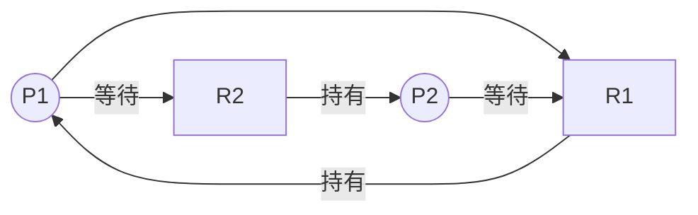

# 3.3 死結：條件、預防與銀行家演算法

## 死結：併發系統的僵局

1971 年，Coffman、Elphick 與 Shoshani 在論文〈System Deadlocks〉中正式系統化了死結（deadlock）問題。**死結**是這樣的僵局：一組行程互相等待對方持有的資源，誰也不肯先放手，於是永遠卡死。

最直觀的例子：

```c
// 執行緒 1                     // 執行緒 2
lock(A);                        lock(B);
lock(B);      // 等 B           lock(A);      // 等 A
// 兩者永遠互相等待
```

哲學家晚餐問題（Dijkstra 約 1965 年提出，最初版本在 EWD 講義中）是它的多路口版本：五位哲學家圍桌，每兩人間一根叉子，同時拿起左手叉子後再等右手叉子——全員持一待一，集體餓死。這個問題之所以常青，是因為它把「資源競爭＋分配順序不當」的結構抽象到了極致。

死結與飢餓（starvation）不同：飢餓是「有人一直排不到」（單方面的不公平），死結是「一組人數學上不可能前進」（環狀依賴）。也與活結（livelock）不同：活結中行程仍在動（例如互相禮讓、退讓、再重試）卻毫無進展，像兩人在窄巷裡不斷同時讓路給對方。

## 死結的四個必要條件（Coffman 條件）

死結發生**當且僅當**以下四條件**同時**成立（必要條件組；在可重用資源下亦近似充分）：

1. **互斥（Mutual exclusion）**：資源一次只能給一個行程使用。
2. **持有並等待（Hold and wait）**：行程持有部分資源，同時等待新資源。
3. **不可搶佔（No preemption）**：資源不能強制奪走，只能由持有者自願釋放。
4. **循環等待（Circular wait）**：存在環 $P_1 \to P_2 \to \cdots \to P_n \to P_1$ ，每個行程等待下一個持有的資源。

四條件的重要性在於它們是**一張攻擊面清單**：破壞任何一條，死結即不可能。這正是死結預防的全部內容。

## 資源分配圖（RAG）

形式化工具：二部圖，行程節點 $P$ 與資源節點 $R$ ，邊有兩種：請求邊 $P \to R$ 、分配邊 $R \to P$ （若資源有多個實例，則資源節點內含多個點）。



定理：**單實例資源的系統中，死結等價於 RAG 中存在環**；多實例時，環是必要不充分條件（需用 3.3 後述的偵測演算法做可達性分析）。RAG 的環偵測本質上是圖論的 cycle detection，一次 $O(E+V)$ 的 DFS 即可完成——死結偵測因此是一個可高效自動化的問題。

## 死結預防：破壞四條件

### 破壞「互斥」

把獨佔資源變共享。可行時很有效：唯讀檔案天然可共享；印表機用 SPOOLing 把「獨佔裝置」轉成「排隊的檔案」。但很多資源本質上不可共享（互斥鎖本身），此路不通時只能靠下一條。

### 破壞「持有並等待」

**一次性申請**：行程啟動時一次要齊所有需要的資源，要不到就全不放、慢慢等。缺點明顯：資源利用率低（申請了暫時用不到）、可能飢餓。折衷是「要用新資源時先釋放全部現有資源再重新申請」。資料庫事務的「短事務、一次性鎖定」設計就是這個思想的實踐。

### 破壞「不可搶佔」

允許強制剝奪：若行程請求新資源失敗，就釋放它持有的全部資源（搶佔自己），稍後重試。問題是代價：被剝奪的工作可能重做（若資源狀態無法還原，如印了一半的報表）。在「狀態可保存/回滾」的資源上（記憶體、資料庫事務）可行，在硬體裝置上往往不行。

### 破壞「循環等待」——最實用的一條

**資源排序（resource ordering / lock ordering）**：把所有資源全域編號，規定任何行程**必須按編號遞增**順序申請。此時循環等待在數學上不可能：環中設 $P_i$ 持有 $r$ 等待 $r'$ ，則編號必遞增，繞環一圈得 $r > r > \cdots > r$ ，矛盾。

```c
// 錯誤：各模組自訂順序，可能交叉
lock(&file_lock); lock(&net_lock);      // 模組X
lock(&net_lock);  lock(&file_lock);     // 模組Y → 死結

// 正確：全域鎖層級（lock hierarchy），一律先 file 後 net
```

這是**實務上最常用、唯一不犧牲並行度的預防法**。Linux 核心有數千把鎖，正是靠嚴格的鎖層級紀律＋一個動態檢查器 **lockdep**（2006，Ingo Molnár）在執行期記錄鎖的取得順序、對任何違反層級的歷史發出警告——把「循環等待」的偵測從執行期當場抓擴展到「潛在死結路徑」的靜態式抓取。資料庫的「表鎖→頁鎖→列鎖」分層、Go 官方文件要求 mutex 順序，都是同一條紀律。

## 死結避免：銀行家演算法（Dijkstra，1965）

預防是「結構上不讓死結可能」，**避免（avoidance）**則更精細：**動態判斷每次資源分配是否會把系統帶進不安全狀態，是的話就暫緩**。Dijkstra 為 THE 系統設計的這套演算法以銀行放款為喻（故稱 Banker's Algorithm，正式發表於其 1965 年前後的 EWD 講義與 1968 年論文），教科書通行的形式化來自 Habermann（1969）。

模型： $n$ 個行程、 $m$ 類資源。已知每個行程的**最大需求** Max（事先宣告）、目前已分配 Allocation、尚需 Need = Max − Allocation，系統剩餘 Available。核心概念：

> **安全狀態**：存在一個行程順序（安全序列），使每個行程的 Need 都能被「當下剩餘＋前面行程釋放後」的資源滿足。不安全 ≠ 死結，但意味著**可能**走到死結；銀行家演算法保證系統永不離開安全狀態。

演算法分兩個程序：

```c
// 安全性檢查：找安全序列
bool is_safe(void) {
    int work[m]; memcpy(work, Available, sizeof(work));
    bool finish[n] = {false};
    while (找得到 i 使 !finish[i] && Need[i] <= work) {
        work += Allocation[i];   // 假設它跑完並歸還
        finish[i] = true;        // 標記完成
    }
    return 所有 finish[i] == true;   // 找得到安全序列？
}

// 請求處理
bool request(int i, int req[m]) {
    if (req > Need[i])        return false;  // 超過宣告 → 錯誤
    if (req > Available)      block(i);      // 資源不足 → 等待
    // 試探性分配
    Available -= req; Allocation[i] += req; Need[i] -= req;
    if (is_safe()) return true;              // 仍安全 → 批准
    // 回滾，讓 i 等待
    Available += req; Allocation[i] -= req; Need[i] += req;
    block(i); return false;
}
```

**範例**：資源 A/B/C 共 (10, 5, 7)，Allocation 與 Need 如下：

| 行程 | Alloc(A,B,C) | Need(A,B,C) |
|---|---|---|
| P0 | 0 1 0 | 7 4 3 |
| P1 | 2 0 0 | 1 2 2 |
| P2 | 3 0 2 | 6 0 0 |
| P3 | 2 1 1 | 0 1 1 |
| P4 | 0 0 2 | 4 3 1 |

Available = (3, 3, 2)。檢查：P1 的 Need (1,2,2) ≤ (3,3,2) ✓ → 執行後 Available=(5,3,2)；P3 (0,1,1) ✓ → (7,4,3)... 依序可得安全序列 **P1, P3, P4, P0, P2**（或 P1,P3,P4,P2,P0），故目前安全。若此時 P4 請求 (1,0,2)：試探分配後 Available=(2,3,0)，仍能找到序列（如 P1,P3,P1...讀者可驗證 P1,P3,P4,P0,P2 依舊成立或另尋序列），批准；若某請求會讓所有 Need 都無法被剩餘滿足，則暫緩。

**實務評價**：銀行家演算法在真實作業系統中**幾乎沒有被使用**，原因有三：

1. 必須預先宣告最大需求——行程自己都無法預知。
2. 行程數與資源種類一多，每次請求都要跑 $O(m \cdot n^2)$ 的安全性檢查，開銷大。
3. 太保守：不安全≠死結，它白白拒絕很多本可並行的請求，串行化程度高。

但它仍是**死結避免理論的基石**，且精神存活於各處：資料庫的兩階段鎖定＋死結偵測回滾、雲端資源管理中的容量預留（headroom）概念，都可視為其後裔。

## 死結偵測與恢復：實務的第三條路

既然預防太貴、避免不現實，多數通用 OS（含資料庫）採用第三策略：**放任死結發生，但定期偵測並恢復**。

- **偵測**：就是「沒有 Max 資訊版」的安全性檢查——用 Available 對 Allocation/Request 圖做可達性搜尋，找出無法完成的行程集合。
- **恢復**：
  1. **終止行程**：全殺（簡單粗暴）或一個個殺到環消失（每次重跑偵測，選「代價最小」者——優先權低、已跑時間短、資源多的先殺）。
  2. **回滾（rollback）**：把行程退回檢查點、釋放資源重跑。需要檢查點機制，成本高但損失小——資料庫的「選一個受害者事務回滾」（deadlock victim selection）是日常化運作：PostgreSQL/InnoDB 用 wait-for graph 偵測，回滾 undo 量最小的事務。

有趣對照：資料庫普遍用**偵測＋回滾**，因為「鎖的請求順序」難以全域控制（SQL 是宣告式的），而「事務可回滾」使恢復廉價——**恢復的成本決定了策略的選擇**，這是一條通用的系統設計法則。

## 與分散式/程式語言世界的延伸

- **分散式死結**：跨機器時 wait-for graph 分布在各節點，需要以 Chandy-Misra-Haas（1983）的邊追蹤（edge-chasing）probe 演算法沿請求邊發射查詢訊息偵測環。
- **語言層的治本**：Go 的 channel、Erlang/Actor 模型**禁止共享可變狀態**，從結構上消滅「互斥＋持有並等待」——沒有鎖就沒有死結（但可能有通訊死結）。Rust 的所有權系統雖不能完全阻止死結，卻把「資料競爭」（data race）在編譯期杜絕，剩餘的死結屬於邏輯錯誤。
- **JVM 層**：Java 內建死結偵測——`jstack` 會掃描 monitor 的 wait-for graph 並直接印出「Found one Java-level deadlock」。語言執行期把 Coffman 的圖論做成了一個診斷工具。

## 重點整理

- 死結 = 四個 Coffman 條件同時成立；破壞任一條即可預防，其中**資源排序**（破壞循環等待）是實務首選。
- 銀行家演算法（Dijkstra, 1965）以「最大需求宣告＋安全性檢查」實現死結避免，理論優美、實務罕用。
- 通用系統多採「偵測（wait-for graph 環）＋恢復（殺/回滾受害者）」，資料庫是此模式的成熟工業實踐。
- lockdep、jstack、Chandy-Misra-Haas 與 Actor 模型顯示：死結問題已從 OS 擴散到核心工具、分散式系統與語言設計。
