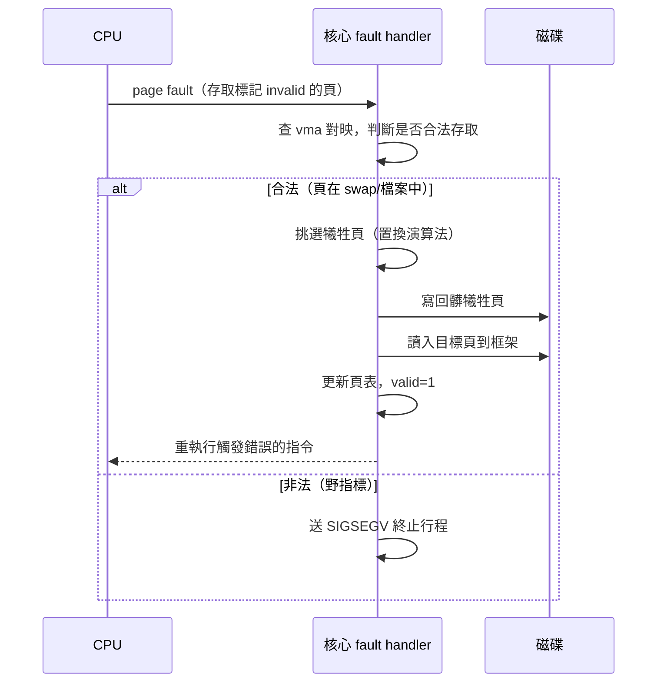

# 4.1 分頁與虛擬記憶體（Atlas 1962、Demand Paging）

## 從固定分割到動態困境

在分頁發明之前，記憶體管理的歷史是一部「碎片化戰爭史」：

- **單一道連續配置**：一個行程吃掉全部記憶體（1950 年代監督程式時代）。
- **固定分割（fixed partitions）**：記憶體切成數塊固定大小，每塊放一個行程。內部碎片（行程小於分割）嚴重。
- **可變分割（variable partitions）**：按需切割。外部碎片出現——記憶體總量夠，卻散成小塊湊不出連續區。1961 年 Rolleston 與 Ferguson 描述的緊實（compaction，搬移行程以合併空塊）代價高昂：要停機搬資料、要處理重定位。

碎片化的根源在於**連續性假設**：程式的位址空間必須佔據一段連續的實體記憶體。破除這個假設，就是虛擬記憶體革命的核心。

## Atlas（1962）：分頁與虛擬記憶體的誕生

**分頁（paging）**思想由曼徹斯特大學 Tom Kilburn 團隊在 **Atlas Superoom/Atlas 電腦**（1962 年正式啟用）上首次完整實現，論文〈One-Level Storage System〉（Kilburn, Edwards, Lanigan, Sumner, 1962）是作業系統史上被引用最多的文獻之一。核心發明：

1. **虛擬位址空間與實體記憶體解耦**：程式使用「一位址」(one-level store) 的統一虛擬位址，硬體透過**分頁表**動態轉譯到實體框架（frame）。
2. **固定大小分頁**（Atlas 為 512 字）：虛擬位址拆成「頁號＋頁內偏移」，任何虛擬頁可放進任何實體框架——**外部碎片被徹底消滅**（只剩每個行程最後一頁平均半頁的內部碎片）。
3. **Demand paging（按需調頁）＋學習演算法**：程式不用一次全部載入；存取尚未載入的頁時硬體觸發「extracode」（Atlas 對 trap 的稱呼），作業系統從磁鼓載入該頁。更驚人的是 Atlas 實作了一個「每頁保留 0.9 秒不用的紀錄」式**學習演算法**來預測哪些頁快被存取而預載——這是今天預取（prefetching）的祖先。
4. **置換（replacement）**：記憶體滿了就挑一頁寫回磁鼓——4.2 節的置換演算法由此開戰。

「虛擬記憶體（virtual memory）」一詞即源於此（由曼徹斯特團隊提出）。它的革命性在於兩個承諾：

- **對程式**：位址空間比實體記憶體更大，程式師不必再手工 overlay（覆蓋，1960 年代程式師把程式切成幾段自己輪流載入的苦役，如早期 FORTRAN 大程式）。
- **對 OS**：記憶體成為**快取**——把整個位址空間視為「磁碟上的真身」、把實體記憶體視為其工作集的快取。

## 位址轉譯：虛擬位址如何變成實體位址

$$
\text{VPN（虛擬頁號）} = \lfloor VA / P \rfloor,\qquad
\text{offset} = VA \bmod P
$$
$$
PA = \text{PT[VPN].PFN} \times P + \text{offset}
$$

虛擬位址被硬體切成兩段：高位是**虛擬頁號（VPN）**、低位是**頁內偏移**（偏移部分原樣照搬，因為頁內佈局不變）。VPN 當索引查分頁表（page table，每個行程一張，由核心維護、存在實體記憶體中），取出**實體框架號（PFN）**與**權限/存在位元**。

硬體執行這個轉譯的是 **MMU（Memory Management Unit）**。1960 年代 MMU 是複雜的外部盒子；1978 年 Intel 8086 尚無 MMU，到 1985 年 80386 才內建分頁單元，使 x86 得以跑真正的虛擬記憶體 OS。

```c
// MMU 轉譯的最小虛擬碼（單層分頁，忽略 TLB）
paddr_t translate(vaddr_t va, bool user, bool write) {
    pte_t *pte = &current->pagetable[va >> PAGE_SHIFT];
    if (!pte->valid)
        raise(PAGE_FAULT, va);            // 陷阱進核心
    if (user && !pte->user)  raise(PROT_FAULT, va);
    if (write && !pte->writable) raise(PROT_FAULT, va);
    return (pte->pfn << PAGE_SHIFT) | (va & OFFSET_MASK);
}
```

注意這個設計的深意：**分頁錯誤（page fault）不是錯誤，是機制**。valid 位元為 0 的頁可能代表「在磁碟上」，也可能代表「故意標無效」（見下文 COW、mmap 與 swap）。硬體只負責「發現並陷阱」，語意全部由核心的 fault handler 詮釋——這是「機制與政策分離」在記憶體層的呈現。

## Demand Paging 的完整生命週期

一次分頁錯誤處理的完整流程（結合 1.3 節的 trap 機制）：



關鍵細節：**fault 後必須「重執行」同一條指令**，因此觸發 fault 的精確指令位址（x86 在 CR2 暫存器、RISC-V 在 stval）必須由硬體保存。這也要求觸發 fault 的指令必須**沒有副作用**（或可回滾），是 ISA 設計的隱藏約束。

## 分頁兌現的語意魔法

有了 fault handler 這個「可程式化的缺口」，分頁成為 OS 的瑞士刀：

- **Copy-on-Write fork（2.1 節）**：fork 時把父子頁表全標唯讀＋COW 標記；寫入時 fault，核心才複製。Linux 的 fork 因此近乎免費。
- **記憶體映射檔案（mmap）**：把檔案「虛擬」到位址空間，讀取即 fault 進檔案頁（page cache）——檔案 I/O 與記憶體管理在此合流，這正是 5.1 節 UNIX inode 快取的實作基礎。
- **零頁最佳化**：映射一大段匿名零記憶體時，全部指向同一個唯讀「零頁」；寫入才 fault 並分配真頁。大量程式申請了卻沒碰的記憶體，因此真正零成本。
- **需求零化與 swap**：匿名頁的「真身」是 swap 分割上的槽位；檔案頁的真身是檔案本身。整個記憶體都成了磁碟的快取——Atlas 的承諾完全兌現。

## 工作集與抖動：分頁的暗面

按需調頁的代價是：**如果行程頻繁存取的頁超過了可用框架數，系統會陷入「載入—置換—再載入」的地獄**，CPU 時間全花在 I/O 上。這個現象稱為**抖動（thrashing）**。

Peter Denning（1968）提出**工作集模型（working set model）**給出理論刻畫：行程在時間窗 $\Delta$ 內實際存取的頁集合 $WS(t,\Delta)$ 稱為工作集。**若 $\sum_i |WS_i| > $ 實體框架總數，抖動必然發生**。實務對策：

- **load control / admission control**：拒絕新行程進入（中期排班，把整個行程換出），保住現有行程的工作集。這正是 1960 年代 swap 與 1968 年 Denning 論文的合流。
- **local vs. global replacement**：給每個行程固定框架配額（局部置換）或全域競爭（全域置換），各自影響公平與效率。

多道程式度（degree of multiprogramming）與 CPU 利用率的關係呈倒 U 型：行程太少 → CPU 等人；太多 → 抖動。排班器（第 2 章）與記憶體管理（本章）在此交會：**排班器必須「記憶體感知」**，現代 Linux 的 OOM killer、cgroup 的記憶體限制皆屬此域。

## 與編譯器/虛擬機的關聯

- **編譯器的佈局最佳化**：分頁使「程式碼的空間局部性」直接轉譯成 TLB/快取/缺頁效能。編譯器因此發展了函式重排（-freorder-functions，把熱函式放到 .text 熱段）、指引式分頁（profile-guided page layout，Huffman 熱度排序，如 Google 的Propeller/hfsort）等技術，讓「按需調頁」只載入真正會被執行的頁。
- **虛擬機的假象堆疊**：JVM/WASM 給程式「無限堆」的假象，其下靠 OS 的虛擬記憶體＋GC 的按需觸發（JVM heap 透過 mmap/reserve-then-commit 成長）。JVM 的 `-Xmx` 與 heap commit/uncommit 正是操作 OS 分頁層。WASM 的線性記憶體擴充（`memory.grow`）在多數引擎中就是 `mremap`。
- **超大頁（huge pages）**：2MB/1GB 頁減少 TLB 壓力，對大型 JVM heap、資料庫影響顯著；`madvise(MADV_HUGEPAGE)` 成為高效能程式的必修項——語言執行期再次介入 OS 機制。

## 重點整理

- Atlas（1962）發明分頁＋demand paging＋置換，把記憶體從「連續稀缺資源」變成「磁碟的快取」。
- 分頁消滅外部碎片；位址轉譯由 MMU 硬體完成，page fault 是核心實作語意（COW、mmap、swap）的可程式化缺口。
- Denning（1968）的工作集模型界定抖動的邊界，連結了記憶體管理與排班。
- 編譯器佈局、JVM heap、WASM 記憶體擴充，全部站在分頁機制之上。
