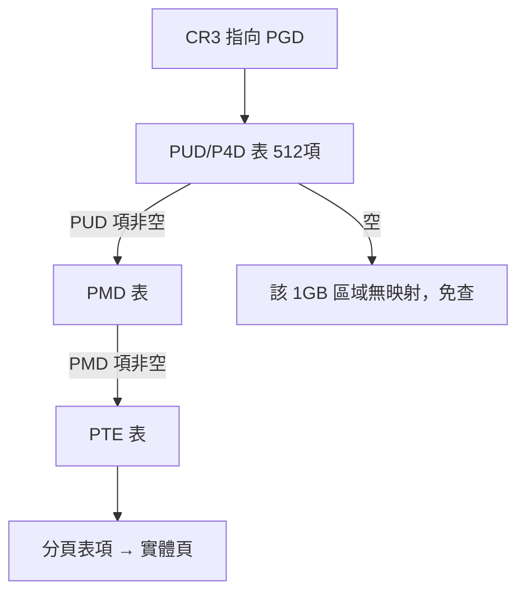
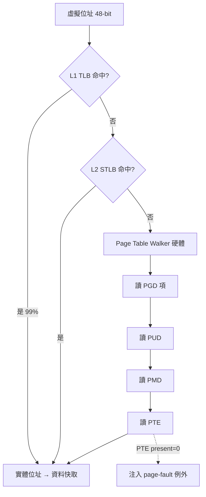

# 4.3 TLB、多層分頁與現代位址轉譯

## 位址轉譯的效能危機

第 4.1 節的單層分頁有一個隱藏的定時炸彈。假設 64 位元位址空間、4KB 頁：VPN 需要 $64-12=52$ 位元，分頁表將有 $2^{52}$ 個項目！即使每項 8 位元組，也是 $2^{55}$ 位元組（32 PB）——比世界上所有記憶體加起來還多。顯然**線性（單層）分頁表在大位址空間上根本不可行**。

即使在 32 位元時代，單層表也有效率問題：一個 4GB 位址空間、4KB 頁需要 100 萬個 PTE（4MB 分頁表），且**每個行程一張**——100 個行程就是 400MB 純表格開銷。

此外還有**時間**成本：每次記憶體存取要先查分頁表（本身是一次記憶體存取）再取資料——**每次存取翻倍**。1970 年代末的硬體設計者被迫回答兩個問題：

1. 如何讓「轉譯」不拖慢每次存取？→ **TLB（Translation Lookaside Buffer）**
2. 如何讓「表格」不必覆蓋整個位址空間？→ **多層（階層式）分頁**

「TLB」這個名字中 "Lookaside"（旁觀）精準描述其角色：先「順便看一眼」這個小快取，命中就免查大表。其概念在 Atlas 的分頁硬體中已有雛形（Atlas 的頁表放在關聯記憶體中），現代形式普及於 1970 年代的 IBM 與 Amdahl 機器。

## TLB：轉譯的快取

### 結構與運作

TLB 是一個小而極快的**關聯式快取（associative cache）**，儲存最近的 VPN→PFN 對映：

- 容量極小：數十到數千項（如 64 項的 L1 ITLB/DITLB、1536 項的 L2 STLB，典型現代 x86）。
- 以 **VPN 並行比對**（content-addressable memory），命中延遲約 1 個週期、並行查詢。
- 每項含：VPN、PFN、權限（RWX）、valid、dirty/accessed、ASID/PCID（位址空間識別碼）。

由於**程式的存取有極強的局部性**（時間與空間），小 TLB 的命中率通常超過 99%。設 TLB 命中率 $h$ 、TLB 查詢時間 $t_{tlb}$ 、分頁表存取 $t_{pt}$ ：

$$
\text{EMAT} = h \cdot (t_{tlb} + t_{mem}) + (1-h) \cdot (t_{tlb} + t_{pt} + t_{mem})
$$

代入 $h=0.99$ 、 $t_{tlb}=1\text{ns}$ 、 $t_{mem}=100\text{ns}$ 、 $t_{pt}=100\text{ns}$ ： $0.99 \times 101 + 0.01 \times 201 \approx 102\text{ns}$ 。若無 TLB，每次都是 200ns——**TLB 拯救了分頁**。反面推論：**TLB 未命中是分頁的真實稅負**，這正是 4.1 節提到 huge pages 存在的理由（一項覆蓋 2MB，TLB 壓力降低 512 倍）。

### 上下文切換與 ASID

行程切換時頁表更換，TLB 裡全是舊行程的對映——全沖掉（flush）太傷（切回來又要全部重填）。現代解法：

- **ASID/PCID**（Address Space Identifier / Process-Context Identifier）：TLB 項目附帶行程編號，比對時連 ASID 一起比，**不同行程的項目可共存**，切換完全免沖刷。
- **非一致 TLB（VIVT 的坑）**與**同義詞問題（aliasing）**：虛擬快取會有兩個虛擬位址對應同一實體頁的資料不一致問題；現代採 **VIPT（虛擬索引、實體標籤）** 快取巧妙繞開——用頁內偏移位元做索引（跨頁不變），用實體位址做標籤。這是 MMU 與快取設計交織的經典範例。

## 多層分頁：用「稀疏」對抗「巨大」

### 樹狀結構

核心思想：**把巨大的線性表變成稀疏樹**。以 64 位元系統常見的 4 級分頁（x86-64 傳統配置，Linux 5.0 起部分架構支援 5 級）為例，48 位元有效位址切成：

```
| 9-bit PGD | 9-bit PUD | 9-bit PMD | 9-bit PTE | 12-bit offset |
```

每 9 位元索引一張 512 項的表：



優點：**位址空間的空洞（如堆與堆疊之間的巨大未用區域）根本不建表**，一個「項目為空」就砍掉 1GB/512GB 的查詢範圍。64 位元的 5 級分頁（Intel, 2017，LA57）支援 128PB 虛擬空間，代價是最多五次記憶體查表——**TLB 因此更加不可或缺**。

```c
// 4 級查表的軟體模擬（x86-64 風格）
paddr_t walk(paddr_t cr3, vaddr_t va) {
    int i4 = (va >> 39) & 0x1FF;   // PGD 索引
    int i3 = (va >> 30) & 0x1FF;   // PUD
    int i2 = (va >> 21) & 0x1FF;   // PMD
    int i1 = (va >> 12) & 0x1FF;   // PTE
    pte_t *p4 = idx(cr3,  i4); if (!p4->present) fault();
    pte_t *p3 = idx(p4->next, i3); if (!p3->present) fault();
    pte_t *p2 = idx(p3->next, i2); if (!p2->present) fault();
    pte_t *p1 = idx(p2->next, i1); if (!p1->present) fault();
    return (p1->pfn << 12) | (va & 0xFFF);
}
```

### 為什麼不是雜湊表或反轉表

教科書上另兩條路線值得一比：

- **雜湊分頁表（hashed page table）**：VPN 雜湊後掛鏈。IBM POWER 架構採用（HTAB），好處是表大小可調；壞處是雜湊衝突鏈的不可預測延遲。
- **反轉分頁表（inverted page table）**：以**實體框架**為索引、記「哪個行程的哪個 VPN 佔我」，全系統一張表。省空間極致，但查詢需雜湊＋鏈，且無法直接表達「共享頁對映多 VPN」。PowerPC/IA-64 曾用，x86/ARM 未採。

**多層樹＋TLB** 成為主流的原因：查詢時間可被 TLB 吸收、結構與「稀疏使用」天然匹配、且支援優雅的**巨型頁分層**——PUD/PMD 層的項目可以直接指向大頁（1GB/2MB），跳過下層查表（Linux 稱 huge page / THP）。

## 現代轉譯的完整圖景

把一切合起來，一次現代 x86-64 的位址轉譯：



工程細節補充：

- **Page Table Walker**：TLB 未命中後由**硬體**自動走表（多層序列存取），軟體無感；現代設計（AMD Zen 3+、Apple Silicon）還有 instruction/data TLB 分離、以及把 walker 也做成小快取加速。
- **髒位元與存取位元**：由硬體在 TLB 回寫時落到 PTE——4.2 節 Clock 演算法的 R 位元就來自這裡。
- **NUMA 與轉譯**：大型多路機器上「頁表在哪個節點」也影響效能，kernel 的 page table allocation 需 NUMA 感知。

## 安全：轉譯層成為戰場

2018 年 Meltdown（Lipp et al.）震驚世界：攻擊者可用**投機執行**在使用者態讀到核心映射頁的內容——因為 x86 為效能把核心也映射進每個行程的位址空間（僅靠特權位元擋存取）。修法 **KPTI（Kernel Page Table Isolation）**：使用者態只見最小核心映射，進出核心要**切頁表**——回到「每個模式一張表」，效能損失顯著。後續的 L1TF、MDS、以及對 TLB 的側信道攻擊，使「轉譯層」成為硬體安全的最前線，也催生了 ASID/PCID 的重新重視與新的 ISA 隔離特性（ARM 的 IPA/VMSA、Intel 的 TME-MK 記憶體加密）。

## 與編譯器/虛擬機的關聯

- **大頁與 JIT**：JIT 編譯的程式碼快取（JVM CodeCache、V8）若用 2MB 大頁映射，可顯著降低 iTLB 未命中——Java 效能調教文獻中「JIT code cache huge pages」是實戰技巧。
- **稀疏位址空間與 ASLR**：位址空間配置隨機化（ASLR，Linux 2005 起）刻意製造位址空洞，依賴多層分頁「空洞免表」的低成本。
- **WASM/JVM 的記憶體模型**：WASM 引擎保留大量虛擬位址（guard pages 做越界檢查——存取 guard 頁即陷阱，**用分頁錯誤做陣列邊界檢查**，免去每次存取的顯式判斷）；這是「用 MMU 機制取代編譯器檢查碼」的絕妙案例。
- **虛擬機監視器（Hypervisor）**：客體 OS 以為自己在管真實記憶體，實際上還有第二層轉譯（GVA→GPA→HPA）。硬體以二維分頁（Intel EPT/AMD NPT，2005+）硬體化之，否則「影子頁表」的軟體模擬開銷高達 30%——**虛擬記憶體概念的自我套疊**，也是「虛擬機器」與「虛擬記憶體」兩個「虛擬」在硬體上的重逢。

## 重點整理

- TLB 以 1% 未命中率解決了「每存取兩次記憶體」的轉譯稅；ASID 讓切換免沖刷。
- 多層分頁用稀疏樹對抗巨大位址空間，空洞免查表；雜湊表與反轉表是另兩條已邊緣化的路線。
- 現代轉譯是 TLB→walker→PTE 的多級管線，並延伸出 huge pages、EPT 二維轉譯與 KPTI 安全隔離。
- guard pages、JIT 大頁、EPT 顯示：位址轉譯機制已經是語言執行期與虛擬機的共同基礎設施。
