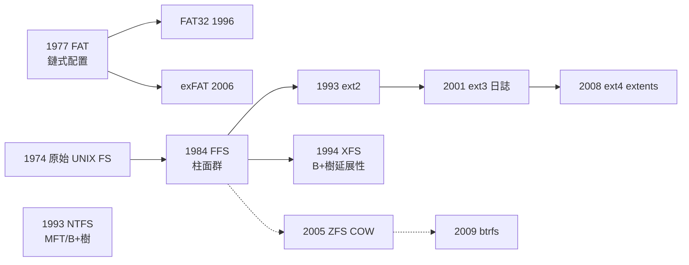

# 5.1 檔案系統的設計（FAT、UNIX inode）

## 檔案系統要解決什麼問題

記憶體是易失的（斷電即空），磁碟是持久的但**按塊（block）定址**——典型 512B/4KB 一塊。檔案系統（file system）的使命，是在「按塊定址的持久裝置」上，實現「**按名稱、可變長、可組織、可共享**的資料單位」——檔案與目錄。這是 OS 中最「資料結構密集」的子系統：本質上是在塊裝置上實作一棵持久化的樹。

一個檔案系統必須回答四個基本問題：

1. **檔案的塊在哪裡？**（配置元資料）
2. **名字如何對應到檔案？**（目錄結構）
3. **空間如何分配與回收？**（free space 管理）
4. **崩潰後如何自保？**（一致性——留待 5.2 節）

## FAT（1977）：檔案配置表的簡單之美

**FAT（File Allocation Table）**由 **Marc McDonald** 於 1976–77 年為微軟的磁碟 BASIC 設計（Stand-alone Disk BASIC），隨 1981 年 IBM PC 的 MS-DOS 統治個人電腦近二十年。它的設計哲學是**極簡**：

- 磁碟劃成**叢集（cluster）**；檔案由叢集鏈組成。
- 開頭的 **FAT 表**：每個叢集一格，格內存「下一個叢集的編號」（或 EOF、壞塊、空閒標記）。
- 檔案的元資料（名稱、大小、起始叢集）放在**目錄項（directory entry）**裡——目錄就是一張線性表。

```c
// FAT 讀檔：沿鏈行走
int cluster = dir_entry->start_cluster;
while (cluster != EOF) {
    read_block(cluster_to_offset(cluster));
    cluster = FAT[cluster];       // 純陣列跳轉，簡單到極致
}
```

**優點**：結構極簡、實作幾十行、救援工具成熟（FAT 表有兩份備份）。
**缺點**：

1. **隨機存取是 O(n)**：要讀檔案中段，必須從頭沿鏈跳 n 次——每跳一次都是一次（可能隨機的）磁碟讀。檔案越大越痛。
2. **FAT 表常駐快取**：表本身要佔記憶體，且**每次塊配置都要寫它**（串列尾指標更新），密集小寫入時 I/O 放大。
3. **膨脹**：FAT32 的叢集最大 32KB，大磁碟上小檔案浪費嚴重（內部碎片）。
4. **元資料貧乏**：目錄項只有名稱、時間、屬性——無權限、無 link、無 journal。

FAT 至今仍活在 U 隨身碟、SD 卡與韌體（UEFI 系統分割必用 FAT32）中——**簡單就是它的永續競爭力**。

## UNIX inode（1970s）：索引節點的革命

UNIX（Thompson 原始 PDP-7 版已具備檔案系統；1974 年 CACM 論文定稿描述）的檔案系統採取截然不同的路線：**把「檔案的元資料」與「名字」分離**。

### inode：檔案的身分證

**inode（index node）**是每個檔案的核心資料結構（名稱來自早期 UNIX 的 index node），固定大小、集中存放在磁碟的 inode 區。它**不含檔名**，包含：

- **型態**（普通檔/目錄/裝置/FIFO）與**權限**（rwx 三組九位元）、擁有者、群組
- **大小**、時間戳（atime/mtime/ctime）
- **連結計數（link count）**：多少個目錄項指向我
- **塊指標**：資料塊的位址陣列

塊指標採**多級索引（multi-level indexing）**設計（UNIX V6/V7 時代定型）：

```c
struct inode {
    mode_t  mode;  uid_t uid;  nlink_t nlink;
    off_t   size;
    // 15 個塊指標（UNIX System V 佈局）
    blk_t   direct[12];   // 直接塊：12 個
    blk_t   indirect1;    // 一級間接：指向一塊，內含 1024 個塊號
    blk_t   indirect2;    // 二級間接
    blk_t   indirect3;    // 三級間接
};
// 容量（1KB 塊、4B 塊號）：
// 12KB + 1024KB + 1024²KB + 1024³KB ≈ 16 GB
```

**神來之筆在於取捨**：小檔案（絕大多數檔案）只走直接塊——**一次元資料查找就拿到資料**；大檔案才需要多次間接跳轉。這是「為常見情況最佳化」的統計洞察（1981 年 Satyanarayanan 對 UNIX 檔案尺寸分布的實測研究確認了此設計的合理性）。

### 目錄：名字與 inode 的解耦

**目錄**在 UNIX 中只是「一張 (名字 → inode 號) 的特殊檔案」。這個解耦直接兌現了兩個 UNIX 標誌性功能：

- **硬連結（hard link）**：多個名字指向同一 inode，刪除名字只是 link count 減一，歸零才回收塊。`ln` 的實作只是加一條目錄項。
- **符號連結（symbolic link）**：一個內容是「路徑」的小檔案，跨檔案系統也能指。

```
/home/alice/report.txt ──┐
/backup/report.txt ──────┤──→ inode #4207 → [資料塊...]
（兩個目錄項，同一個 inode，nlink=2）
```

「一切皆檔案」也由 inode 的型態位元實現：裝置檔案的 inode 記錄主/次設備號，對其 read/write 即呼叫驅動程式（5.3 節）。

### BSD FFS 與磁碟佈局的局部性

原始 UNIX FS 隨磁碟變大而效能崩壞（塊太碎、inode 與資料相距千里）。**McKusick 等人於 1984 年發表 FFS（Fast File System，即 Berkeley Fast File System）**，引入：

- **柱面群（cylinder group）**：把磁碟切成群，每群有自己的 inode 區與資料區；**同一檔案的 inode 與資料盡量同群**，尋道距離驟減。
- **大塊＋碎片**：8KB 塊＋1KB 碎片，兼顧吞吐與小檔案空間效率。
- **叢集寫入（clustering）**：連續塊合併成大 I/O。

FFS 的「**以局部性為第一設計目標**」思想，是所有現代檔案系統的直系血統——ext2/ext3/ext4、XFS、UFS 全部承襲。

## 對照：兩條設計路線的譜系



- **FAT 路線**（塊鏈）：極簡、可攜，隨機存取差。
- **FFS 路線**（索引＋局部性）：複雜、高效，成為伺服器與桌面主流。
- **日誌與 COW 路線**（ext3/ZFS/btrfs）：把「崩潰一致性」當第一目標（5.2 節）。

## 空間管理：位圖 vs. 鏈

空閒塊追蹤也是設計分野：

- **位圖（bitmap）**：每塊一位元。查詢 O(n) 但可被 SIMD/位運算加速；FFS/ext2/NTFS 用之。優點：**容易找到「近鄰」的空閒塊**（局部性）。
- **空閒鏈（free list）**：空閒塊互鏈。FAT 隱含、早期系統用。缺點：鏈越走越散、無法挑局部性。

近代演進：**extent（區段）**——ext4/XFS 記錄「起始塊＋連續長度」而非單塊，一個元資料項覆蓋上百 MB，把大檔案的元資料從「百萬條間接塊」壓縮成幾條 extent。這是 2000 年代對「多級索引已不合時宜」的直接回應。

## 與編譯器/虛擬機的關聯

- **編譯器的連結器本質上是「檔案系統元資料」的消費者**：ELF/Mach-O 目標檔的 symbol table、section 布局是「miniature inode」——連結器對多個物件檔做「塊合併與重定位」，如同 FS 對碎片做緊實。
- **資料庫＝自建檔案系統**：InnoDB 的 tablespace/extent/頁三層、PostgreSQL 的 segment，都是繞過 OS 檔案系統的抽象、直接管理塊（O_DIRECT）以掌控配置與快取——**當通用抽象不合用時，系統軟體會下沉自建**。
- **JVM 的類別載入**：class path 尋找 `.class` 檔、jar（zip）內目錄解析，本質是「使用者態的檔案系統目錄遍歷」；OSGi/模組系統進一步在 JVM 內重建了「命名空間 → 資源 → 版本」的樹。
- **疊加式檔案系統（overlayfs）**：Docker 容器映像層的基礎，把多個目錄樹聯合成一棵——如同 JIT 把直譯器疊加到硬體上，**分層合成**是兩界共享的方法論。

## 重點整理

- 檔案系統 = 在塊裝置上實作持久樹；核心問題是塊定位、命名、空閒管理與崩潰安全。
- FAT（1977）以叢集鏈求極簡，隨機存取 O(n) 是其原罪，仍統治可攜媒體。
- UNIX inode（1970s）以「元資料與名字解耦＋多級索引」兌現硬連結與一切皆檔案；FFS（1984）引入柱面群把局部性變成第一設計目標。
- extent、B+ 樹、COW 是 1990–2010 年代的三條現代化主線，將在 5.2 節與日誌匯流。
