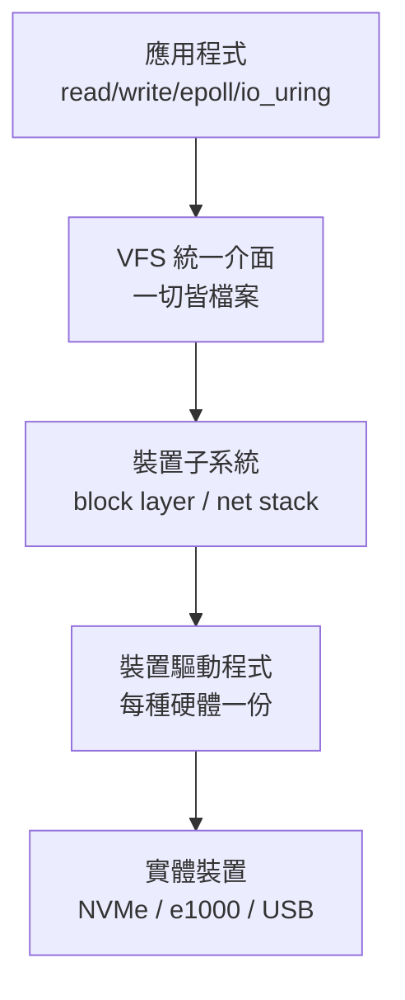

# 5.3 裝置驅動、中斷處理與 I/O 排班

## I/O 的三層世界

一台電腦連接著速度相差**八個數量級**的裝置：CPU 暫存器（~0.3ns）、DRAM（~100ns）、SSD（~100μs）、HDD（~10ms）、網路（~1–100ms）、人類（~秒）。作業系統的 I/O 子系統必須在這個光譜上，用一套**統一介面**管理**千差萬別**的硬體。這是「抽象與效能」矛盾最尖銳的戰場。

層次架構：



**VFS（Virtual File Switch）**（Kleiman, 1986，SunOS；Linux 的實作繼承此概念）把所有檔案系統與檔案類型歸一為 `file_operations` 介面；**驅動程式（device driver）**則是「每種硬體的方言翻譯器」。Linux 核心程式碼中超過一半是驅動（數千萬行），驅動 bug 也是核心當機的主因——**可插拔驅動架構**（module，1990 年代中期 Linux 引入）使硬體支援可以在不重編核心下載入。

## 驅動程式：與硬體說話

### 兩種定址：port-mapped 與 memory-mapped I/O

驅動與裝置通訊有兩條路：

- **PMIO（port I/O）**：x86 的獨立 I/O 位址空間，用 `in/out` 特權指令存取（如 0x3F8 = COM1 的 UART）。
- **MMIO（memory-mapped I/O）**：把裝置暫存器**映射進實體位址空間**，普通 load/store 即讀寫裝置。現代裝置（PCIe）幾乎全是 MMIO。

```c
// MMIO 驅動的最小骨架（虛擬碼）
volatile uint32_t *regs;  // 映射後的裝置暫存器基地址

void e1000_init(paddr_t bar) {
    regs = ioremap(bar, SIZE);       // 建立映射
    // volatile 禁止編譯器把「讀硬體」最佳化掉！
}
void e1000_send(packet_t *pkt) {
    tx_desc[d].addr = virt_to_phys(pkt);
    tx_desc[d].len = pkt->len;
    wmb();                            // 寫屏障：描述子先於 tail 通知
    regs[E1000_TDT] = (d + 1) % N;    // 敲門：更新 tail 暫存器
}
```

`volatile` 與**記憶體屏障（wmb）**在此是生計問題：編譯器與 CPU 都可能重排或合併對「看起來像普通記憶體」的裝置暫存器的存取，順序錯了硬體就收到垃圾。這是 C 語言規格中最幽暗的角落之一（`volatile` ≠ 原子 ≠ 屏障，三者語意交錯），Linux 核心因此定義了完整的 `readl/writel/barrier()` 巨集體系，並在 **memory-barriers.txt** 文件中寫下數千字的告誡。

### DMA：讓裝置直接存取記憶體

CPU 逐位元組搬資料（PIO）在高速裝置上純屬浪費。**DMA（Direct Memory Access）**引擎讓裝置直接讀寫實體記憶體，CPU 只下指令：

1. 驅動在記憶體中準備**描述子（descriptor）**環：指向緩衝區的（位址、長度、狀態）。
2. 驅動把描述子環的實體位址寫入裝置暫存器，更新 tail 指標「敲門」。
3. 裝置 DMA 讀描述子、搬資料，完成後發**中斷**。
4. 驅動的中斷處理常式清 head 指標、喚醒等待者。

這個「**共享環形緩衝區＋門鈴**」模式是現代高速 I/O 的通用語言：NVMe 的 submission/completion queue、 virtio、乃至 5.3 末尾的 io_uring，都是同一個形狀。注意 DMA 帶來新問題：**裝置看到的必須是實體（或 IOVA）位址**，且頁可能在核心管理外被換走——需要 **dma_map/一致性映射**與 IOMMU（把虛擬位址轉譯延伸到裝置，同時作為安全圍欄，防惡意裝置亂寫記憶體，Thunderbolt DMA 攻擊的解藥）。

## 中斷處理的效能工程

### Top half 與 bottom half

中斷處理常式（ISR）執行時，同級中斷通常被遮蔽——**ISR 越長，系統延遲越差**。Linux 的經典劃分：

- **上半部（top half）**：硬中斷（hardirq），**最短**——確認硬體、把資料搬走或登記、排入下半部即返回。
- **下半部（bottom half）**：稍後執行的延後工作，歷代機制：
  - **BH（1990s 早期）**：全域串行，已淘汰。
  - **軟中斷（softirq）**：靜態定義的幾種（NET_RX/TX、TIMER、TASKLET、BLOCK），可在中斷返回時或 ksoftirqd 核心執行緒中執行；**同類可並行**，需自行鎖。
  - **tasklet**：軟中斷的串行化包裝，正在被淘汰。
  - **工作佇列（workqueue）**：在**行程上下文**執行，可以睡覺、可以做事務性工作——最通用。

```c
// 網卡驅動的典型分工
irqreturn_t nic_isr(int irq, void *dev) {
    ack_hardware();                    // 1. 立即確認裝置
    napi_schedule(&nic->napi);         // 2. 只登記，關閉該中斷
    return IRQ_HANDLED;
}
int nic_poll(struct napi_struct *n, int budget) {
    int work = drain_rx_ring(nic, budget);  // 3. 批次收割封包
    if (work < budget) { napi_complete(n); enable_irq(nic->irq); }
    return work;
}
```

### 輪詢 vs. 中斷的鐘擺

**中斷**在低速時是恩賜（不用等），在**高速時是災難**：40Gbps 網卡每秒數百萬封包，每封包一次中斷 → **中斷風暴**，CPU 全在處理中斷上下文。解法是**中斷緩和（interrupt moderation）與 NAPI**（2001，Alexey Kuznetsov/Rober Olsson 進入 Linux）：**來了第一個封包先關中斷，改用輪詢把佇列清空，清完再開中斷**——混合兩種模式的優點。這個鐘擺在歷史上擺了三次：1950 年代輪詢（無中斷硬體）→ 1960 年代中斷革命 → 2000 年代高速 I/O 的「中斷＋輪詢混合」。io_uring 與 DPDK 則把輪詢推到極致（專用核心純輪詢，zero interrupt）。

## I/O 排班：塊裝置的「行程排班」

塊裝置（磁碟）上同時排著許多請求，**I/O 排班器**決定下發順序。它的目標與 CPU 排班不同：除了公平與吞吐，還要對抗**尋道成本**。

- ** Elevator（電梯演算法，1960s 概念，SCAN）**：像電梯一樣沿磁頭方向服務，掃到底再回頭——合併沿途請求，消滅來回抖動。
- **Deadline 排班器（2002 進入 Linux）**：電梯的問題是「最壞情況餓死」（一端請求持續湧入時另一端永遠輪不到）。Deadline 給每個請求**讀/寫截止時間**，快超時者強制優先——**讀優先**（讀是同步的、行程在等；寫是異步的、可稍後）。
- **CFQ（Complete Fair Queuing，2004）**：按行程分配時間片，追求公平；已於 5.0（2019）移除。
- **BFQ / mq-deadline / none（多佇列時代）**：**NVMe/SSD** 沒有機械尋道，電梯思想失效且單一佇列鎖成瓶頸。Linux 4.0（2015）改為**多佇列 blk-mq**：每 CPU 一套提交佇列，直接映射 NVMe 硬體佇列，排班器大多設為 `none`（裝置自己有內部並行）或輕量 mq-deadline。**硬體革命使作業系統的排班器幾乎整個退役**——少見的「軟體抽象被硬體進步架空」案例。

## 標準介面的三場革命

**1. 一切皆檔案（UNIX，1970s）**：`open/read/write/close` 適用檔案、終端機、pipe——VFS 統一介面。

**2. 非同步與事件驅動（1990s–2000s）**：C10K 問題（Dan Kegel 1999）迫使伺服器從「一連線一行程」轉向事件驅動：

- `select/poll`（1983/1986，BSD/System V）：O(n) 掃描，描述子上千就慢。
- `epoll`（Linux 2.5.44，2002）：核心維護就緒列表，`epoll_wait` 只回就緒者，O(1)；nginx（2004）、Redis 由此崛起。
- Windows 的 IOCP（1994+）與 FreeBSD 的 `kqueue`（2000）同期；macOS 的 `kqueue` 後來化為 Spring/AIO 基礎。

**3. io_uring（2019，Jens Axboe）**：把「系統呼叫」本身也異步化——核心與使用者共用兩個環形緩衝（提交環、完成環），應用填提交項、看完成項，**熱路徑零系統呼叫**。NVMe 隊列直通、批次提交、核心側輪詢，使儲存延遲趨近裸裝置。這是「共享環＋門鈴」模式的終極回歸：**與 DMA 描述子環、NVMe queue 同構**。

## 與編譯器/虛擬機的關聯

- **volatile 與編譯器契約**：驅動的 `volatile`、`barrier`、`__attribute__((noinline))` 等，本質是「對最佳化器的區域性禁言」。RISC-V/ARM 的記憶體模型文件與 LLVM 的 `MemoryModel` 直接介接這些語意——編譯器後端工程師必讀硬體手冊。
- **虛擬機的 I/O 虛擬化**：QEMU 全模擬（每次 MMIO 陷入 VMM）太慢 → **virtio**（Rusty Russell，2008）定義「給客體的標準虛擬裝置介面」（共享環＋門鈴），客體前端驅動直通 VMM 後端；硬體化後成為 SR-IOV/VFIO 直通。virtio 本身就是「為虛擬機重新設計的驅動介面標準」——驅動概念的虛擬化延伸。
- **使用者態驅動（DPDK/SPDK）**：把驅動搬出核心、以大頁＋UIO/VFIO 直接映射裝置，跳過系統呼叫與核心排班——效能提升 10 倍，代價是繞過了核心的保護與統一管理。這是「特權邊界的重新談判」，與 3.1 節使用者層執行緒的 M:N 抉擇同構：**把管理者下放到被管理者身邊，換取速度**。
- **JIT 與 IO 語意**：Java 的 NIO/`AsynchronousChannelGroup`、Go 的 netpoller（把 epoll 包成看起來阻塞的介面）、Node.js 的 libuv——**語言執行期紛紛自建 I/O 排班與事件迴圈**，證明 I/O 抽象已不再是 OS 獨佔的領域。

## 重點整理

- I/O 子系統以 VFS 統一介面＋驅動程式翻譯千種硬體；MMIO/DMA/描述子環是現代驅動的三件套。
- 中斷處理以「上半部極短＋下半部延後」保護延遲；NAPI 以「中斷＋輪詢混合」對抗中斷風暴。
- I/O 排班從電梯（機械磁碟時代）走到 blk-mq/none（NVMe 時代），硬體進步會架空軟體抽象。
- epoll → io_uring 的演進是「系統呼叫本身的異步化」；virtio/DPDK 顯示驅動與 I/O 模式已成為虛擬機與語言執行期的共同課題。
