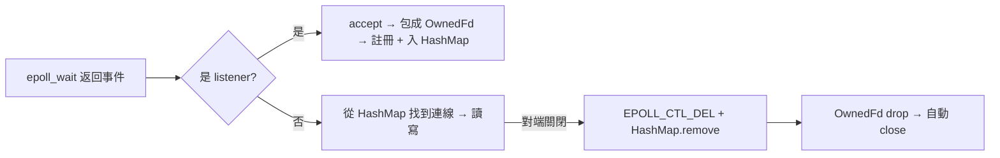

# 3.2 epoll 與事件迴圈：用 libc 直接包 epoll

## C10K：1999 年的危機

1999 年 Dan Kegel 提出 C10K 問題：硬體明明撐得住一萬個同時連線，伺服器軟體卻撐不住。原因在「一連線一執行緒」模型：一萬個執行緒的 context switch 與 stack 記憶體吃光資源。解法是**事件驅動 I/O**：單執行緒（或少量執行緒）監視大量 fd，誰準備好了就處理誰。

Linux 的演進史就是一部回應史：

| 年份 | 機制 | 問題 |
|---|---|---|
| 1983 | `select`（BSD） | fd 上限 1024、每次都要複製整個 fd set、O(n) 掃描 |
| 1997 | `poll`（POSIX） | 沒有 1024 上限，但仍 O(n) |
| 2002 | `epoll`（Linux 2.5.44/2.6，Davide Libenzi 設計） | O(1)：註冊一次，核心維護就緒清單 |
| 2003 | `kqueue`（FreeBSD） | 同一思路的非 Linux 版本 |

epoll 三個系統呼叫：`epoll_create1`（建實例）、`epoll_ctl`（註冊/修改 fd）、`epoll_wait`（等事件）。Nginx（2004 年，Igor Sysoev 為解決高併發而寫）正是靠 epoll 取得效能霸主地位。

## epoll 的 C 經典難題

```c
struct epoll_event ev;
ev.events = EPOLLIN;
ev.data.fd = sock_fd;        // 只能塞一個整數/指標
epoll_ctl(epfd, EPOLL_CTL_ADD, sock_fd, &ev);
```

C 的痛點：`data` 是 union（fd 或指標二選一）。塞指標的話，**fd 關閉之後指標指向的記憶體若已被釋放，事件回來就是 use-after-free**——這是 epoll 程式最著名的踩雷點。另外 `epoll_wait` 補救機制也催生了邊緣觸發（ET）與水平觸發（LT）之辯：ET 更高效但必須把 fd 讀到 `EAGAIN`，寫錯就掉事件。

## 用 libc 親手包一個事件迴圈

```toml
[dependencies]
libc = "0.2"
```

```rust
use std::collections::HashMap;
use std::io::{Read, Write, ErrorKind};
use std::os::unix::io::{AsRawFd, FromRawFd, OwnedFd, RawFd};
use std::net::{TcpListener, TcpStream};

fn main() -> std::io::Result<()> {
    let listener = TcpListener::bind("0.0.0.0:8080")?;
    listener.set_nonblocking(true)?;

    let epfd = unsafe { libc::epoll_create1(0) };
    assert!(epfd >= 0);

    let mut add = libc::epoll_event { events: libc::EPOLLIN as u32, u64: 0 };
    unsafe {
        libc::epoll_ctl(epfd, libc::EPOLL_CTL_ADD, listener.as_raw_fd(), &mut add);
    }

    // fd → 連線的所有權表：epoll 的 data 只放 fd 編號，
    // 「事件回來時連線還活著」由這張 HashMap 的所有權保證
    let mut conns: HashMap<RawFd, OwnedFd> = HashMap::new();
    let mut events = [libc::epoll_event { events: 0, u64: 0 }; 64];
    let mut buf = [0u8; 4096];

    loop {
        let n = unsafe { libc::epoll_wait(epfd, events.as_mut_ptr(), 64, -1) };
        if n < 0 {
            let e = std::io::Error::last_os_error();
            if e.kind() == ErrorKind::Interrupted { continue; }  // EINTR 重試
            return Err(e);
        }
        for ev in &events[..n as usize] {
            let fd = ev.u64 as RawFd;
            if fd == listener.as_raw_fd() {
                // 新連線
                if let Ok((stream, _addr)) = listener.accept() {
                    stream.set_nonblocking(true)?;
                    let owned = unsafe { OwnedFd::from_raw_fd(stream.into_raw_fd()) };
                    let mut ev2 = libc::epoll_event {
                        events: (libc::EPOLLIN | libc::EPOLLET) as u32,
                        u64: owned.as_raw_fd() as u64,
                    };
                    unsafe {
                        libc::epoll_ctl(epfd, libc::EPOLL_CTL_ADD,
                                        owned.as_raw_fd(), &mut ev2);
                    }
                    conns.insert(owned.as_raw_fd(), owned);   // 所有權入表
                }
            } else {
                // 已連線：EPOLLET 邊緣觸發 → 讀到 EAGAIN 為止
                let mut owned = match conns.get(&fd) {
                    Some(o) => unsafe { OwnedFd::from_raw_fd(o.as_raw_fd()) },
                    None => continue,             // 理論上不會發生：型別保證
                };
                loop {
                    let n = unsafe {
                        libc::read(fd, buf.as_mut_ptr() as *mut _, buf.len())
                    };
                    if n > 0 {
                        let resp = format!("HTTP/1.1 200 OK\r\nContent-Length: {}\r\n\r\n", n);
                        let out = format!("{resp}{}", String::from_utf8_lossy(&buf[..n as usize]));
                        unsafe { libc::write(fd, out.as_ptr() as *const _, out.len()); }
                    } else if n == 0 {
                        // 對端關閉：從 epoll 摘除 → 從表移除 → fd 自動關閉
                        unsafe { libc::epoll_ctl(epfd, libc::EPOLL_CTL_DEL, fd, std::ptr::null_mut()); }
                        conns.remove(&fd);
                        break;
                    } else {
                        let e = std::io::Error::last_os_error();
                        if e.kind() == ErrorKind::WouldBlock { break; }   // EAGAIN
                        unsafe { libc::epoll_ctl(epfd, libc::EPOLL_CTL_DEL, fd, std::ptr::null_mut()); }
                        conns.remove(&fd);
                        break;
                    }
                }
                drop(owned);   // 借用版 fd（非擁有）drop 不會 close
            }
        }
    }
}
```

上面刻意混用兩種 fd 處理（示意），重點在架構：



## Rust 版 epoll 的本質改進

對照 C 版本的三個修正：

1. **`data` 不放指標**：放 fd 整數，真正的狀態放在 `HashMap<RawFd, Conn>`——fd 與其資料的所有權由同一張表管理。
2. **close 時序由型別保證**：`conns.remove(&fd)` 之後 `OwnedFd` drop 自動 close；不可能出現「先 close 再等事件、事件回來查到幽靈指標」。
3. **EINTR/WouldBlock 顯式處理**：`ErrorKind::Interrupted`/`WouldBlock` 把 errno 語意化，不會像 C 那樣 `if (n < 0 && errno != EINTR)` 忘一半。

這個單檔事件迴圈大約 120 行，正是 tokio、mio（tokio 底層，2014 年由 Carl Lerche 為 Servo 效能而寫）的縮影：**mio = 對 epoll/kqueue 的薄封裝，tokio = 在其上加 task 排程**。第 3.3 節我們把這個迴圈抽象成 async。

## 習題

1. 把範例改成水平觸發（去掉 EPOLLET），觀察程式行為差異。
2. 用 `wrk -c100 -t4 http://localhost:8080` 壓測，觀察 CPU 與連線數。
3. 解釋：若把 `HashMap` 換成「fd → 裸指標」，哪個場景會重現 C 的 use-after-free？
